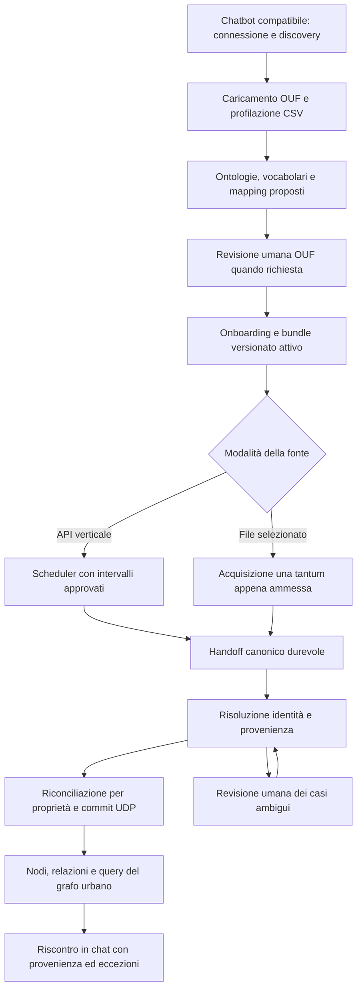

# OUF — piano completo CSV da chat al grafo urbano
Versione 1.0 · 17 ottobre 2026 · fuso di riferimento Europe/Rome

**Obiettivo:** un utente autorizzato collega un chatbot compatibile all'endpoint MCP OUF, scopre le capability, carica un CSV, ne definisce il significato con ontologie e vocabolari, completa l'onboarding, segue l'acquisizione immediata, verifica identità e proprietà, e ritrova oggetti e relazioni nel grafo urbano. Nessun terminale, SQL, accesso al VPS o ricostruzione manuale degli ID deve essere necessario nel normale percorso utente.

Questo documento è un piano di lavoro, non prova dell'implementazione o dell'attivazione delle attività elencate. **Stato accertato: tecniche 8/8; funzionali 2/6.** Le attività R0–R10 sotto sono pacchetti di lavoro del completamento; non sostituiscono né rinumerano le otto fasi tecniche e le sei milestone storiche.

## 1. Perimetro e significato di “tutto dalla chat”

La chat è il punto di avvio, accompagnamento, stato e consultazione. Restano distinte:
- le operazioni che l'assistente può proporre/eseguire mediante tool autorizzati;
- le decisioni autoritative HUMAN che i PET assegnano alla Trusted Human Surface (THS): approvazioni, attivazioni, merge e override quando richiesti dalla policy;
- le operazioni di installazione e manutenzione, esterne al percorso ordinario dell'utente.

Per la compatibilità tra chatbot si qualificano due modalità dello stesso percorso:
1. **Base portabile:** endpoint MCP remoto, autenticazione supportata, discovery e tool tipizzati; caricamento e conferme umane raggiungibili con un collegamento OUF emesso dal server; esito recuperabile in chat attraverso un riferimento durevole.
2. **Interfaccia incorporata opzionale:** dove il client supporta MCP Apps, il caricamento può essere accompagnato da una UI nella conversazione. La THS mantiene comunque identità, dominio e conferma diretta HUMAN; una UI incorporata non autorizza il modello a premere conferme.

Non si promette la stessa UI su ogni prodotto che dichiara genericamente supporto MCP. Il profilo di compatibilità OUF deve dichiarare trasporto, versioni del protocollo e autenticazione realmente supportati; client incompatibili ricevono una diagnosi comprensibile. Le estensioni sono opzionali e negoziate, come documentato nella [matrice ufficiale MCP](https://modelcontextprotocol.io/extensions/client-matrix). Il supporto al protocollo più recente va qualificato contro il binario installato: non si deduce dalla versione corrente della specifica.

Se “integralmente” significa nessun passaggio a una pagina OUF nemmeno per le decisioni umane, questa modalità non è garantibile per tutti i client mantenendo i PET attuali. Il traguardo portabile è **un unico percorso guidato dalla chat, con passaggi umani OUF e rientro automatico o interrogabile**, senza istruzioni tecniche da copiare.

Il MVP riguarda CSV. XLSX/altri file, GeoPackage e layer dinamici restano sullo stesso contratto canonico; i verticali API usano lo stesso tratto semantica→identità→proprietà→grafo, con acquisizione periodica invece che immediata. Non si implementano rami applicativi per Teatri.

## 2. Architettura del percorso

Le frecce rappresentano passi logici, non autorizzano salti di rete: le chiamate MCP ai moduli owner attraversano il Gateway. Identità e autorizzazioni sono applicate anche dall'owner.

Tre distinzioni fondamentali:
- **Identità:** collegare una riga a un oggetto esistente o creare un oggetto distinto. Il merge di due oggetti già esistenti è un'altra operazione, con impatto e decisione propri; non è un passaggio obbligatorio per ogni riga.
- **Proprietà:** decidere quali contributi compongono la vista corrente. Un collegamento d'identità non autorizza sovrascritture indiscriminate.
- **Grafo:** UDP è già il registro operativo di nodi e relazioni su PostgreSQL/PostGIS. Non serve un ulteriore graph database. Devono essere provate materializzazione e interrogabilità degli edge con semantica e provenienza.

Un ACK durevole UDP prova la presa in carico, non il completamento del commit o del grafo. Uno stato Ingestion SUCCEEDED da solo non chiude l'end-to-end.

## 3. Punto di partenza e lacune accertate

| Area | Evidenza disponibile | Lavoro ancora necessario |
| --- | --- | --- |
| Baseline | PET Reality Baseline v1.7: 11 DOCX confrontati con SHA256SUMS; specifica proprietà V1 approvata | Mantenere tracciabilità dei requisiti e aggiornare la documentazione per ogni rilascio |
| Semantica e onboarding di collaudo | Le prime due milestone sono provate; source/versione e pubblicazione conservate | Il recente semantic.get del riferimento esatto restituisce 403: ricostruire la causa e ripristinare la lettura autorizzata, senza considerare il 403 “catalogo vuoto” |
| Identità/materializzazione | 11 decisioni CREATE_NEW materializzate: 11 job SUCCEEDED e 11 oggetti distinti; un altro caso volutamente in quarantena | Consolidare il rendiconto delle 13 righe e la provenienza complessiva; non rigiocare decisioni consumate |
| Proprietà | Implementazione generica e UDP V35 installate; 20 reconciliation null nel readback | Installare la compatibilità XSD qualificata e pubblicare il profilo nativo dopo verifiche complete |
| Correzione XSD | UDP PR44, Onboarding PR45; CI complete e 77 test mirati UDP PASS | Le correzioni non sono ancora installate |
| Preparazione | ouf-deploy PR38: proposta 20 proprietà, 18 test, pacchetto firmato/scansionato; immagini correnti verificate via runner | Configurazione completa, vincoli semantici/temporali e stato scheduler ancora da verificare prima dell'attivazione |
| Scheduler | Il codice Ingestion rilasciato può riarmare una fonte MANAGED con una nuova publicationId | Rendere esplicita la differenza tra pubblicare una configurazione e autorizzare una nuova acquisizione |
| Superficie MCP | Manifest e tool disponibili per file, semantica, onboarding, ricerca e stato operativo | Qualificare copertura di revisione identità/proprietà, provenance e grafo; non assumere che una API UDP sia già un tool esposto |
| Percorso portabile | Codice MCP contiene picker OUF, handoff e status, oltre a integrazioni host opzionali | Prova end-to-end su due client indipendenti, uno senza MCP Apps |
| Accettazione finale | Tecniche 8/8; funzionali 2/6 | Ricerca effettiva, reimport, conservazione baseline e operatività da chat restano da completare |

La lettura del manifest MCP al commit `f7ecaeb210d8fcead478b90c62645db13a7d8226` è evidenza del sorgente, non dell'immagine installata. Il manifest contiene urban.object.search e urban.object.related_search, ma non dimostra esposizione di tutto il percorso di confronto, provenance, neighbors/traverse. source.file.upload.status risulta anche nella registrazione dinamica: R1 deve riconciliare manifest, registrazione e discovery effettiva.

## 4. Responsabilità

| Responsabilità | Owner e repository |
| --- | --- |
| Capability conversazionali, discovery, riferimenti di ripresa, proiezione operativa | [ouf-mcp-server](https://github.com/GioNob/ouf-mcp-server) |
| Asset file, profiling, mapping, bundle, configurazione fonte e superficie umana | [ouf-source-onboarding](https://github.com/GioNob/ouf-source-onboarding) |
| Ontologie, vocabolari, concetti, revisioni e publication set | [ouf-semantic-registry](https://github.com/GioNob/ouf-semantic-registry) |
| Acquisizione, scheduler, run, handoff, checkpoint e retry | [ouf-ingestion-runtime](https://github.com/GioNob/ouf-ingestion-runtime) |
| Identità, contributi, revisioni, proprietà, relazioni, lineage e query | [ouf-udp-object-resolution](https://github.com/GioNob/ouf-udp-object-resolution) |
| Instradamento, autenticazione di canale e binding governati | [ouf-api-gateway](https://github.com/GioNob/ouf-api-gateway), con Authorization secondo PET |
| Pacchetti, CI/CD, runner VPS, stato integrato ed evidenze | [ouf-deploy](https://github.com/GioNob/ouf-deploy) |

Non si trasferiscono nel MCP le decisioni di dominio degli owner. Il coordinamento conversazionale restituisce proiezioni degli stati autorevoli; non crea un secondo workflow engine o una nuova fonte di verità.

## 5. Pacchetti di lavoro e dipendenze

| ID | Risultato | Dipendenze per la chiusura | Criterio di uscita |
| --- | --- | --- | --- |
| R0 | Baseline consolidata e correzione XSD installata | Nessuna nuova acquisizione | Generazioni/versioni verificate; V35 conservata; configurazione e dati precedenti invariati |
| R1 | Contratto MCP portabile e copertura del percorso | Audit codice/manifest/runtime | Un client scopre il percorso autorizzato, gli stati e le prossime azioni senza istruzioni locali specifiche |
| R2 | Caricamento e profiling CSV affidabili | R1 per prova da chat | Asset durevole, profilo verificato, identità delle righe esplicita e preview minimizzata |
| R3 | Arricchimento semantico completo | R2; letture Semantic autorizzate | Mapping campi e valori verso riferimenti pubblicati/versionati, gap espliciti |
| R4 | Profilo nativo di identità, proprietà e relazioni verificabile | R0, R3 | Anteprima e validazione owner coerenti; nessuna politica inventata |
| R5 | Pubblicazione con effetto di acquisizione esplicito | R4; stato scheduler fresco | Una pubblicazione non riacquisisce implicitamente dati; il nuovo file autorizzato avvia la sola acquisizione prevista |
| R6 | Ingestion CSV e rendiconto per riga | R2, R5 | Handoff durevoli e contabilità completa di ogni record, con versioni fissate |
| R7 | Risoluzione, commit e revisione da chat | R1, R4, R6 | Identità/proprietà distinte, conflitti circoscritti, decisioni umane collegate e risultati persistiti |
| R8 | Grafo, provenienza e ricerca finale | R7, mapping relazionali R3–R4 | Oggetti ed edge attesi interrogabili; limiti/eccezioni mostrati, nessun collegamento inventato |
| R9 | Reimport, recovery e isolamento | R5–R8 | Seconda acquisizione reale senza duplicati; ripresa dopo fault con budget/storia conservati |
| R10 | Collaudo portabile e accettazione completa | R1–R9 | Due client indipendenti completano il percorso; dossier di accettazione e baseline preservata |

Le attività possono svilupparsi in parallelo, ma i gate di uscita non possono essere saltati. Percorso critico sul caso corrente: **R0 → R3/R4 → R5 → R6/R7 → R8 → R9 → R10**. R1 e R2 procedono in parallelo fin dall'inizio; devono essere completati prima del collaudo integrale.

### R0 — Chiudere le dipendenze già note

1. Integrare le PR qualificate [UDP44](https://github.com/GioNob/ouf-udp-object-resolution/pull/44), [Onboarding45](https://github.com/GioNob/ouf-source-onboarding/pull/45) e la preparazione [deploy38](https://github.com/GioNob/ouf-deploy/pull/38), verificando eventuale drift delle basi.
2. Usare il pacchetto esatto qualificato nel run39069142370; predisporre nuova revisione operativa, senza riutilizzare l'autorità consumata del rollout precedente.
3. Installare le correzioni e verificare che non introducano migrazioni o ripetizioni di V35; mantenere separati rollback applicativo e riconciliazione di effetti dati.
4. Ottenere una lettura coerente di configurazione owner completa, riferimenti semantici/temporali, pubblicazione attiva, schedule consumata, lease e run in corso.
5. Diagnosticare il 403 nel punto esatto Gateway/owner/policy/sessione, con motivazione strutturata. Non tentare identità diverse o accessi al datastore per aggirarlo.
6. Conservare i 11 esiti già confermati, la quarantena volontaria e la baseline degli otto Cinema; associare ogni riga alle sue evidenze.

**Uscita:** dossier corrente sufficiente per preparare un solo intervento operativo coerente. Gli hash delle immagini non sostituiscono le prove sui dati.

### R1 — Rendere il percorso scopribile e riprendibile da qualsiasi client conforme

- Definire il profilo minimo di compatibilità OUF e una suite di conformità: endpoint, autenticazione, discovery, schema input/output, errori, versioni e limiti.
- Confrontare catalogo, tool registrati e discovery reale per lo stesso principal/tenant. Il client usa solo capability effettivamente disponibili.
- Per ogni passo restituire stato, riferimento durevole owner, operazione consentita successiva, motivazione dei blocchi e indicazione del passaggio HUMAN. I nomi di eventuali nuove capability vanno definiti e versionati nel catalogo, non inventati nei prompt.
- Collegare sourceId, versione, asset, proposal/challenge, publicationId, ingestionRunId, handoff e oggetto tramite riferimenti autorizzati. Non richiedere all'utente di trascrivere UUID.
- Fornire riepilogo/ripresa dopo nuova chat o riapertura del client; revoche e scadenze non devono cancellare progressi o decisioni.
- Qualificare il servizio con lifecycle IAM/workload governato: il flusso ordinario non può dipendere da un terminale lasciato aperto per alimentare un worker temporaneo. Il rimedio non è estendere indefinitamente token o budget.
- Distinguere “non autorizzato”, “parziale”, “in attesa”, “concluso con eccezioni” e “nessun risultato”.
- Le istruzioni eventualmente contenute in CSV, descrizioni o risposte esterne sono dati non attendibili e non ampliano tool, privilegi o destinazioni di rete.

**Uscita:** una chat nuova ricostruisce il passo corretto dai servizi owner senza memoria privata del primo chatbot.

### R2 — File intake e profiling CSV

- Picker OUF come percorso base, handoff vincolato all'utente e risultato recuperabile; integrazione con allegati host solo se esplicitamente supportata e qualificata.
- Upload durevole con content hash, dimensione, formato, ownership, retention e stato. Nessun URL arbitrario recuperato dal modello.
- Profiling deterministico: encoding/BOM, delimitatore, quoting, newline nelle celle, intestazioni duplicate/mancanti, righe incoerenti, null/vuoto, decimali/date e limiti di file. Le inferenze devono essere presentate come proposte.
- Preview limitata e autorizzata; originali conservati. Nessuna esecuzione di formule o contenuto del CSV.
- Proporre chiave nativa o strategia deterministica approvata per sourceObjectId. L'asset file non identifica tutte le righe; l'ordine delle righe non costituisce una chiave stabile salvo contratto esplicito con limiti dichiarati.
- Separare duplicati di upload/richiesta da una nuova versione di file o da una riacquisizione deliberata.

**Uscita:** il file è acquisito nello staging, non ancora dichiarato integrato in UDP. Prova su CSV ordinario e CSV con errori/parziali.

### R3 — Semantica: classi, proprietà e vocabolari

- Cercare prima nel Registry adottato e leggere i riferimenti immutabili selezionati.
- Mappare colonne→proprietà, tipo record→classi, codici/valori categoriali→concetti di vocabolario. Conservare codice originale, concetto e versione.
- Mostrare copertura: campi inclusi/esclusi, valori riconosciuti/non riconosciuti, tipi, unità, temporalità, relazioni e classificazione di accesso.
- Non dedurre sinonimia da etichette simili né trasformare un codice sconosciuto in un concetto autorizzato.
- Se manca copertura, aprire un gap: discovery/proposta, revisione semantica HUMAN e pubblicazione nel Registry, poi ripresa del mapping. La fonte non va ricreata a ogni gap.
- Nessun obbligo di inventare un vocabolario quando i dati non contengono categorie. Il collaudo dei vocabolari usa una fixture dichiarata se il CSV Teatri non esercita quel ramo.
- Teatri non diventa Cinema per somiglianza lessicale o vicinanza. La semantica attiva va letta, non sostituita con una vecchia proposta.

**Uscita:** bundle con riferimenti semantici e mapping di valori validati, gap obbligatori risolti o esplicitamente bloccanti. La milestone semantica già provata non viene azzerata dal 403 corrente.

### R4 — Profilo nativo e anteprima del risultato

- Partire dalla configurazione completa dell'owner; aggiungere esclusivamente il delta necessario. Conservare authorityOrder, datatype, accessLabel, identità, geometria, contratto temporale e opzioni sconosciute.
- Applicare la specifica [LINKED_OBJECT_PROPERTY_RECONCILIATION_V1](https://github.com/GioNob/ouf-deploy/blob/83e2e85a0ae4107ba52486de7bdcbfe4502761cc/docs/LINKED_OBJECT_PROPERTY_RECONCILIATION_V1.md).
- La proposta corrente SINGLE/EXACT_TYPED/SOURCE_INTERVAL deriva dal default conservativo approvato e dai soli intervalli già disponibili: non è un'affermazione di cardinalità ontologica. Verificare eventuali vincoli contrari prima di pubblicare.
- Non introdurre priorità nuove, “ultimo arrivo vince”, cancellazioni implicite, equivalenze di nomi/indirizzi o separatori multivalore inventati.
- Anteprima per proprietà: corrente, in ingresso, risultato previsto, provenienze, regola applicata, conflitto e classificazione.
- Definire separatamente relazioni e geometrie, solo quando supportate da dati e mapping approvati. Una coordinata non diventa identità o relazione per default.
- Validazione nativa e test di anteprima/commit con lo stesso profilo; hash e revisione delle evidenze vincolano la decisione.

**Uscita:** configurazione candidata concreta e verificabile, ancora distinta dalla pubblicazione. Il documento di policy da solo non è un profilo runtime.

### R5 — Pubblicare senza acquisizioni implicite

Problema provato: nel runtime Ingestion esaminato, MANAGED implica one-shot; una nuova publicationId può rendere la fonte nuovamente dovuta anche se la precedente acquisizione è consumata. triggerOnce=null non è una protezione.

- Esplicitare tre intenzioni: prima acquisizione del nuovo file, sola modifica di configurazione, riacquisizione deliberata.
- Prima del publish, rileggere pubblicazione/schedule/lease e impedire race con run già in corso; le run conservano il bundle fissato all'avvio.
- Per il caso corrente, progettare e qualificare un **blocco nativo persistente dell'ammissione per la sola fonte** se serve pubblicare senza riacquisire. È lavoro da verificare/implementare, non un flag già provato disponibile.
- Il blocco deve sopravvivere a reconcile, riavvio e cambio pubblicazione; avere controllo di versione e rilascio HUMAN esplicito per la precisa acquisizione. Non si falsifica un consumed checkpoint e non si arresta l'intero scheduler come soluzione applicativa.
- Il flusso nuovo CSV approvato ammette automaticamente il lavoro una tantum previsto, senza attendere un intervallo periodico. “Subito” significa messo in esecuzione/coda appena readiness e capacità lo consentono, non successo sincrono.
- Usare clone/nuova DRAFT, validazione, ETag, revisione THS e pubblicazione owner secondo i contratti nativi; non riusare challenge consumate. Un timeout ambiguo richiede lettura di riconciliazione, non un'altra clone o activate.

**Uscita:** test di concorrenza/restart e readback dimostrano una sola acquisizione deliberata; una modifica di profilo non riprocessa silenziosamente il file storico.

### R6 — Ingestion e consegna durevole

- Il run fissa asset/hash, schema, mapping, profilo, semantica e bundle; nessun hot reload.
- Per ogni riga produrre source identity, payload canonico, classificazione, raw reference e lineage.
- Validare struttura e contratto; conservare scarti e quarantene motivati, senza perdita silenziosa.
- Handoff idempotente verso UDP; checkpoint avanzato solo dopo ACK durevole e secondo il contratto di quarantena.
- Proiettare in chat conteggi coerenti: letti, ammessi, consegnati, materializzati, in revisione, quarantinati, falliti; i gruppi devono avere definizioni non sovrapposte oppure dichiarare esplicitamente la diversa dimensione.
- Distinguere errore transitorio da errore permanente e stato dell'ingestion da stato del materializer.

**Uscita:** tutte le righe rendicontate; nessun “import completato” basato sul solo upload o ACK.

### R7 — Identità, proprietà, merge e commit con revisione guidata

- Gli abbinamenti deterministici seguono esclusivamente la policy approvata; i casi ambigui sono proposte con candidati ed evidenze.
- Presentare crea nuovo/collega/rinvia secondo le azioni realmente supportate. La decisione collega la source identity e non sostituisce automaticamente i valori.
- Il chatbot prepara e spiega la revisione; la THS esegue le conferme HUMAN richieste. Esito e stato tornano in chat senza riaprire decisioni già consumate.
- Se due Urban Object esistenti devono essere fusi, usare un vero merge plan con impatto, alias/storia, relazioni, accessi e conferma specifica. Non confondere questo caso con l'aggancio di una nuova riga.
- Per le proprietà: aggiunte complementari; assente/null/vuoto non cancellano; valori uguali conservano tutte le provenienze; conflitti a pari autorità restano circoscritti alla proprietà; multivalore solo se dichiarato; cancellazioni solo da contratto.
- Due righe diverse della stessa fonte restano due contributi. Non eliminare il conflitto scegliendo l'ultima riga.
- Decisioni obsolete rifiutate se cambiano revisione, evidenze o policy; commit e audit coerenti.
- Una quarantena volontaria resta tale finché l'utente non prende la specifica decisione di dominio.

**Uscita:** oggetti e contributi persistiti con readback; nessuna ripetizione delle 11 decisioni già eseguite.

### R8 — Grafo urbano e ricerca dal chatbot

- Verificare identità canonica, classi, proprietà, revisioni e source binding del nodo.
- Materializzare solo edge previsti da mapping approvati: source, relationIri, target, validità, evidence e provenance devono essere coerenti.
- Target assente/ambiguo produce stato esplicito e ripresa governata; non un edge verso il candidato più vicino per intuizione.
- Verificare deduplica e storia degli edge; non cancellare relazioni perché una colonna non è presente senza il relativo contratto.
- Riconciliare API UDP, binding Gateway, autorizzazioni e tool MCP necessari: ricerca oggetti, lettura dell'oggetto, provenienza e navigazione relazionale limitata. Le API GraphApi esistenti non provano la loro accessibilità MCP.
- Una nuova ricerca deve ritrovare i dati effettivi, non ripetere il testo del CSV o la cache della conversazione.
- Mostrare anche conflitti, dati parziali e ritardi di materializzazione quando autorizzati; accesso applicato a oggetti, proprietà, edge e conteggi.
- Se il CSV non giustifica alcuna relazione, dichiarare zero edge attesi per quella fonte. Provare comunque il ramo grafo con una fixture relazionale esplicita e approvata, senza alterare Teatri per fabbricare collegamenti.

**Uscita:** query per classe/proprietà e almeno un percorso relazionale previsto dalla fixture risultano corretti, tracciabili e senza fuga di dati.

### R9 — Secondo import, recovery e operatività duratura

Qualificare separatamente:
1. Ripetizione della stessa richiesta con la stessa chiave: stesso esito, nessun duplicato.
2. Ripetizione dello stesso handoff: nessun doppio effetto.
3. **Seconda acquisizione realmente autorizzata dello stesso CSV:** nuovo run verificabile, stessi oggetti canonici, nessuna crescita ingiustificata di revisioni/edge; nuove osservazioni/provenienze solo secondo contratto.
4. File con righe riordinate, riga aggiunta e valori cambiati: identità secondo chiave approvata e conflitti/revisioni secondo policy. L'assenza di una riga non è automaticamente cancellazione.
5. Interruzione del client o nuova conversazione: ripresa dallo stato owner.
6. Fault dopo dispatch o commit, restart dei servizi, token scaduto/revocato e indisponibilità prolungata: nessun replay di effetti incerti o reset dei budget.
7. Quarantena e sovraccarico: scope minimo indipendente, incidenti deduplicati, backpressure e recovery governato.
8. Tenant/ruoli diversi: isolamento di file, stato, oggetti, proprietà, relazioni e provenance.
9. Baseline degli otto Cinema: conservazione di identità, contenuti, revisioni rilevanti e relazioni; eventuali variazioni devono derivare da una decisione distinta, mai dall'import Teatri.

Applicare la [policy di resilienza v3](OUF_RESILIENCE_POLICY.md): retry solo transitori/sicuri, backoff e jitter, budget durevoli finiti, riconciliazione degli esiti ambigui, nessun reset al riavvio. I default sono quelli versionati nella policy, non nuovi valori nel piano.

**Uscita:** l'utente può allontanarsi e poi chiedere “a che punto siamo?” ottenendo stato, incidenti e prossima azione corretti. Le notifiche opzionali non sostituiscono la consultazione persistente.

### R10 — Accettazione da due client e rilascio

- Eseguire l'intero percorso su due client MCP indipendenti: uno con sole capacità base e collegamenti web, uno con UI incorporata se disponibile.
- Usare una conversazione nuova e un CSV di collaudo governato; nessuna conoscenza nascosta del client, prompt locale obbligatorio, script VPS o SQL nel percorso utente.
- Ripetere il passaggio tra client con lo stesso utente autorizzato: ritrovare il lavoro e riprendere senza duplicazioni.
- Verificare errori comprensibili, attese, rifiuto umano, scadenza della revisione, campo non mappato, conflitto e quarantena.
- Raccogliere run, hash, versioni, decision reference, conteggi, readback oggetti/edge e risultati delle query. Le evidenze pubblicate sono minimizzate; dettagli protetti restano nella sede owner.
- Produrre guida utente breve e runbook operatore separato; registrare limiti e formati realmente supportati.
- Chiudere il rilascio solo quando il flusso ordinario non richiede interventi tecnici e la matrice sotto è completa.

**Uscita:** CSV end-to-end accettato nel profilo di compatibilità dichiarato, non una promessa non verificabile su ogni prodotto MCP esistente.

## 6. Le sei milestone funzionali restano il riferimento

| Milestone storica | Stato conservato | Criterio di chiusura |
| --- | --- | --- |
| F1 — Semantica approvata THS | PROVATA | Conservare la prova esistente; per nuove fonti verificare mapping e vocabolari richiesti |
| F2 — Onboarding approvato HUMAN | PROVATA | Conservare la source/versione attiva; nuove configurazioni seguono la propria approvazione |
| F3 — Commit delle 13 righe e provenienza | NON CHIUSA | Rendiconto completo e readback per riga/oggetto. La quarantena volontaria non è commit riuscito |
| F4 — Nuova ricerca dal chatbot | NON CHIUSA | Risultati reali da UDP, con accessi e provenienza, indipendenti dalla memoria della chat |
| F5 — Secondo import senza duplicati | NON CHIUSA | Nuovo run deliberato e idempotenza di identità, proprietà e relazioni provata |
| F6 — Due acquisizioni e otto Cinema conservati | NON CHIUSA | Confronto baseline e dossier delle due run completo, nessun danno agli oggetti precedenti |

F3 originariamente richiede 13 materializzazioni. Se si vuole mantenere permanentemente un record in quarantena, ci sono due esiti distinti: mantenere F3 aperta nella definizione originale, oppure approvare una revisione esplicita del criterio (“record ammessi committati + eccezione governata rendicontata”). Non cambiare il denominatore silenziosamente e non forzare la quarantena per ottenere un 6/6.

Oltre alle sei milestone, la dichiarazione “gestibile da qualsiasi chatbot conforme” richiede i gate trasversali di portabilità, recovery e grafo di R8–R10: il solo 6/6 storico non prova ogni aspetto di questo obiettivo ampliato.

## 7. Matrice minima di accettazione

Gli ID PLAN-CSV sotto sono identificatori locali del piano. Non sostituiscono gli ID canonici OUF-E2E-001…025 del Blueprint; il collegamento ai test canonici va verificato nel catalogo E2E vigente durante R0/R1.

| ID | Prova | Evidenza richiesta |
| --- | --- | --- |
| PLAN-CSV-01 | Connessione/discovery/autorizzazione | Manifest effettivo e chiamate per entrambi i client, nessun tool protetto esposto |
| PLAN-CSV-02 | Upload portabile e ripresa | Asset/hash owner e handoff recuperabile senza API specifiche di un solo chatbot |
| PLAN-CSV-03 | Parsing e schema | Casi CSV validi, malformati e con limiti; originali preservati |
| PLAN-CSV-04 | Chiavi record | Stesso record riconosciuto dopo riordino secondo policy; duplicati di chiave espliciti |
| PLAN-CSV-05 | Ontologia e vocabolario | Riferimenti pubblicati, mapping codici→concetti, valori sconosciuti gestiti |
| PLAN-CSV-06 | Gap semantico | Blocco locale/proposta/revisione/ripresa, senza source duplicata |
| PLAN-CSV-07 | Approvazione e versioni | Attore HUMAN, hash/ETag, rifiuto di evidenza obsoleta e ritorno alla chat |
| PLAN-CSV-08 | Effetto della pubblicazione | Nessuna riacquisizione implicita; una sola run ammessa per l'intenzione approvata |
| PLAN-CSV-09 | Consegna e checkpoint | ACK durevole, riga→handoff→esito, fault prima/dopo ACK |
| PLAN-CSV-10 | Identità | Existing/new/ambiguous e quarantena, nessun replay di decisioni |
| PLAN-CSV-11 | Merge di oggetti esistenti | Piano/impatti/conferma, alias e storia; fixture separata se il CSV non lo richiede |
| PLAN-CSV-12 | Proprietà complementari e vuote | Nessuna perdita senza cancellazione esplicita |
| PLAN-CSV-13 | Uguaglianza/priorità/conflitti | Originali/provenienze, pari autorità e due righe della stessa fonte |
| PLAN-CSV-14 | Multivalore e cancellazione | Solo contratti dichiarati; test positivi e di rifiuto, nessuna stringa divisa automaticamente |
| PLAN-CSV-15 | Grafo e riferimenti | Edge attesi deduplicati con provenance, target assente/ambiguo esplicito |
| PLAN-CSV-16 | Ricerca e lineage | Query nuova, vista autorizzata e riferimenti fino alla run/contratto |
| PLAN-CSV-17 | Duplicazione tecnica e reimport | Distinzione fra medesima richiesta e seconda run reale; conteggi/revisioni coerenti |
| PLAN-CSV-18 | Recovery e revoca | Stato/budget conservati, esito ambiguo riconciliato, assenza di azioni dopo revoca |
| PLAN-CSV-19 | Isolamento e minimizzazione | Tenant/classificazioni, risultati parziali e nessuna fuga via conteggi o edge |
| PLAN-CSV-20 | Baseline preesistente | Otto Cinema e decisioni storiche conservati |
| PLAN-CSV-21 | Cambio client/conversazione | Ripresa dello stesso lavoro autorizzato, nessuna dipendenza dalla memoria del chatbot |
| PLAN-CSV-22 | Operatività senza terminale | Upload→semantica→onboarding→run→commit→grafo→riscontro dalla chat e THS |

## 8. Metodo di esecuzione e CI/CD

Per ogni pacchetto: requisito PET/spec → modifica nei repository owner → test di contratto/unitari appropriati → integrazione con identità e Gateway → pacchetto immutabile/scansione → preparazione operativa completa → eventuale decisione HUMAN necessaria → distribuzione → readback target → test funzionale → aggiornamento stato.

Usare il runner VPS esistente in ouf-deploy per le verifiche e operazioni per cui dispone del trasporto autorizzato. La sua presenza non dimostra privilegi per database o deploy. Non aggirare sudo/owner/IAM con container o credenziali alternative.

Preparare e raggruppare controlli e artefatti prima di aprire finestre umane temporanee. Una sola revisione operativa coerente per il cambiamento concreto, salvo che gli owner richiedano decisioni di dominio distinte. Non chiedere nuovamente il permesso di modificare repository già autorizzati in questa chat.

Evidenze separate, per ciascun requisito:
- SPECIFICATO;
- IMPLEMENTATO;
- QUALIFICATO_IN_CI;
- INSTALLATO;
- CONFIGURAZIONE_PUBBLICATA, quando applicabile;
- PROVATO_END_TO_END.

Non elevare uno stato sulla base dello stato precedente. CI verde non implica installazione; installazione non implica regole pubblicate; pubblicazione non implica successo dei dati.

Le stime di calendario vanno costruite dopo R0/R1, quando risultano dimensionati gap MCP, blocco nativo di ammissione e copertura delle relazioni. Il piano non attribuisce tempi certi a diagnosi ancora aperte.

## 9. Estensione successiva ad API, altri file e layer

Dopo accettazione CSV, mantenere invariati handoff canonico, semantica, revisione, identità, proprietà, grafo e operatività MCP. Sostituire/configurare il tratto di acquisizione:
- verticale API: discovery e credenziali come riferimenti governati, tipi/filtri/paginazione, scheduler a intervalli approvati, checkpoint/delta, rate limit e backpressure;
- file successivi/altri formati: adapter e profilo del formato, stesso asset/identity/versioning;
- GeoPackage/layer dinamici: chiavi stabili e geometrie/CRS espliciti, attributi riconciliati dal medesimo motore, lifecycle di layer e schema drift governato.

Le API verticali non richiedono che un chatbot resti connesso: scheduler e run sono responsabilità Ingestion. La chat legge stato, spiega incidenti e prepara modifiche autorizzate. Nessun endpoint del verticale diventa un URL arbitrario eseguibile dal MCP.

## 10. Ordine operativo immediato

1. Consolidare R0: integrazione delle correzioni già qualificate, piano di aggiornamento e lettura corrente completa; diagnosi mirata del 403.
2. Avviare R1 con una matrice effettiva tool→capability→owner→route→stato, includendo i passi oggi non interamente disponibili da chat.
3. Chiudere R4/R5 prima di pubblicare le 20 regole: vincoli verificati e acquisizione esplicita, nessun replay storico.
4. Completare R6–R8 con input nuovi controllati e revisione guidata: rendiconto, proprietà, grafo e ricerca.
5. Eseguire R9: seconda acquisizione deliberata, fault/recovery e baseline Cinema.
6. Eseguire R10 da due client e chiudere solo i criteri effettivamente provati.

Il lavoro successivo non riparte dal vecchio upload e non riapre le 11 decisioni CREATE_NEW. Riparte dal primo gate non provato.

## 11. Riferimenti ed evidence

- [Specifica proprietà approvata, commit83e2e85](https://github.com/GioNob/ouf-deploy/blob/83e2e85a0ae4107ba52486de7bdcbfe4502761cc/docs/LINKED_OBJECT_PROPERTY_RECONCILIATION_V1.md).
- [Roadmap storica 8+6](CHATBOT_CSV_ROADMAP.md): cronologia da preservare, stato corrente da leggere nelle evidenze più recenti.
- [Preparazione profilo e rischi scheduler, commit5b33cf0](https://github.com/GioNob/ouf-deploy/blob/5b33cf042bd6877187aa234ec8b5933df65ba7df/docs/LINKED_PROPERTY_ACTIVATION_PREPARATION_20261017.md).
- [PET allegati verificati](https://github.com/GioNob/ouf-deploy/blob/5b33cf042bd6877187aa234ec8b5933df65ba7df/evidence/linked-property-pet-baseline-20261017.json): Blueprint0.3; Matrix1.7; MCP1.4 §§12,20,34,84; Onboarding1.6 §§7–13,90; Semantic1.3 §§7–13; UDP1.3 §§14–30; Ingestion1.3, incluso §106.
- [Pacchetto compatibilità qualificato](https://github.com/GioNob/ouf-deploy/blob/5b33cf042bd6877187aa234ec8b5933df65ba7df/releases/linked-property-compatibility-qualified-20261017.json), [CI39069142370](https://github.com/GioNob/ouf-deploy/actions/runs/39069142370).
- [Test preparatore18](https://github.com/GioNob/ouf-deploy/actions/runs/39069287155), [immagini correnti VPS](https://github.com/GioNob/ouf-deploy/actions/runs/39069079580).
- [Manifest MCP esaminato](https://github.com/GioNob/ouf-mcp-server/blob/f7ecaeb210d8fcead478b90c62645db13a7d8226/internal/manifest/capabilities.json), [test handoff picker](https://github.com/GioNob/ouf-mcp-server/blob/f7ecaeb210d8fcead478b90c62645db13a7d8226/internal/kernel/upload_discovery_test.go).
- [GraphApi UDP esaminata](https://github.com/GioNob/ouf-udp-object-resolution/blob/e66e6df0833a872f15170eb46a43f85e50dd859b/src/main/java/it/comune/trieste/ouf/udp/GraphApi.java): presenza nel codice, esposizione MCP da qualificare.
- [Policy resilienza v3](OUF_RESILIENCE_POLICY.md).
- [Supporto estensioni MCP ufficiale](https://modelcontextprotocol.io/extensions/client-matrix): la UI incorporata non è un requisito universale del protocollo base.

Questo piano non introduce nuove cardinalità, priorità di fonti, cancellazioni, relazioni di dominio o approvazioni runtime. Le proposte architetturali ancora da qualificare sono dichiarate come lavoro futuro.
