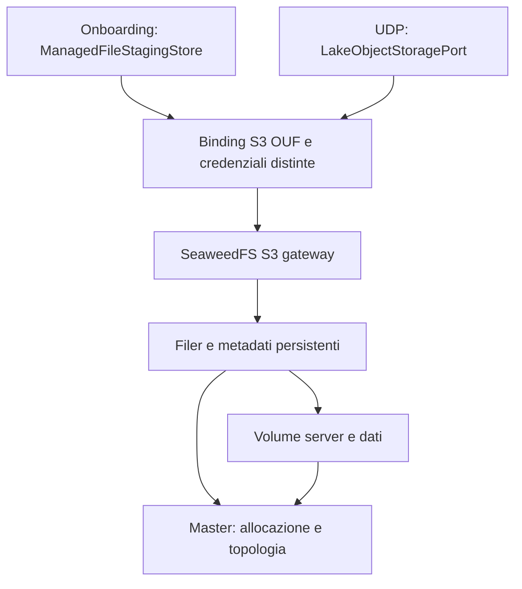

## Checkpoint storage 2026-11-04 — coorte 33 qualificata; fencing nativo PASS; prove PITR e rotazione avviate

- Generazione33 candidata tecnica corrente, non ammessa: immagine run 41782068047 e coorte/runtime run 41794344274 tutti SUCCESS. Lock `c2b30130…`, OCI `5bfda2ef…`, binario `c301b4f4…`, 214 moduli / 1.532 pacchetti. Coorte hosted identica al replay locale `5b28de1d…`: 214 ZIP originali, 302 testi legali, sette archivi MPL, sei file MPL modificati e provenienza separata della patch Iceberg. Firma publisher ricontrollata hosted; nessuna verifica crittografica locale dichiarata.
- Runtime33 verificato sull'immagine esatta: 68 membri / 67 checksum e 18 sorgenti Git identici; cinque oggetti / 8.388.702 byte, 110 file backup / 8.417.383 byte, MIME GET/HEAD prima e dopo PASS. Radici ripristinate indipendenti, 12 container distinti e arresti puliti; 23 casi S3, due rifiuti TLS e due blocchi egress. Originali ZIP conservati. PostgreSQL della coorte33 ancora NOT_TESTED; nessun trasferimento della prova coordinata32.
- Fencing pubblicazioni PostgreSQL17.11 run 41794344238 SUCCESS: sette test offline e 23 controlli nativi, due client reali concorrenti, riavvio con epoch/intenti/storico conservati, worker ritardati respinti e ambiguità riconciliata prima del freeze. ZIP originale con 104 membri / 103 checksum e dieci sorgenti verificati; due effetti sintetici da 30 byte riletti. È una fixture PostgreSQL con file locali, non fencing delle scritture S3 o dei writer target.
- Piano33 conserva l'intera vista32 all'hash canonico `228760f4…` e la catena31→29, compresi progresso precedente e fallimenti storici. Undici test locali33/32 PASS; suite completa71 richiesta hosted. Il tentativo locale completo incontra file storici assenti nella copia parziale: non viene dichiarato PASS completo.
- MiniPET tecnico **circa40% ±10**: pesi invariati [4,6,8,8,8,4,4,4], credito solo SW-WP3 35→45 per ripristino PostgreSQL/S3 sintetico verificato e fencing persistente della fixture; **18,3/46 = 39,78%**. Incremento vincolato agli originali delle due prove, non a prototipi o accettazioni. Sempre 0/8 gate, 0/21 AT, 0/120 oggetti reali.
- Nuova qualifica fisica PostgreSQL: pg_basebackup e pg_verifybackup, WAL successivo al backup, recupero al punto nominato in radice separata e controllo negativo su WAL mancante. Nove test offline PASS; prova nativa PENDING. Il punto sintetico scelto precede deliberatamente un ACK successivo custodito nel report: non è RPO zero o recovery coordinato S3.
- Nuova qualifica TLS sull'OCI33: trust A, B e sovrapposto A+B, dinieghi CA/hostname/fingerprint, un solo seed e GET/HEAD/LIST dopo sostituzione del solo gateway. Dieci test locali PASS, inclusi handshake TLS crittografici in memoria; prova Docker hosted PENDING. Non promette hot reload, zero downtime, mTLS o rotazione credenziali S3.
- Restano aperti licenze/redistribuzione, manutenzione completa e responsabilità patch, custodia durevole, cut coordinato, target fencing, RPO/RTO rappresentativi e binding target. MinIO attivo; scope17 consumati / 52 Engine GET, Teatri/M1 8/8 tecniche + 6/6 funzionali, Farmacie61righe/10OPEN/STRING invariati. Zero operazioni target, replay/reset/grant, merge/deploy o autorità runtime nuova.

## Checkpoint storage 2026-11-04 — immagine 33 verificata; coorte e fencing in qualifica

- Immagine33 run 41782068047 sul commit `1a11295a…`: tutti quattro i job SUCCESS, inclusa verifica publisher su runner indipendente. Readback locale riprodotto integralmente: 20 checksum produttore, 75 sorgenti esatti e sette file identici al lettore hosted. Originali sorgente/regressioni (266 membri, 234 checksum osservazione) e readback conservati; 251 membri del bundle produttore coincidono con l'archivio sorgenti. OCI `sha256:5bfda2ef577b3c33216b82fb3eb1bed3ad76842ed13fc0a114ef94084b20da4d`, binario `c301b4f4…`, 214 moduli / 1.532 pacchetti, zero findings nelle cinque severità. L'archivio OCI completo resta in custodia temporanea CI, non durevole.
- Regressioni hosted33: main 6.656 PASS / 12 skip, server 984, storage 58, shell 306, race 185, compatibilità DB 3, IAM root 24 e IAM separato 18. Sono conteggi di eventi, non test unici. Metadati vendor h1 vuoti per progetto; origini ZIP/h1 autentiche separate, scanner/SPDX grezzi invariati.
- Coorte33 riprodotta localmente: 214 ZIP originali / 372.925.820 byte, 302 testi legali, sette archivi MPL e sei sorgenti MPL locali modificati, più sorgente originale/modificato Iceberg con LICENSE/NOTICE originali e notice della patch. Lock `c2b30130…`, ricevuta deterministica `5b28de1d…`. 54 test coorte/runtime PASS; commit e run errati respinti sull'archivio produttore reale. Nuovi workflow richiedono firma publisher, cold restore/MIME, identità/TLS/egress sull'OCI33: esito hosted PENDING. La generazione32 rimane la candidata tecnica corrente; nessun trasferimento della sua qualifica.
- Ripristino coordinato32 run 41782068196 SUCCESS: ZIP originale conservato, 97 checksum e 18 sorgenti verificati; PostgreSQL17.11 ripristinato in cluster indipendente, catalogo confrontato con LIST/GET reali dei tre oggetti sintetici / 1.064 byte su S3 ripristinato. Otto container distinti e arresti puliti. Non prova fencing, cut simultaneo, PITR o RPO/RTO.
- Nuova fixture PostgreSQL per controllo persistente delle pubblicazioni: CAS epoch/version, intenti durevoli, diniego writer ritardati, riavvio e riconciliazione prima del freeze. Sette test offline PASS; esecuzione nativa hosted PENDING. Ruoli/schema soltanto di laboratorio; nessun fencing delle scritture S3 o dei writer OUF reali dichiarato.
- Audit lifecycle33 fresco: 214 moduli riconciliati con il binario; tutti dieci i moduli archived censiti alla generazione29 assenti. 173 repository interrogati per 213 moduli, nessuno archived/disabled. Undici origini precedentemente UNKNOWN risolte con commit e go.mod identici agli input; modernc.org/b rimane UNKNOWN nella sede GitLab corrente. Le 28 origini VCS assenti nei record Go non sono inventate. Deprecazione, supporto delle versioni e responsabilità di manutenzione delle patch restano verifiche distinte aperte.
- MiniPET **38% ±10**, 17,5/46 crediti invariati finché le nuove prove native non sono verificate; 0/8 gate, 0/21 AT e 0/120 oggetti reali. Licenze/redistribuzione, manutenzione completa, custodia durevole, recovery/PITR, rotazione e binding target restano OPEN. MinIO attivo. Scope 17 consumati / 52 Engine GET, Teatri/M1 8/8 tecniche + 6/6 funzionali e Farmacie 61 righe / 10 OPEN / STRING preservati. Zero effetti target o nuova autorità runtime.

## Checkpoint storage 2026-11-04 — piano 32 verificato; avvio della qualifica 33 corretto

- Il piano tecnico 32 pubblicato in `0cdfe1b9` passa 64 test nella CI 41780309777. Restauro canonico del piano precedente, gate, scope e prove storiche preservati.
- Primo avvio immagine33 `41780306657` FAIL prima della creazione dei job. La definizione usava il contesto runner nell'ambiente del job. La correzione imposta i percorsi di cache nel runner dopo la ricostruzione fresca, tramite GITHUB_ENV. Verificati struttura dei quattro job, 18 blocchi shell, inizializzazione positiva e negativa e tutti i 75 hash del sigillo sorgenti. Il nuovo tentativo richiede ancora tutti gli esiti immagine, scan, SPDX, firma e readback.
- Nuovo laboratorio congiunto sintetico: vincola OCI32 e coorte già verificate, usa dump/restore PostgreSQL 17.11 e confronta il catalogo ripristinato con LIST e GET reali su SeaweedFS dopo copia fredda indipendente. Cinque test offline PASS, inclusi corruzione a lunghezza uguale, metadata obsoleti, LIST troncata e digest dump diverso. Prova hosted PENDING; niente prova di cut simultaneo, fencing effettivo, PITR o RPO/RTO.
- MiniPET **38% ±10**, 17,5/46 crediti, 0/8 gate, 0/21 AT, 0/120 oggetti reali. MinIO attivo. Scope 17 consumati / 52 Engine GET, Teatri/M1 8/8 tecniche e 6/6 funzionali, Farmacie 61 righe / 10 OPEN / STRING preservati. Zero effetti target, ammissione o nuova autorità runtime.

## Checkpoint storage 2026-11-04 — qualifica tecnica 32 completata; ripristino PostgreSQL e pipeline immagine 33

- La generazione 32 è la candidata tecnica con immagine, coorte e laboratori verificati. Immagine run 41724851743, coorte/runtime run 41778371999, tutti i job PASS. OCI `sha256:5531868a8acc4ac8b1581339e5cae79c7a6211402c936eb74f2bcfcd070831f6`, binario `33c54c17…`. Ricevuta coorte `cf3a01b6…` identica al replay locale, firma publisher verificata sul runner e nessuna ammissione.
- Runtime32: cinque oggetti sintetici / 8.388.702 byte su radici indipendenti, 110 file di backup, MIME GET/HEAD prima e dopo PASS. 23 casi S3, due rifiuti TLS, due blocchi egress. Prove sull'immagine esatta, 61 checksum runtime e 16 hash sorgenti verificati. Rotazione, isolamento laterale e obiettivi RPO/RTO restano aperti.
- PostgreSQL 17.11 run 41778371958 PASS: sette casi nativi senza skip, dump reale di 4.578 byte ripristinato in cluster indipendente con schema inizialmente assente. Snapshot identici, tre corpi sintetici / 1.064 byte riletti e verificati, due arresti puliti. 148 checksum interni verificati. Prova logica di laboratorio; recovery coordinato con S3, PITR e fencing effettivo restano aperti.
- Preflight YAML33 run 41778372008 PASS (19 test contratto e 5 regressioni). Il sorgente osservato esclude tutti e dieci i moduli archiviati del censimento29 dal binario e mantiene 214 moduli / 1.532 pacchetti. La pipeline immagine33 ora richiede due build fresche, regressioni in vendor, OCI, scansione e SPDX grezzi, provenienza separata e readback indipendente. Sei test nuovi e 79 riusati PASS localmente; esecuzione completa hosted PENDING. Nessun risultato runtime32 trasferito a33.
- MiniPET **38% ±10**, 17,5/46 crediti, 0/8 gate, 0/21 AT e 0/120 oggetti reali. MinIO attivo. Scope 17 consumati / 52 Engine GET cumulativi, Teatri/M1 8/8 tecniche + 6/6 funzionali e Farmacie 61 righe / 10 OPEN / STRING preservati. Zero effetti target, ammissione e autorità runtime.

## Checkpoint storage 2026-11-04 — coorte 32 riprodotta localmente, prove hosted richieste

- Immagine 32, run 41724851743: 20 checksum interni e 48 sorgenti ricontrollati, sette file di readback identici al runner indipendente. Firma verificata in CI. Lock di qualifica `91a7c874deb5b11f1a18dc483e99f6031644b62abb769a9e11ff1ad29250fb7d` vincolato al produttore esatto e all'OCI `sha256:5531868a8acc4ac8b1581339e5cae79c7a6211402c936eb74f2bcfcd070831f6`.
- Replay locale della coorte 32: 215 ZIP originali, 373.030.443 byte, 304 testi legali, sette archivi MPL upstream e sei file MPL locali. Receipt deterministica `cf3a01b6426bdb64725b155d252089026a3cf08bc94859da7619ac17a88af19c`. MongoDB v2 ha LICENSE identico a v1 e THIRD-PARTY-NOTICES diverso; i due testi v2 sono conservati e nessuna classificazione viene trasferita.
- Verificati 17 test coorte e 30 test runtime, più lock e preflight sulla ricevuta reale. La nuova CI deve ricostruire la coorte, verificare la firma e ripetere cold restore/MIME, identità S3, TLS ed egress sull'OCI32. La generazione 31 resta la candidata con qualifica tecnica completa finché queste prove non passano. Review licenze, redistribuzione e custodia durevole aperte.
- Riproduzione locale con Go 1.27.3 del footer `go-bip39`: il manifest generato su fixture sintetica viene respinto dal parser precedente e accettato da quello corretto senza aggiungere il modulo all'inventario. La verifica integrale YAML33 del run 41776440912 è separata.
- Osservazione YAML33 completata nel run 41776440912. Due build identiche con binario `c301b4f4…`. L'unico modulo e pacchetto rimosso rispetto a 32 è `gopkg.in/yaml.v3` (215→214 moduli e 1.533→1.532 package); nessuna aggiunta. Confermato il footer inattivo go-bip39. Verificati 13.917 file vendor contro i ZIP originali e 234 checksum dell'archivio CI. 41 test di guardia e 325 eventi Go PASS, inclusa race. L'immagine 33 e la sua provenienza richiedono una nuova qualifica.
- Laboratorio aggiuntivo PostgreSQL 17.11: dump logico con SHA verificato, restore in cluster inizialmente vuoto e indipendente, confronto degli snapshot e riconciliazione dei corpi sintetici. 14 test offline PASS, sette casi storici invariati. Prova nativa nuova PENDING; nessuna attestazione di recovery S3, fencing, PITR, RPO/RTO.
- MiniPET **38% ±10** (17,5/46 crediti), 0/8 gate, 0/21 AT, 0/120 oggetti reali. MinIO attivo. Scope 17 consumati / 52 Engine GET cumulativi, Teatri/M1 8/8 tecniche + 6/6 funzionali e Farmacie 61 righe / 10 OPEN / STRING preservati. Zero effetti target e nessuna autorità runtime.

## Checkpoint storage 2026-11-04 — immagine 32 e laboratorio PostgreSQL PASS, osservazione YAML33 corretta

- Tornata `20bded51` conclusa con 53 SUCCESS su 54. Immagine 32: quattro job PASS nel run 41724851743, inclusa verifica indipendente della provenienza. OCI `sha256:5531868a8acc4ac8b1581339e5cae79c7a6211402c936eb74f2bcfcd070831f6`, binario `33c54c17…`, zero findings nelle cinque severità. Coorte e laboratori sull'OCI32 ancora da qualificare. La generazione 31 resta la candidata con qualifica tecnica completa; nessuna ammissione.
- PostgreSQL 17.11: run 41724851796, 7/7 casi nativi PASS, zero skip, arresto riuscito. ZIP originale e tutti i 91 checksum interni verificati. È una prova di fixture SQL e riconciliazione sintetica; recovery coordinato, fencing, PITR e RPO/RTO restano aperti.
- Prima osservazione YAML33, run 41724851908: `go mod vendor` PASS, il controllo delle intestazioni si ferma prima della build. ZIP originale e 93 checksum interni verificati. Il manifest effettivo non era conservato dal primo run. Nel sorgente upstream è fissato il replace wildcard go-bip39, assente dal grafo osservato. Il parser consente solo il suo esatto footer finale se privo di modulo e pacchetti associati. Sostituzioni effettive, sconosciute o ripetute sono respinte. Il prossimo run conserva `vendor/modules.txt` prima del controllo. 12 test observer locali PASS; riproduzione completa e qualifica YAML ancora pendenti.
- MiniPET **38% ±10** (17,5/46 crediti pesati), 0/8 gate, 0/21 AT, 0/120 oggetti reali. MinIO attivo. Scope 17 consumati / 52 Engine GET cumulativi, Teatri/M1 8/8 tecniche + 6/6 funzionali e Farmacie 61 righe / 10 OPEN / STRING preservati. Zero operazioni target, replay/reset/grant, merge, deploy o nuova autorità runtime.

## Checkpoint storage 2026-11-03 — correzione identità sorgente32 e fixture PostgreSQL; osservazione YAML33

- Tornata `77215bee…` conclusa: 55 workflow, 53 SUCCESS e due FAIL conservati. La candidata corrente qualificata tecnicamente resta la 31, non ammessa; nessun trasferimento della qualifica alla 32 o 33.
- Primo run immagine32 `41719761247`: main 6.656 PASS / 12 skip, server 984 PASS, storage 58 PASS, race 185 PASS e shell 306 PASS; compatibilità DB, IAM e tidy PASS. Fallisce il binding del tree prima di immagine/scan/SPDX/provenienza. Le precedenti asserzioni su binario, grafo e 1.533 package sono passate nel log; nessun binario hosted scaricato indipendentemente.
- Causa riprodotta: indice locale inizializzato vuoto e git add -A avevano omesso 24 file upstream già tracciati ma ignorati. I 4.567 file erano presenti e corretti nel sorgente. Replay canonico da indice upstream conserva tutti i file e produce `80632ef3a54debb04531c1913860d2f94d2b418d`, identico al runner, invece del precedente `d58d388b…`. Patch, bytes sorgente, binario `33c54c17…`, 215 moduli e test richiesti invariati. Manifest originale e ricevuta locale conservati; manifest corretto `5289372f…`. Helper isolato con otto regressioni e controllo canonico prima della build; nuova qualifica completa obbligatoria. Nessun lock operativo32 né ammissione.
- PostgreSQL nativo secondo run `41719760642`: 5 PASS / 2 ERROR / 0 skip. Correzione passfile efficace; i due errori sono il prefisso mancante nell'identificatore sintetico del backup. Il runner ora usa `lab-native-fixture-0001`, con una regressione reale runner→manifest→riconciliazione che prova anche il rifiuto di un corpo corrotto. 51 test foundation locali PASS; foundation hosted precedente 50 PASS nel run `41719760718`. Nuova esecuzione nativa richiesta: nessuna dichiarazione di 7/7, PITR, fencing, RPO/RTO o recovery target.
- YAML33: preparata osservazione hosted di sorgente vendorizzato, inventari completi, origini ZIP/h1, patch minima Iceberg config e due build reali. Parent32 corretto vincolato; nessuna identità di vendor tree/binario anticipata. 11 test observer e review indipendente PASS; contratto preliminare immagine33 19 PASS. I 215 moduli originali sono verificati, ma la generazione33 non è ancora compilata/qualificata. Scanner/SPDX canonici non alterati; provenienza delle modifiche separata e nessun h1 inventato.
- MiniPET **38% ±10**, 17,5/46 crediti invariati; 0/8 gate, 0/21 AT, 0/120 oggetti reali. Nove dei dieci moduli archiviati censiti non sono compilati dalla candidata32, YAML resta OPEN; manutenzione completa, origini irrisolte, licenze/redistribuzione, custodia durevole, recovery coordinato/PITR, rotazione, RPO/RTO e binding target restano OPEN. MinIO attivo.
- Scope 17 consumati / 52 Engine GET cumulativi, Teatri/M1 8/8 tecniche + 6/6 funzionali e Farmacie 61 righe / 10 OPEN / STRING preservati. Zero operazioni target, replay/reset/grant, merge, deploy o nuova autorità runtime.

## Checkpoint storage 2026-11-03 — candidata 31 qualificata; nuova 32 in qualifica

- Generazione 31 candidata corrente tecnica, non ammessa: immagine run 41712811559 e coorte/runtime run 41715991128 tutti SUCCESS. Binario `5b7e3dcf…`, OCI `5af4cbe1…`, 234 moduli / 1.740 package. Scan fresco zero findings nelle cinque severità, provenienza verificata hosted e artefatti ricontrollati. Coorte: 234 ZIP, 324 testi legali, sette archivi MPL upstream e sei file MPL locali modificati; obblighi e custodia durevole OPEN.
- Sull'esatta OCI31: cinque oggetti / 8.388.702 byte ripristinati, 110 file backup / 8.417.282 byte, MIME GET/HEAD prima e dopo PASS; 23 casi S3, due dinieghi TLS e due egress. Dodici container distinti arrestati pulitamente; 62 membri runtime e 15 sorgenti verificati. Non è recovery PostgreSQL/PITR né accettazione target.
- Piano31: 60 test PASS e 369 input vincolati. L'intero piano29 precedente si ricostruisce allo stesso hash canonico; vecchio MIME FAIL, scope, decisioni e progresso preservati. Nessuna prova precedente viene trasferita alla nuova candidata. Il finding MongoDB è preciso: v1 deprecato ma con security fix 1.17.10 successivo; non viene dichiarato totalmente privo di manutenzione.
- Nuova patch cumulativa32 integra progress locale, MongoDB ufficiale v2.9.2 e esclusione esplicita dei quattro adapter Google prima degli effetti. Due build VCS e replay di 4.567 file identici: binario `33c54c17…`, tree `d58d388b…`, 1.533 package / 215 moduli. Un solo modulo nuovo, nessun pin/h1 mantenuto alterato. Rispetto all'inventario29, nove dei dieci moduli archiviati identificati non sono più compilati; YAMLv3 e le origini non risolte restano OPEN. Gli archi legacy opzionali del grafo root non sono dichiarati eliminati. Binding funzioni target e compatibilità MongoDB4.4+ restano da provare.
- Prove locali32: main 6.656 PASS / 12 skip; server 982 PASS / 2 skip; storage 54 PASS / 2 skip; race 185 PASS. Tidy IAM/Kafka vuoti e compilazione PASS, nove combinazioni escluse correttamente respinte. Shell locale 296 PASS / 10 FAIL ambientali AF_UNIX, conservati con confronto baseline; non è una suite completa PASS. La nuova CI obbliga tutte le 306 identità shell, i due casi TLS server e i due casi storage condizionali a PASS. 55 test pipeline/engine PASS e review indipendente; immagine32, scansione/SPDX/provenienza, coorte e runtime32 ancora PENDING.
- PostgreSQL17.11 run 41715990786 FAIL preservato: build server e nove test offline PASS, sette casi nativi con tre FAIL e quattro ERROR a causa dell'avviso libpq su PGPASSFILE=/dev/null. Correzione circoscritta: file vuoto regolare0600 in directory privata0700, cleanup anche su errore; stderr resta rigorosamente respinto. 50 test locali PASS e review indipendente; nuova prova hosted necessaria. Tornata9ead15c5: 52 SUCCESS / 1 FAIL.
- MiniPET **38% ±10**, 17,5/46 crediti invariati; 0/8 gate, 0/21 AT, 0/120 oggetti reali. Restano manutenzione completa, licenze/redistribuzione, custodia durevole, recovery coordinato/PITR, rotazione, RPO/RTO e binding target. MinIO resta attivo.
- Scope 17 consumati / 52 Engine GET cumulativi, Teatri/M1 8/8 tecniche + 6/6 funzionali e Farmacie 61 righe / 10 OPEN / STRING preservati. Zero operazioni target, replay/reset/grant, merge, deploy o nuova autorità runtime.

## Checkpoint storage 2026-11-03 — immagine 31 hosted PASS; coorte e laboratori pronti

- Generazione 31: run 41712811559 sul commit `5d0d456b…`, quattro job SUCCESS. Nuove prove hosted: 6.371 eventi PASS / 5 skip principali, server 7, storage 58, race 25, compatibilità DB 3, root IAM 24 e IAM separato 18; tidy root/Kafka vuoti. Non sono conteggi di test unici. Il FAIL della generazione 30 rimane conservato.
- Immagine OCI `sha256:5af4cbe1…`, binario `5b7e3dcf…`, 1.740 pacchetti e 234 moduli. Scansione fresca: zero findings nelle cinque severità, 236 componenti binario e 238 nodi SPDX coerenti. Provenienza verificata sul runner indipendente; ZIP, 45 sorgenti e 20 checksum interni ricontrollati localmente. Lock reale 31 `19cd03cc…`; la verifica Python locale non viene dichiarata verifica crittografica.
- Coorte 31 pronta con binding effettivo dei nuovi artefatti, 234 ZIP originali, 324 testi legali e sei sorgenti locali MPL modificati. Replay locale completo e 84 test Python PASS. Nuova esecuzione hosted coorte→cold restore→identità/TLS/egress ancora PENDING: nessun trasferimento dei risultati 29 e candidata corrente qualificata tecnicamente ancora 29. Licenze, redistribuzione e custodia durevole restano OPEN.
- Laboratorio PostgreSQL 17.11 pronto: sorgente con hash ufficiale, build nativa in CI, socket privato, ruolo SELECT-only e sette casi reali richiesti senza skip. Nove test offline PASS e review indipendente completata; esecuzione PostgreSQL hosted PENDING. Non qualifica PITR, fencing, recovery coordinato, RPO/RTO o target.
- Correzione test-only M2 verificata nei run 41712824449 e 41712811538: outage/recovery nello stesso processo, secondo worker respinto, revoca senza query e claim precedenti preservati. Nessun runtime owner o budget modificato. Il FAIL del controllo advisory storico 41712812265 resta un diniego corretto dopo drift dell'advisory, senza rinnovo della vecchia decisione HUMAN.
- MiniPET **38% ±10**, 17,5/46 crediti invariati; 0/8 gate, 0/21 AT, 0/120 oggetti reali. Rimozione completa delle dipendenze non mantenute ancora OPEN. MinIO resta attivo.
- Scope 17 consumati / 52 Engine GET cumulativi, Teatri/M1 8/8 tecniche + 6/6 funzionali, Farmacie 61 righe / 10 OPEN / STRING preservati. Zero operazioni target, replay/reset/grant, merge, deploy o nuova autorità runtime.

## Checkpoint storage 2026-11-03 — revisione 31 corregge il modulo Kafka; qualifica nuova richiesta

- La generazione 30 ha superato le regressioni hosted principali (6.371 PASS / 5 skip), server (7), storage (58), race (25), compatibilità DB (3), root IAM (24) e IAM separato (18), ma il run 41709442499 è FAIL: tidy del modulo test Kafka segnala una dichiarazione Btree e due checksum inutilizzati. Archivio completo e receipt negativa sono conservati; nessuna immagine, scansione o provenienza 30 è stata prodotta da quel run.
- Patch 31 aggiunta dopo il prefisso immutato delle 30 precedenti: rimuove solo tre righe da `test/kafka/go.mod` e `go.sum`. Tidy vuoto, compilazione dei quattro package Kafka e ricostruzione locale PASS. Il tree cambia in `c2b7d4bd…`; binario `5b7e3dcf…`, 1.740 pacchetti, 234 moduli e tutti i pin produttivi restano identici. Le prove precedenti non diventano una qualifica 31.
- Nuova pipeline 31 e review indipendente: 50 test Python PASS; vincoli sul prefisso, modifica circoscritta dei lockfile test e identità produttive. Sono richieste nuova esecuzione hosted, scansione/SPDX, provenienza, readback, coorte e laboratori. La candidata corrente qualificata tecnicamente resta la 29.
- Il controllo storico per il binario 4.51 `bb9f…` ha correttamente negato il riuso della decisione dopo la modifica dell'advisory GO-2026-5932. La decisione e il FAIL restano immutati. Le candidate 29/30/31 hanno già il pin crypto corretto e nessuno dei sette package segnalati compilato; questo non rinnova l'eccezione storica. La qualifica delle nuove candidate usa le proprie scansioni fresche.
- Una correzione solo nel laboratorio M2 legge il budget durevole dopo lo stop sincrono del worker, evitando la contesa con il reporter attivo. Il secondo processo deve essere respinto mentre il worker è vivo; tentativi, query e claim restano verificati. 13 test locali PASS, prova nativa della modifica ancora PENDING; nessun runtime owner cambiato.
- MiniPET **38% ±10**, 17,5/46 crediti, invariato: 0/8 gate, 0/21 AT, 0/120 oggetti reali. Restano aperti manutenzione completa, licenze/redistribuzione, custodia durevole, recovery PostgreSQL/PITR, rotazione e RPO/RTO rappresentativi. MinIO resta attivo.
- Scope 17 consumati / 52 Engine GET, Teatri/M1 8/8 tecniche + 6/6 funzionali e Farmacie 61 righe / 10 OPEN / STRING preservati. Zero operazioni target, replay/reset/grant, merge, deploy o autorità runtime nuova.

## Checkpoint storage 2026-11-03 — candidata 30 integrata localmente, nuova qualifica immagine in preparazione

- Sette fronti integrati nella patch cumulativa 30: metriche Hashicorp, LDAP mapstructure/v2, adattatore locale bbolt, esclusioni esplicite Kafka notifiche/replica e OpenBao/Vault, rimozione adapter Btree inutilizzato e timer/Stats HTTPdown locali. I profili esclusi sono rifiutati prima degli effetti; MQ Kafka nativo resta distinto. Il binding delle funzioni necessarie al target rimane OPEN.
- Replay indicizzato e ricostruzione producono il binario identico `5b7e3dcf…`. Pacchetti compilati 1.811→1.740, moduli binario 262→234; nessun modulo aggiunto e nessuna versione/h1 mantenuta alterata. Sei dei dieci moduli archived rimossi dal binario; colorstring, OpenCensus, YAMLv3 e PGV restano, insieme ai rilievi MongoDB v1/GCP e alle origini non risolte. Gli archi opzionali non compilati del grafo root non vengono dichiarati eliminati.
- Suite combinata: 6.432 eventi PASS / 7 skip, più 25 esiti race e tre compatibilità DB separati. Non sono conteggi di test unici. Sei profili/tag esclusi falliscono come previsto. Log raw, prove negative, patch isolate e decisione di non selezionare la migrazione IBM Sarama conservati; la pipeline immagine supera 46 test Python e review indipendente.
- La nuova pipeline 30 richiede build riproducibile, scansione fresca, SPDX, provenienza verificata su runner indipendente e inventario completo di 234 moduli. Nuova coorte/licenze e laboratori runtime30 restano PENDING; il sorgente MPL locale Raft è incluso per la successiva verifica. Nessun risultato della generazione29 viene trasferito.
- La candidata corrente qualificata tecnicamente resta la 29. Tornata del checkpoint `51fd3022…`: 51/51 workflow SUCCESS. MiniPET **38% ±10**, 17,5/46 crediti pesati, senza incremento per prototipi: 0/8 gate, 0/21 AT e 0/120 oggetti reali. Licenze/redistribuzione, custodia durevole, recovery coordinato PostgreSQL/PITR, RPO/RTO e binding target restano OPEN. MinIO resta attivo.
- Scope17 consumati / 52 Engine GET cumulativi, Teatri/M1 8/8 tecniche + 6/6 funzionali e Farmacie 61 righe / 10 OPEN / STRING invariati. Nessuna operazione target, replay/reset/grant, merge, deploy o nuova autorità runtime.

## Checkpoint storage 2026-11-03 — generazione 29 candidata corrente, coorte e laboratori hosted PASS

- Immagine 29 qualificata nel run 41696541570, sorgente `041992ea…`: 6.156 PASS / 5 skip / 21 pacchetti, zero vulnerabilità grezze di ogni severità, inventari scan/SPDX coerenti e provenienza publisher verificata sul runner indipendente. Binario `a0c74718…`, OCI `f8679022…`, lock 29 `ed2a3b04…`.
- Coorte e laboratori del run 41701381292 sul commit `7a712185…` SUCCESS: nuovo binding di 262 moduli / 353 testi, 17 archivi MPL, nove file legali sorgente e 39 toolchain; firma publisher ricontrollata hosted. Review licenze, tre classificazioni UNKNOWN e custodia durevole restano OPEN.
- Sulla stessa OCI 29: cold restore indipendente di cinque oggetti/8.388.702 byte, 110 file backup; GET e HEAD octet-stream PASS prima e dopo restore. Ripetuti 23 casi S3 identità, due rifiuti TLS e due dinieghi egress. Dodici container distinti, massimo quattro concorrenti, laboratori sequenziali. Non qualifica PostgreSQL/PITR, rotazione certificati, RPO/RTO o target.
- `currentQualification` del piano ora descrive esclusivamente la generazione 29 tecnica, non ammessa. `historicalQualification15` conserva senza modifica la vista OCI15/SDK27/profilo28; `historicalGeneration29PhaseA` conserva lo snapshot precedente. Il difetto MIME 15 rimane FAIL storico: la correzione 29 non recupera metadati già persi né chiude G2.
- La chiusura qualificata riguarda AWS SDKv1 e S3 manager deprecato. L’audit dei 262 moduli compilati rileva 10 moduli con repository archiviato, il termine della finestra annunciata di fix MongoDB v1 e il detector GCP dichiarato non più mantenuto. Per 12 moduli manca la risoluzione metadata GitHub: non sono considerati mantenuti per presunzione. I quattro fronti Shopify/rcrowley, Bolt, mapstructure e Armon sono una selezione di rimedi; l’inventario più ampio resta OPEN e i prototipi non sono qualificati.
- MiniPET **circa 38% ±10**, stessi 17,5/46 crediti pesati; nessun ulteriore incremento per questa promozione. 0/8 gate, 0/21 AT, 0/120 oggetti reali; MinIO resta attivo.
- Scope 17 consumati e 52 Engine GET invariati; Teatri/M1 8/8 tecniche e 6/6 funzionali, Farmacie 61 righe / 10 OPEN / STRING preservati. Zero target operations, replay/reset/grant, merge, deploy, ammissioni o nuova autorità runtime.

## Checkpoint storage 2026-11-03 — immagine 29 hosted PASS; cold restore della coorte 15 verificato

- La tornata del commit `041992eacd851d277cd049f03b9fe68a393e6df4` è conclusa: **55/55 workflow SUCCESS**. Il run immagine 29 `41696541570` supera i quattro job, inclusi 6.156 PASS/5 skip/21 pacchetti, scansione fresca e verifica indipendente della provenienza su un runner distinto.
- Prove correnti: [receipt immagine 29](../evidence/seaweedfs-452-generation29-image-hosted-20261103.json), [receipt cold 15](../evidence/seaweedfs-452-cold-recovery-hosted-20261103.json) e [tornata CI](../evidence/storage-generation29-image-ci-round-20261103.json).
- La nuova generazione ha binario `a0c74718e584942f58c02214f6b3abe46b71cd47d4995b8da3aa002dcdadeef7` e OCI `sha256:f8679022d5baff88c33285b501317510ac4d1713cc4901f99999a1df937b18bd`. Il piano la registra separatamente dalla coorte 15: binding licenze/coorte e laboratori runtime 29 restano PENDING finché non ne esistono prove effettive. Nessuna vecchia scansione, prova runtime o decisione viene trasferita.
- Cold restore della **sola coorte 15** PASS nel run `41696541366`: cinque oggetti sintetici, 8.388.702 byte; copia fredda di 110 file/8.417.419 byte, radici ripristinate indipendenti, otto container distinti e otto uscite pulite. Ricevuta e 31 file raw sono trattenuti e verificati. I corpi GET e i payload del backup non sono nell’artefatto: il readback controlla i confronti hosted e i manifest, senza dichiarare una seconda verifica locale dei payload.
- Il probe `octet-stream.txt` della coorte 15 conferma **FAIL** per GET e HEAD: `text/plain; charset=utf-8` al posto di `application/octet-stream`. Il successo della copia/ripristino non chiude G2 e non qualifica ancora il MIME della generazione 29. La correzione non ricostruisce MIME già perso nei vecchi oggetti.
- Avanzamento tecnico **circa 38% ±10**: credito SW-WP3 15→35 per il cold drill verificato; pesi originali `[4,6,8,8,8,4,4,4]`, crediti `[50,85,60,35,35,0,0,0]`, **17,5/46 = 38,04%**. È una stima di lavoro tecnico, non acceptance: **0/8 gate, 0/21 AT, 0/120 oggetti reali**. Nessun credito runtime trasferito alla nuova OCI.
- Recovery coordinato PostgreSQL/oggetti, WAL/PITR, fencing dei writer, crash/reboot, rotazione TLS/chiavi e obiettivi rappresentativi RPO/RTO restano OPEN; i 5,844 secondi del piccolo drill non sono RTO. Restano OPEN anche licenze/redistribuzione, custodia durevole e binding target. MinIO resta attivo.
- Scope consumati **17**, Engine GET cumulativi **52**, Teatri/M1 **8/8 tecniche + 6/6 funzionali** e Farmacie **61 righe/10 OPEN/STRING** invariati. Zero operazioni target, replay/reset/grant, merge, deploy o nuova autorità runtime.

## Checkpoint storage 2026-11-03 — profilo 28 hosted PASS; correzione MIME e nuova coorte 29 in qualifica

- Profilo standard OUF a 28 patch hosted PASS: run 41691297148 sul commit `24e96bb5e875a4c0b5c17aed2653e0bd14bd05be`; 5.591 PASS/5 skip/20 pacchetti, rientro root IAM 16+8 e IAM separato 14+4, Kafka compilato e tidy vuoto. Modulo root senza SDK v1/manager deprecato, esclusioni elastic/rclone esplicite. Grafo 1.811 e binario `85fa52c6…` identici alla coorte 15.
- Identità/TLS/egress sull’OCI esatta hosted PASS: run 41691296988, 23 casi S3, due rifiuti TLS e due dinieghi kernel egress; quattro arresti puliti. Prove raw e receipt conservate; non prova rotazione certificati né isolamento laterale dei ruoli.
- Secondo cold recovery 41691296882 FALLITO per `CONTENT_TYPE_MISMATCH` dopo seed/list e controlli corpo/hash riusciti; nessun backup/restore eseguito. Chiave e MIME effettivo del primo mismatch non erano registrati e non vengono inventati.
- Il drill cold separa ora la copia/ripristino con MIME esplicito dal probe octet-stream, che resta un risultato distinto: nessuna incompatibilità viene considerata risolta da un PASS recovery. 15 test locali PASS; nuova esecuzione hosted PENDING.
- Patch 29 `54982d752afc77e680cfa75b5ada1febc6680709bdb46f8d284f2090448849bc`: preserva il MIME deciso dal PUT S3, inclusi i default octet-stream per corpo vuoto/binario senza header; mantiene la normalizzazione nativa del filer. Prova negativa sul codice precedente e regressioni reali PUT→persistenza→GET/HEAD; 6.156 PASS/5 skip/21 pacchetti.
- Nuovo binario 29 `a0c74718e584942f58c02214f6b3abe46b71cd47d4995b8da3aa002dcdadeef7`, stessi 262 moduli e grafo 1.811. È una nuova generazione: immagine, scan, SBOM, provenienza, licenze, coorte e collaudi richiedono nuovi binding. Il lock e le prove 15 restano immutati; nessuna ammissione o trasferimento automatico di qualifiche. MIME già perso in vecchi oggetti non recuperabile automaticamente.
- Riconciliatore DB–oggetti sintetico: 13 test locali PASS, hash ricalcolati dai flussi dei corpi e rifiuto di oggetti mancanti/extra/corrotti, generazioni miste e ACK pendenti. Non esegue SQL, fencing writer o recovery PostgreSQL; non dichiara salute runtime.
- MiniPET circa 35% ±10 (15,9/46 crediti pesati), 0/8 gate, 0/21 AT, 0/120 oggetti reali. Compatibilità MIME della vecchia coorte, licenze/redistribuzione, custodia durevole, recovery coordinato e binding target restano OPEN. MinIO resta attivo.
- 17 scope consumati e 52 Engine GET cumulativi invariati; Teatri/M1 8/8 tecniche e 6/6 funzionali, Farmacie 61 righe/10 OPEN/STRING preservati. Zero operazioni target, replay/reset/grant, merge, deploy o nuova autorità runtime.

## Checkpoint storage 2026-11-03 — 27 patch qualificate, importatori diretti SDK v1 azzerati

- Tutti i sei workflow SDK sul commit `70cd2671b41b0f775889826b2617811451a5e2ba` sono SUCCESS; archivi e manifest scaricati e verificati indipendentemente.
- Sequenza esatta a 27 patch: zero importatori diretti v1 nell’intero sorgente; 30 test principali e 12 sottocasi unici PASS con pin pubblicati esatti.
- Il run root IAM 41687967264 prova anche il grafo produttivo identico di 1.811 pacchetti e il binario `85fa52c68a783f3cf4d54ae6064e7b46d022982c1bef4460616dd76cdc609033`, identico alla coorte OCI a 15 patch.
- [Ricevuta aggregata](../evidence/seaweedfs-sdk27-hosted-20261103.json): grafi normal/policy singoli 1.801, congiunto 1.803, IAM 303, Kafka verificato 763; zero SDK v1 nei perimetri qualificati. Dipendenze indirette elastic/rclone e ulteriori moduli Kafka restano fuori dalla dichiarazione di chiusura.
- Cold recovery 41687967286 FALLITO durante il seed, prima di backup/restore. OCI esatto, quattro ruoli e isolamento verificati; causa timeout inferita dai log di avvio, errore figlio non trattenuto nel primo run. Ricevuta negativa conservata.
- Correzione del laboratorio: precondizione read-only del lock ring applicato, budget finiti, nessun retry mutativo e diagnostica figlio anche su timeout. 11 test offline PASS; nuova prova live ancora PENDING.
- Laboratorio identità/TLS/egress pronto sulla stessa OCI esatta: 13 test locali PASS, inclusi handshake TLS in memoria e rifiuti CA/hostname; 23 casi S3, due rifiuti TLS e due probe egress previsti in CI, ancora PENDING. Non prova isolamento laterale fra ruoli né rotazione certificati.
- Patch 28 del profilo standard OUF pronta: esclude esplicitamente elastic/rclone e nega quei tag in compilazione; grafo moduli root senza SDK v1/manager deprecato, nessun pin mantenuto aggiornato. Suite locale 5.591 PASS/5 skip/20 pacchetti, rientro root/IAM 30+12 e Kafka compilato PASS; binario identico. Qualifica hosted PENDING: il piano mantiene come corrente la sequenza 27 qualificata, senza promuovere il prototipo.
- MiniPET circa 35% ±10 (15,9/46 crediti pesati); 0/8 gate, 0/21 AT, 0/120 oggetti reali. Licenze/redistribuzione, custodia durevole e recovery coordinato OPEN; MinIO resta attivo.
- 17 scope consumati e 52 Engine GET cumulativi invariati; Teatri/M1 8/8 tecniche e 6/6 funzionali, Farmacie 61 righe/10 OPEN/STRING preservati. Zero operazioni target, replay/reset/grant, merge, deploy o nuova autorità runtime.

## Checkpoint storage 2026-11-03 — 27 patch, chiusura importatori sorgente locale

- Sei patch ulteriori migrano i test policy/S3 normal, i client IAM e il modulo IAM separato; ripuliscono il modulo Kafka.
- Sequenza completa riapplicata: importatori diretti AWS SDK Go v1 20→0 nell’intero sorgente.
- Prova combinata con pin esatti: 30 test principali e 12 sottocasi PASS; nessuna sostituzione modfile.
- Grafo server 1.811 pacchetti e binario `85fa52c6…` identici alla coorte OCI qualificata a 15 patch; l’immagine non viene sostituita.
- I grafi dei test normal/policy e dei moduli IAM/Kafka verificati non contengono SDK v1. Gli archi opzionali elastic/rclone e gli ulteriori moduli Kafka restano fuori dalla dichiarazione di chiusura.
- Sei workflow SDK condividono l’esatta sequenza a 27 patch; qualifica hosted ancora PENDING.
- Nuovo drill cold recovery pronto: quattro ruoli isolati, copia fredda e restore indipendente dell’OCI esatto; 6 test offline PASS, esecuzione Docker hosted PENDING.
- Fondazione recovery e dossier licenze già hosted PASS nei run 41684434955 e 41684434829 sul checkpoint `d2e927d`.
- MiniPET circa 35% ±10; 0/8 gate, 0/21 AT, 0/120 oggetti reali; MinIO attivo. Licenze, redistribuzione e custodia durevole OPEN.
- Scope17/52 Engine GET, Teatri/M1 e Farmacie invariati; nessuna operazione target o autorità runtime.

## Checkpoint repository — signer IAM/STS migrato a SDK v2 (3 novembre 2026)

La [patch 21](../patches/seaweedfs/4.52-iam-sts-signer-sdk-v2.patch), SHA256 `cf755f4046011666806b538b1835abf5188c648066f2c1f4d106598355bcf44b`, migra soltanto il signer di `test/s3/iam/s3_sts_assume_role_test.go` al signer AWS SDK Go v2. Il protocollo resta HTTP/XML raw: `POST /`, form URL-encoded, servizio `sts`, regione `us-east-1`, endpoint, host singolo e timeout di 30 secondi sono preservati. Nessun client STS tipizzato viene introdotto.

La [CI 41665635452](https://github.com/GioNob/ouf-deploy/actions/runs/41665635452) ha applicato in ordine tutte le 21 patch, compilato l'intero modulo IAM con `-mod=readonly` sugli esatti pin e superato i due test deterministici del signer. Gli otto step principali sono PASS, inclusi manifest e attestazione. L'artifact `13245451582`, 5.038 byte, ha digest GitHub `sha256:d375975e0bf9ec503b1ae48ce4cbfe055a51e22928f2eaa1b4977cf7be0c72e4`; il manifest attestato ha SHA256 `46d8cd312d71e2d08bc3fd42433e1ff4f4defb4a459ccbbedaeca56dfb082952`. La tornata complessiva è 51/51 SUCCESS dopo il rerun di una sola attestazione M2 non correlata, fallita inizialmente per `socket hang up` OIDC.

Gli importatori diretti repository-wide scendono 21→20: 12 in `test/s3/iam` e 8 in altri test non qualificati. La prova bounded non esegue un roundtrip STS live e non sostituisce la successiva qualifica IAM. La patch resta solo test: binario standard e coorte OCI esatta a 15 patch invariati, nessuna release ammessa.

Avanzamento invariato **circa 35% ±10**: 0/8 gate, 0/21 AT, 0/120 oggetti reali; licenze e custodia durevole restano OPEN, MinIO resta in esercizio. Scope17/52 Engine GET, Teatri/M1 e Farmacie preservati; zero operazioni target o nuova autorità.

## Checkpoint repository — test SSE migrati a SDK v2 (3 novembre 2026)

La [patch 20](../patches/seaweedfs/4.52-sse-tests-sdk-v2.patch), SHA256 `53ea30a77b924f78832bd424ae9bde65315c587a845c5c98884bbfefd4bc259c`, migra `test/s3/sse/s3_volume_encryption_test.go` a AWS SDK Go v2. Conserva endpoint HTTP locale, credenziali fixture, regione, path-style e casi funzionali. Le chiamate usano il contesto del test, l'SDK usa un solo tentativo e il cleanup ha un contesto indipendente con timeout di 30 secondi.

La [CI 41656007239](https://github.com/GioNob/ouf-deploy/actions/runs/41656007239) ha completato tutti gli otto step principali applicando in ordine venti patch. Il package con build tag `integration` compila; il grafo contiene 331 pacchetti e zero SDK v1. L'artifact attestato `13239852878`, ZIP SHA256 `eff1b81794da7702e29f4b9349ef57ccd1707a4cb3d25e6f4f2b9ff5a59eac18`, conserva otto file e l'elenco esatto dei 21 importatori residui. La tornata complessiva è 51/51 SUCCESS.

Gli importatori diretti repository-wide scendono 22→21: 13 in `test/s3/iam` e 8 in altri test non qualificati. La prova bounded non sostituisce i roundtrip live cifrati. La patch è solo test e non sostituisce l'esatta coorte OCI a 15 patch, non modifica il server qualificato e non ammette una release. Avanzamento invariato **circa 35% ±10**: 0/8 gate, 0/21 AT, 0/120 oggetti reali; licenze e custodia durevole restano OPEN, MinIO resta in esercizio. Scope17/52 Engine GET, Teatri/M1 e Farmacie preservati; zero operazioni target o nuova autorità.

## Checkpoint repository — signer S3Tables migrato a SDK v2 (3 novembre 2026)

La [patch 19](../patches/seaweedfs/4.52-s3tables-signer-sdk-v2.patch), SHA256 `aeeb5ceeb6cbeb2f176f3d4ae40561a7b7e70ddbd702598e7d097114cbfbd398`, migra il signer SigV4 di `test/s3tables/catalog/iceberg_catalog_test.go` a AWS SDK Go v2. Conserva credenziali fixture, regione `us-east-1`, servizio `s3tables` e payload firmato; payload hash e contesto della richiesta sono ora espliciti.

La [CI 41649313494](https://github.com/GioNob/ouf-deploy/actions/runs/41649313494) ha completato tutti gli otto step principali applicando in ordine diciannove patch. Il grafo del package contiene 639 pacchetti e zero SDK v1. L'artifact attestato `13235454773`, ZIP SHA256 `7c0587f35a79f306912250b0e71dc5e5364f8232d021e0ea6cf52d5c935fb440`, conserva sette file e l'elenco esatto dei 22 importatori residui. La tornata complessiva è 51/51 SUCCESS.

Gli importatori diretti repository-wide scendono 23→22: 13 in `test/s3/iam` e 9 in altri test non qualificati. La patch è solo test e non sostituisce l'esatta coorte OCI a 15 patch, non modifica il server qualificato e non ammette una release. Avanzamento invariato **circa 35% ±10**: 0/8 gate, 0/21 AT, 0/120 oggetti reali; licenze e custodia durevole restano OPEN, MinIO resta in esercizio. Scope17/52 Engine GET, Teatri/M1 e Farmacie preservati; zero operazioni target o nuova autorità.

## Checkpoint repository — test volume/gRPC S3 migrato a SDK v2 (3 novembre 2026)

La [patch 18](../patches/seaweedfs/4.52-volume-grpc-s3-test-sdk-v2.patch), SHA256 `743687801734174592e8ac5e48c0b8d8be64ea33d187d51cff8069d0f0e5fac7`, migra `test/volume_server/grpc/fetch_remote_s3_test.go` a AWS SDK Go v2. Conserva endpoint HTTP locale, credenziali fixture, regione `us-east-1` e path-style. L'SDK usa un solo tentativo; CreateBucket e PutObject ricevono context e gli errori prima ignorati sono verificati.

La [CI 41643462164](https://github.com/GioNob/ouf-deploy/actions/runs/41643462164) ha completato tutti gli otto step principali applicando in ordine diciotto patch. Il grafo del package contiene 580 pacchetti e zero SDK v1. L'artifact attestato `13233557928`, ZIP SHA256 `9b238c2c81d6e9c9c07801e1416dc644b885b593886e6f7ae6c7d48ee4fd0534`, conserva sette file e l'elenco esatto dei 23 importatori residui. La tornata complessiva è 51/51 SUCCESS.

Gli importatori diretti repository-wide scendono 24→23: 13 in `test/s3/iam` e 10 in altri test non qualificati. La patch è solo test e non sostituisce l'esatta coorte OCI a 15 patch, non modifica il server qualificato e non ammette una release. Avanzamento invariato **circa 35% ±10**: 0/8 gate, 0/21 AT, 0/120 oggetti reali; licenze e custodia durevole restano OPEN, MinIO resta in esercizio. Scope17/52 Engine GET, Teatri/M1 e Farmacie preservati; zero operazioni target o nuova autorità.

## Checkpoint repository — strumento multipart migrato a SDK v2 (3 novembre 2026)

La [patch 17](../patches/seaweedfs/4.52-multipart-tool-sdk-v2.patch), SHA256 `3477b4233312670e5e6174e9e734d1590b9f38445fe0991f0bf2f63c89ea7cf8`, migra `test/s3/multipart/aws_upload.go` a AWS SDK Go v2. Conserva endpoint HTTP locale, credenziali fixture e path-style; corregge la regione al valore ASCII `us-west-1`. L'SDK usa un solo tentativo. Il loop esplicito mantiene tre tentativi per UploadPart sullo stesso upload ID e part number, quindi sostituisce la stessa parte senza produrre una seconda mutazione logica.

La [CI 41638106512](https://github.com/GioNob/ouf-deploy/actions/runs/41638106512) ha completato tutti gli otto step principali applicando in ordine diciassette patch. Il grafo del package contiene 290 pacchetti e zero SDK v1. L'artifact attestato `13230963602`, ZIP SHA256 `dd6391fffd52a29b5a67d41c249a7812502fc025180cb5caf7f440e10aa23c7a`, conserva sette file e l'elenco esatto dei 24 importatori residui. La tornata complessiva è 51/51 SUCCESS; un worker M2 è riuscito al secondo tentativo dopo scadenza di una finestra sintetica, senza operazioni target.

Gli importatori diretti repository-wide scendono 25→24: 13 in `test/s3/iam` e 11 in altri test non qualificati. La patch è solo strumento di test e non sostituisce l'esatta coorte OCI a 15 patch, non modifica il server qualificato e non ammette una release. Avanzamento invariato **circa 35% ±10**: 0/8 gate, 0/21 AT, 0/120 oggetti reali; licenze e custodia durevole restano OPEN, MinIO resta in esercizio. Scope17/52 Engine GET, Teatri/M1 e Farmacie preservati; zero operazioni target o nuova autorità.

## Checkpoint repository — test S3 basic migrati a SDK v2 (3 novembre 2026)

La [patch 16](../patches/seaweedfs/4.52-basic-tests-sdk-v2.patch), SHA256 `ee5fd114aff8f2cb527740171b07ba460fba83c1b33a96ccac807b869aa79a40`, migra i tre file di `test/s3/basic` a AWS SDK Go v2. Conserva endpoint locale HTTP, regione, credenziali configurate e path-style; le chiamate ricevono context e i modelli ACL/tagging usano i tipi mantenuti. Il test non-network del contratto client è PASS in locale e sulla [CI 41632509122](https://github.com/GioNob/ouf-deploy/actions/runs/41632509122).

La CI ha completato tutti gli otto step principali, applicando in ordine le quindici patch qualificate e la nuova patch. Il grafo del package contiene 330 pacchetti e zero SDK v1. L'artifact attestato `13229155800`, ZIP SHA256 `6fe51c97f819a4ea5c883d41b00ac5c8c611b576f611bfbd0914b8ee2db0a506`, conserva sette file e l'elenco esatto dei 25 importatori residui. La tornata complessiva sul commit `3924cf73e0c5fc66e0bddfe6ec5ca92a2e2e4d50` è 51/51 SUCCESS; un job Registry è riuscito al secondo tentativo dopo una cancellazione per timeout, senza prova di prodotto fallita.

Gli importatori diretti repository-wide scendono 28→25: 13 in `test/s3/iam` e 12 in altri test/strumenti non qualificati. La patch è solo test e non sostituisce l'esatta coorte OCI a 15 patch, non modifica il server qualificato e non ammette una release. Avanzamento invariato **circa 35% ±10**: 0/8 gate, 0/21 AT, 0/120 oggetti reali; licenze e custodia durevole restano OPEN, MinIO resta in esercizio. Scope17/52 Engine GET, Teatri/M1 e Farmacie preservati; zero operazioni target o nuova autorità.

## Checkpoint repository — coorte 4.52 verificata su runner ospitato (3 novembre 2026)

La [CI 41627470213](https://github.com/GioNob/ouf-deploy/actions/runs/41627470213) ha completato **7/7 step PASS** sul commit `fe6b392c1e5789513c6cea18fdf913b0acf1c559`. Ha scaricato l'esatto OCI producer da 194.296.104 byte e il readback indipendente, ricostruito OCI e assessment, verificato 16 checksum, 21 sorgenti, firma publisher, 262 moduli e 353 testi. La ricevuta hosted trattenuta nel repository è di 1.393 byte, SHA256 `da3482b4710e50c40634a89e37d7d17d78bdff8073d00e048ba00990de16f092`; l'artifact bounded `13226228195` ha ZIP SHA256 `eff348904adb4ad63f6bf7304914b3972e11db468ea8c5d136c35972c5f1c6d4` ed è attestato dal workflow.

Lo stato resta `TECHNICAL_COHORT_VERIFIED_NOT_ADMITTED`: la coorte tecnica è verificata, ma review licenze, accettazione della redistribuzione e custodia durevole dell'immagine completa sono ancora OPEN. Nessuna ammissione release, autorità runtime o operazione target è stata prodotta. L'avanzamento resta **circa 35% ±10**: 0/8 gate, 0/21 AT e 0/120 oggetti reali; MinIO resta in esercizio. Scope17/52 Engine GET, Teatri/M1 e Farmacie rimangono invariati.

## Checkpoint repository — coorte tecnica 4.52 riletta localmente (3 novembre 2026)

L'[esatta coorte candidata](OUF_SEAWEEDFS_452_COHORT_READBACK_20261103.md) è stata riletta sui byte trattenuti: archivio OCI completo da 194.296.104 byte, readback indipendente, delta licenze e corpus storico. Il verificatore ha ricostruito assessment e OCI, verificato 16 checksum interni, 21 sorgenti, firma del publisher, 262 moduli e 353 testi legali. Ricevuta canonica locale SHA256 `390121e8d48793f0f10fa3351e8aa87fe5603fd7617f680ebc7dd978272b0a11`; 6 test unitari PASS e readback integrale PASS.

I tre risultati UNKNOWN del classificatore restano grezzi e visibili. Il verificatore lega ciascuno a modulo, versione, percorso, SHA256 e co-rilevazioni Apache/BSD, ma impone `licenceReview=OPEN`, `redistributionAccepted=false`, `durableImageCustody=OPEN`, `releaseAdmitted=false`, zero autorità runtime e zero operazioni target. Il workflow dedicato con azioni pin-nate a commit ripeterà la prova su runner GitHub e attesterà soltanto la ricevuta bounded; il suo esito remoto è ancora da confermare.

Avanzamento invariato **circa 35% ±10**: 0/8 gate, 0/21 AT, 0/120 oggetti reali. SW-G1 resta aperto per review licenze e custodia durevole dell'immagine; coorte dei contenuti verificata localmente, non ammessa. MinIO resta in esercizio. Scope17/52 Engine GET, Teatri/M1 e Farmacie preservati. Nessun replay, reset, grant, deploy, merge o nuova autorità.

## Checkpoint repository — immagine 4.52 attestata, sottogate vulnerabilità PASS_RAW (3 novembre 2026)

La [CI 41622752493](https://github.com/GioNob/ouf-deploy/actions/runs/41622752493) ha superato **tutte e quattro le job** sul commit `7a775d2a63ae5ede005056c325db85e2f335ed94`. Evidenze verificate: 16 test di packaging, **5.591 PASS, 5 skip, 20 pacchetti PASS**, sei casi remote-cache su due istanze, build esatta e smoke nonroot/read-only senza rete. Il [lock 4.52](../releases/seaweedfs-452-candidate-lock-20261103.json) fissa sorgente, patch, SHA server e digest OCI. Il binario standard e la SBOM sono privi di AWS SDK v1 e del manager S3 deprecato. La scansione Trivy 0.70.0, con tutti i livelli e gli unfixed, restituisce **zero rilievi a tutte le severità**, 264 componenti scansionati e 266 record SPDX. Nessuna disposizione di applicabilità è stata applicata.

Il [runner indipendente](https://github.com/GioNob/ouf-deploy/actions/runs/41622752493/job/125876762583) e la rilettura locale hanno verificato archivio, 16 checksum interni, 21 hash sorgente, riproduzione dell'OCI e dell'assessment, e firma GitHub del produttore sul workflow e commit esatti. [Readback conservato](../evidence/artifacts/seaweedfs-452-image-readback-41622752493.zip). L'[archivio completo dell'immagine](https://github.com/GioNob/ouf-deploy/actions/runs/41622752493/artifacts/13224053625) resta in custodia CI a scadenza. Il readback nel repository conserva metadati e firma. La custodia durevole del binario e dei byte OCI resta aperta.

Il [delta licenze](../evidence/artifacts/seaweedfs-452-patch15-licence-delta.zip) conserva 65 membri e i relativi checksum, i testi delle 38 versioni di moduli nuove, i nove file legali del sorgente e i tre testi con classificazione UNKNOWN. È legato al corpus storico esatto, che conserva i testi identici di 224 moduli, i 39 testi Go 1.27.3 riletti e tutti i 17 archivi sorgente MPL verificati byte per byte. SHA256 del delta `7cf2b9dc596ded071c9c75f1bfeb87245f443e25984b9cddf8bf4f411791eda2`. I tre UNKNOWN del classificatore di licenze coincidono per versione, file e hash con il corpus storico. Il rapporto vulnerabilità è distinto. Restano la review delle classificazioni e degli obblighi, la coorte e la custodia durevole.

Avanzamento tecnico **circa 35% ±10**, secondo i pesi originali di 46 ore minime. Il credito stimato SW-WP1 sale dal 75% all'85% per la riproduzione dell'immagine, la chiusura del sottogate vulnerabilità e la verifica della provenienza. Gli altri crediti sono invariati. Totale ponderato 15,9/46, circa 34,6%. Acceptance **0/8 gate, 0/21 AT e 0/120 oggetti reali copiati**. SW-G1 resta aperto. Scope17/52 Engine GET, Teatri/M1 e Farmacie preservati. MinIO resta in esercizio.

## Checkpoint repository — patch 15 e scansione locale pulita (3 novembre 2026)

La [patch 15](../patches/seaweedfs/4.52-go-network-security-fixes.patch) fissa `golang.org/x/net` a `v0.62.0` e `golang.org/x/crypto` a `v0.58.1-0.20261009181718-2f1f834330b2`, versioni di correzione riportate da [GO-2026-6860](https://pkg.go.dev/vuln/GO-2026-6860), [GO-2026-6866](https://pkg.go.dev/vuln/GO-2026-6866) e [GO-2026-5932](https://pkg.go.dev/vuln/GO-2026-5932). Go ha verificato i due archivi e i rispettivi go.mod con sum.golang.org. La patch si riapplica byte per byte, SHA256 `a32f169988281c2702b24af0fb8f9868930b50226f0bdda7f9276f7f24dde53e`.

In locale **5.591 PASS, 5 skip, 20 pacchetti PASS**, 16 test del qualificatore e build riusciti. Il grafo standard resta identico a **1.811 pacchetti**, senza OpenPGP, x/net/html, SDK v1 o manager S3 deprecato. SHA256 binario `85fa52c68a783f3cf4d54ae6064e7b46d022982c1bef4460616dd76cdc609033`, manifest OCI `sha256:1bb1ff9d7a42e98f5c6a90903644ed5e18e83a89d76bccbc4d16ce6b8027c6b4`, config `sha256:add1988121001fe6339a31635d5f61bc560b3c9a540da8027e376a4ebdf0df35`. Trivy 0.70.0 sul Docker archive esatto, tutti i livelli e gli unfixed, zero ignore: **0 CRITICAL, HIGH, MEDIUM, LOW e UNKNOWN**. La SBOM contiene 266 record e include tutti i 264 componenti scansionati. Il workflow ricostruisce il binario, scansiona l'immagine caricata, la attesta e verifica su un runner distinto ZIP, checksum, sorgenti e firma.

Il precedente [CI 41620176788](https://github.com/GioNob/ouf-deploy/actions/runs/41620176788) ha concluso le tre job con successo e ha prodotto l'immagine `d9873b7d…` con **3 UNKNOWN** (CVE-2026-78661, CVE-2026-97045, GO-2026-5932), zero altri rilievi e sottogate `HELD_RAW_FINDINGS`. L'artefatto [13223329223](https://github.com/GioNob/ouf-deploy/actions/runs/41620176788/artifacts/13223329223), SHA256 `7ef7ff664098bb41217f432f923f78a721d87806341bd1445371e04a5d109ed2`, è stato scaricato e riletto: 16 checksum interni, 20 sorgenti, assessment e OCI riprodotti. La firma GitHub è stata verificata con gh 2.97.0 per workflow, ramo, commit sorgente e runner ospitato. I workflow storici della 4.51 hanno mantenuto la propria negazione su advisory modificato.

Preflight licenze della patch 15: checksum h1 del ZIP e go.mod ricalcolati per tutti i **262 moduli terzi**, 352 testi legali individuati; il solo modulo privo di licenza alla radice è FlatBuffers Go, i cui dieci file coincidono con i blob del commit upstream `3b8644d32c50e86872584829af4b8caf180235ab` con licenza parent già documentata. I testi LICENSE di x/net e x/crypto sono identici a quelli delle versioni sostituite. Il supplemento FlatBuffers porta a 353 testi. Trivy license-full a confidenza 0,9 ha restituito 311 rilevazioni su 293 delle 296 viste. Tre risultati UNKNOWN riguardano i testi di Thrift, Arrow e Parquet; tre viste senza classificazione sono due workflow di controllo licenza e un fixture di test. Restano la review degli obblighi e delle classificazioni, la verifica toolchain/root completa, coorte e custodia durevole.

Stima MiniPET **circa 33% ±10**, con **0/8 gate, 0/21 AT e 0/120 oggetti reali copiati**. La scansione locale prepara G1; qualifica e readback remoti del nuovo hash sono da confermare. Scope17/52 Engine GET, Teatri/M1 e Farmacie preservati.

## Checkpoint repository — immagine OCI del candidato SeaweedFS 4.52 (3 novembre 2026)

Il [workflow storage](../.github/workflows/storage-sdk-lifecycle.yml) confeziona il binario prodotto dalla stessa esecuzione che applica le 14 patch ed esegue le regressioni. Il [qualificatore](../scripts/qualify-seaweedfs-452-image.py) vincola sorgente upstream `984eac6a790be89e2a11de175a7413e1e3e32dd3`, SHA256 del server `d9873b7d5c484266c9226e90acf20215e7ed1985fe2b235171f617768471a98f`, licenza upstream esatta e build standard Go 1.27.3 linux/amd64 CGO disabilitato. Verifica i 1.811 pacchetti della chiusura e il modulo binario prima di produrre l'immagine scratch. I profili 4.51 e 4.52 hanno pin distinti.

Packaging locale sul binario esatto e **16 test** dei due profili passati. Digest OCI manifest locale `sha256:326d13f773fec1291815105d68a8f12529f0a40b74508bc039b1a46d1c7f790f`, config `sha256:cc545e812f9070fd8f1f78b0eec1ea9142c420efd528996005156e2541ce1009`. La CI deve confermare l'identità con Docker, scansione Trivy senza ignore e con tutti i livelli, SBOM SPDX, smoke nonroot/read-only senza rete e attestazione dell'inventario degli artefatti. L'assessment conserva eventuali HIGH, CRITICAL e UNKNOWN; la disposizione del vecchio binario resta confinata al suo hash.

MiniPET circa **33% ±10** con **0/8 gate, 0/21 AT, 0/120 oggetti reali**. L'OCI locale prepara la qualifica G1. Esito remoto, revisione licenze, custodia durevole e coorte restano aperti. Scope17/52 Engine GET, Teatri/M1 e Farmacie preservati.

## Checkpoint repository — suite remote-cache su SDK v2 (3 novembre 2026)

La [quattordicesima patch](../patches/seaweedfs/4.52-remote-cache-tests-sdk-v2.patch) migra i tre file residui della suite remote-cache. Conserva indirizzamento path-style, credenziali fixture, letture a intervalli, copia, copia multipart e prova di eviction. Il client di laboratorio usa il contesto del test, un timeout HTTP di 30 secondi e un tentativo SDK. L'abort di cleanup è circoscritto all'upload creato dal test e viene saltato dopo una conferma di completamento.

La suite storage qualificata ha prodotto **5.591 PASS, 5 skip e 20 pacchetti PASS**. La suite remote-cache compila con `-mod=readonly`; il grafo dei suoi test e dell'utility conta **301 pacchetti, zero SDK v1 e zero manager S3 deprecato** (SHA256 del grafo `b6c40a20947d52b6dfc1d9541c4b51d75a5685ad943126cfb66840fb4b50018f`). I tre file della patch si riapplicano e coincidono byte per byte. SHA256 patch `1dc0dd0514dd0af43d928eff8bc8a9ed4739c66b8ebb4a6f62d9a449110344d6`. L'avvio locale delle due istanze è stato interrotto per il divieto del sandbox sui socket Unix. Il workflow esegue sei casi sul runner GitHub con due istanze loopback e conserva grafo, log dei test e log delle istanze.

La [CI 41616094307 della patch 14](https://github.com/GioNob/ouf-deploy/actions/runs/41616094307) è **SUCCESS** in entrambe le job sul commit `7fbad82e35373035e052f44fb82fba407af7b906`. L'artefatto scaricato coincide con il digest pubblicato `sha256:da1414c999bbf88633ddd8e37a4314b4f385972ea20865c10c285b595323b34a`. Il log conserva **6/6 PASS**: flusso base, range GET, oggetto assente, CopyObject, copia multipart ed eviction sotto pressione. Sono confermati **5.591 PASS, 5 skip, 20 pacchetti PASS** nella suite storage, grafo remote-cache identico al locale e binario invariato con SHA256 `d9873b7d5c484266c9226e90acf20215e7ed1985fe2b235171f617768471a98f`.

Nel grafo dei moduli radice, `olivere/elastic/v7@v7.0.32` dichiara SDK v1.43.21 e `rclone@v1.75.1` dichiara `feature/s3/manager@v1.22.34`. Le integrazioni SeaweedFS che li importano richiedono rispettivamente i tag `elastic` e `rclone`. Il grafo compilato e il binario qualificati riguardano la build standard senza quei tag. La rimozione dei soli import diretti non elimina automaticamente questi archi dal grafo dei moduli.

La [CI 41612171089 della patch 13](https://github.com/GioNob/ouf-deploy/actions/runs/41612171089) è **SUCCESS** in entrambe le job. Digest dell'artefatto `sha256:4efb644af8fe17ff77f222ea1b2f24dade00f321a0e843c0cce39b6bc3bf36b2`.

Gli importatori diretti scendono da **31 a 28** (15 nel modulo radice e 13 in `test/s3/iam`). Resta da verificare la dichiarazione indiretta in `test/kafka/go.mod`. La stima MiniPET è **circa 33% ±10**, con **0/8 gate, 0/21 AT e 0/120 oggetti reali**. La migrazione dei test lascia ancora da qualificare immagine, SBOM, scan, licenze, custodia e coorte G1. Scope17/52 Engine GET, Teatri/M1 e Farmacie sono preservati.

## Checkpoint repository — utility S3 di laboratorio su SDK v2 (3 novembre 2026)

La [tredicesima patch](../patches/seaweedfs/4.52-storage-test-tools-sdk-v2.patch) migra l'esempio di PUT prefirmata e l'utility di creazione bucket del test remote-cache. La PUT locale usa path-style, firma `Content-MD5` e conserva la scadenza di 15 minuti. Il test sintetico verifica firma, header, corpo e chiave con spazi. L'utility conserva l'interfaccia CLI, riconosce i codici S3 di bucket già esistente e limita CreateBucket a un tentativo SDK entro 30 secondi. Per l'utility è verificata la compilazione. Le prove locali non chiamano endpoint S3.

La suite qualificata ha prodotto **5.591 PASS, 5 skip e 20 pacchetti PASS**. Il grafo delle due utility e dei loro test conta **320 pacchetti, zero SDK v1 e zero manager S3 deprecato**. Il grafo produttivo resta identico a **1.811 pacchetti** e il binario è identico byte per byte alla patch 12, SHA256 `d9873b7d5c484266c9226e90acf20215e7ed1985fe2b235171f617768471a98f`. La riapplicazione sui tre file e il confronto dei byte sono riusciti. SHA256 della patch: `59b72ea7a8d57bfd63a67d267f2fe4f95bb9d8c701a499c80f8698af2348f714`. Il workflow storage applica la patch e conserva il grafo e il log separati delle utility.

Gli importatori diretti residui scendono da **33 a 31** (18 nel modulo radice e 13 in `test/s3/iam`). `test/kafka/go.mod` dichiara inoltre v1 come dipendenza indiretta. La verifica offline non aveva tutti i moduli Kafka in cache, quindi la dichiarazione resta da riconciliare. La stima MiniPET resta **circa 33% ±10**, con **0/8 gate, 0/21 AT, 0/120 oggetti reali**. La qualifica G1 richiede ancora immagine, SBOM, scan, licenze, custody e coorte. Scope17/52 Engine GET, Teatri/M1 e Farmacie sono preservati.

## Checkpoint repository — chiusura SDK v1 nei test qualificati (3 novembre 2026)

La [dodicesima patch](../patches/seaweedfs/4.52-test-fixtures-remove-sdk-v1.patch) rimuove AWS SDK Go v1 dai 23 file di test sotto `weed`. Introduce un encoder IAM Query locale e fixture SigV4 basate su AWS SDK v2, mantenendo canonicalizzazione S3, `X-Amz-Content-Sha256`, presign `UNSIGNED-PAYLOAD` e hash streaming. Gli oracoli XML/JSON live del vecchio SDK sono sostituiti da golden SHA-256 congelati e da casi espliciti per `xsi:type`, liste flattened, testo misto/finale, radici multiple e XML troncato. SHA256 patch: `d772a087347f23f75c13b15c7179b6ad7845d053ea6ca9b31cec92917f6b3b16`; riapplicazione esatta dopo le undici patch precedenti e confronto byte-per-byte riusciti. [Evidenza locale](../evidence/seaweedfs-sdk-v1-test-closure-local-20261103.json).

La suite storage qualificata resta **5.591 PASS, 5 skip, 20 pacchetti PASS**. Il grafo `go list -deps -test` degli stessi 20 pacchetti contiene **1.839 pacchetti e 0 SDK v1**; sotto `weed` restano **0 importatori sorgente v1**. Il grafo produttivo resta **1.811 pacchetti, 0 SDK v1**. Il binario è invariato rispetto alla patch undici: SHA256 `d9873b7d5c484266c9226e90acf20215e7ed1985fe2b235171f617768471a98f`, 223.555.213 byte, nessun metadato SDK v1.

La [CI 41608755366](https://github.com/GioNob/ouf-deploy/actions/runs/41608755366) è **SUCCESS** in entrambe le job sul checkpoint sorgente `da03a99996cc8deeaf87e73f2b74eecad79e3f18`: applicazione ordinata delle dodici patch, controllo degli import `weed`, grafo test qualificato, regressioni, build e artefatto `seaweedfs-sdk-lifecycle-evidence` (digest `sha256:901ef733ad35d65d38034067aca9bc10aa2f647e2ed398b886855b5b88e2a2a4`).

Limite esplicito: questa è chiusura del perimetro storage qualificato, non eradicazione dell'intero repository. Il `go.mod` radice conserva SDK v1 per **20 importatori** esterni a `weed` (integrazioni e strumenti di test); il modulo separato `test/s3/iam` conserva v1.44.0 e **13 importatori**. Totale residuo: **33 importatori repository**. La scansione estesa `./weed/...` ha contato 15.312 PASS, 75 skip e 160 pacchetti PASS, ma non è verde per assunzioni d'ambiente preesistenti in `weed/mount`, `weed/shell` e `weed/server`; non sostituisce la baseline storage né costituisce acceptance.

L'avanzamento MiniPET resta circa **33% ±10**, non acceptance: **0/8 gate, 0/21 AT, 0/120 oggetti reali**. Zero SDK v1 nei grafi qualificati è una precondizione G1; restano eradicazione repository/moduli, nuova immagine, SBOM, scan, licenze, custody, coorte e prove recovery/identità/TLS/egress. MinIO resta in esercizio. Scope17/52 Engine GET, Teatri/M1 8/8 tecniche e 6/6 funzionali e Farmacie 61 righe/10 OPEN/STRING sono invariati. Nessuna operazione target, authority, replay/reset/grant, merge o deploy.

## Checkpoint repository — zero SDK v1 nel binario candidato (3 novembre 2026)

L'[undicesima patch](../patches/seaweedfs/4.52-s3-wire-parser-remove-sdk-v1.patch), source `e5a36b02fe46105b88500ceba9337cb79d06c91d`, rimuove gli ultimi import produttivi AWS SDK Go v1. I costruttori di puntatori sono nativi; il parser delle richieste XML diventa codice locale Apache-2.0 sotto i `wire/LICENSE` e `wire/NOTICE` già conservati. Il confronto contro l'implementazione legacy mantiene attributi `xsi:type`, liste flattened, ultimo segmento di testo, più radici e rifiuto dei documenti troncati.

Prove locali: **5.591 PASS, 5 skip, 20 pacchetti PASS**, race su `wire`, test completi `s3api`, build server e riapplicazione esatta dopo le dieci patch precedenti. Il binario SHA256 `d9873b7d5c484266c9226e90acf20215e7ed1985fe2b235171f617768471a98f` non contiene `github.com/aws/aws-sdk-go` nei metadati. Il grafo `CGO_ENABLED=0 go list -mod=readonly -deps ./weed` contiene **1.811 pacchetti, 0 SDK v1, 0 importatori e 0 archi produttivi**. Il [manifest](../patches/seaweedfs/4.52-s3-wire-parser-remove-sdk-v1-removed-packages.txt) rimuove esattamente 14 package SDK v1 più `jmespath`, senza ingressi. [Evidenza completa](../evidence/seaweedfs-sdk-v1-binary-closure-local-20261103.json).

Limite esplicito: `go.mod` conserva ancora SDK v1 per **23 file di test** usati come oracoli di compatibilità, signer fixture e client IAM legacy. Non entra nel grafo/binario produttivo, ma la rimozione integrale dal modulo richiede migrare quei test. La [CI 41599415067](https://github.com/GioNob/ouf-deploy/actions/runs/41599415067) è **SUCCESS** in entrambe le job sul checkpoint `080aed6d1a4867ad01a0a8c90a963a04f6711346`. L'artefatto attestato conferma 1.811 package/0 v1, 5.591 PASS/5 skip/20 package PASS, zero metadati binari v1 e lo stesso SHA256 locale.

L'avanzamento MiniPET resta circa **33% ±10**, non acceptance: **0/8 gate, 0/21 AT, 0/120 oggetti reali**. Zero v1 nel binario è una precondizione G1, non chiude G1 senza nuova immagine, SBOM, scan, licenze, custody e coorte. MinIO resta in esercizio. Scope17/52 Engine GET, Teatri/M1 8/8 tecniche e 6/6 funzionali e Farmacie 61 righe/10 OPEN/STRING sono invariati. Nessuna operazione target, authority, replay/reset/grant, merge o deploy.

## Checkpoint repository — decima patch SDK lifecycle (3 novembre 2026)

Il client `weed/remote_storage/s3` è migrato da AWS SDK Go v1 a `service/s3` v2 1.114.1 e `feature/s3/transfermanager` v0.4.3 con la [decima patch](../patches/seaweedfs/4.52-remote-storage-s3-sdk-v2.patch), source `f730a88253c7727933aa4e3a8c6a4d225e5ed53c`. Il [manifest](../patches/seaweedfs/4.52-remote-storage-s3-sdk-v2-removed-packages.txt) vincola i 38 pacchetti v1 che devono uscire dalla chiusura compilata. La [CI 41594094791](https://github.com/GioNob/ouf-deploy/actions/runs/41594094791) è **SUCCESS** in entrambe le job sul checkpoint `2aa318aaeb8c4c0731f8a7683f7af6115d3b8414`: applicazione ordinata delle dieci patch, chiusura esatta del grafo, regressioni e build.

Prove locali: **5.591 PASS, 5 skip, 20 pacchetti PASS**, race test del client, regressioni server sul default credential chain, build completa e riapplicazione esatta dopo le nove patch precedenti. Binario locale SHA256 `a0733e3b245945d597b63223a94638bfb1e8bf2bff4d5edb7a6222656ff8cc5c`. Il grafo esatto `CGO_ENABLED=0 go list -mod=readonly -deps ./weed` contiene **1.826 pacchetti, 14 SDK v1, 1 importatore produttivo diretto e 2 archi**. Il residuo diretto è confinato a `weed/s3api`; nessun package del deprecato `feature/s3/manager` è compilato. [Evidenza completa](../evidence/seaweedfs-remote-storage-s3-v2-local-20261103.json).

Sono preservati listing, range read, copy e multipart copy, tag, cifratura, storage class, user-agent, delete condizionale, omissione storica di Content-Type e Content-MD5 su DeleteObjects. Endpoint espliciti e tuple di credenziali incomplete vengono negati; `AWS_ENDPOINT_URL_S3` implicito non può cambiare il binding. Il client SDK esegue un solo tentativo; il downloader assegna il retry del body a un unico owner locale. I test usano trasporto sintetico e nessun AWS/target.

L'avanzamento resta circa **33% ±10**, non acceptance: **0/8 gate, 0/21 AT, 0/120 oggetti reali**. MinIO resta in esercizio. Scope17/52 Engine GET, Teatri/M1 8/8 tecniche e 6/6 funzionali e Farmacie 61 righe/10 OPEN/STRING sono invariati. Nessuna operazione target, replay/reset/grant, merge o deploy. Restano i due import XML/helper in `weed/s3api`, poi nuova immagine/SBOM/security/licenze/custody/coorte e qualifica recovery/identità/TLS/egress.

## Checkpoint repository — nona patch SDK lifecycle (3 novembre 2026)

Il backend tier S3 è migrato da AWS SDK Go v1 al transfer manager mantenuto v0.4.3/S3 v2 1.114.1 nel patch `4.52-s3backend-sdk-v2.patch`, source `5083a7f177cb3f983028efdb815d66a023beb495`. La CI [41585394627](https://github.com/GioNob/ouf-deploy/actions/runs/41585394627) è SUCCESS in entrambi i job: applicazione ordinata di nove patch, chiusura dipendenze esatta, regressioni e build.

Prove locali: 5.548 PASS/5 skip/19 pacchetti, race test del backend, build completa SHA256 `178a2ff1d3d99acd5b3226874df95cb2fb691b07e296f73cfb75f09261567194`. Il grafo `./weed` resta identico fra otto e nove patch a **1.864 pacchetti**; 52 pacchetti SDK v1, importatori produttivi diretti 3→2 e archi 18→11. La successiva correzione a 1.865 era errata: il file `seaweedfs-patched-deps` conservato dall'artefatto CI 41585394627 contiene 1.864 righe. Il nuovo artefatto CI 41594094791 contiene 1.826 righe, coerenti con le 38 rimozioni esatte.

Il client richiede regione esplicita e binding credenziali/endpoint non ambiguo, isola la cache per identità/addressing/trasporto, conserva checksum, range read e fsync, e non ripete upload ambigui. HTTP sintetico ha verificato firma SigV4, user-agent, checksum e un solo tentativo su503; nessun AWS o target è stato chiamato. Restano `remote_storage/s3` e helper/XML `weed/s3api`, oltre a image/SBOM/security/licenze/custody/coorte e recovery owner.

L'avanzamento resta circa **33% ±10**, non acceptance: **0/8 gate**, **0/21 AT**, **0/120 oggetti reali**. MinIO resta in esercizio. Scope17/52 Engine GET, Teatri/M1 8/8 tecniche e6/6 funzionali e Farmacie61righe/10OPEN/STRING sono invariati. Nessuna operazione target, replay/reset/grant, merge o deploy.

# Checkpoint 3 novembre 2026 — replica S3 mantenuta, otto patch

L'ottava [patch](../patches/seaweedfs/4.52-s3sink-sdk-v2.patch) migra il sink di replica S3 a SDK v2 e `feature/s3/transfermanager v0.4.3`. Non introduce `feature/s3/manager`, che AWS dichiara deprecato e sostituito dal [nuovo componente](https://github.com/aws/aws-sdk-go-v2/discussions/3306). S3v2 1.114.1 e checksum dei moduli erano già nel lockfile; transfermanager diventa dipendenza diretta in go.mod.

**5.524 eventi PASS, 5 skip preesistenti, 18 pacchetti PASS; build server riuscita.** Le otto patch riapplicate producono gli stessi55file del sorgente testato. Il grafo contiene **1.864pacchetti,52SDKv1,3importatori diretti,18archi**; questa patch aggiunge16pacchetti mantenuti e non elimina ancora altri pacchetti v1, richiesti dai client residui. [Manifest](../patches/seaweedfs/4.52-s3sink-sdk-v2-added-packages.txt) e [prove/hash/limiti](../evidence/seaweedfs-s3sink-v2-local-20261103.json).

Le prove conservano tag,mtime,MIME,metadati utente e MD5 nel PUT singolo,insieme ai checksum flessibili. Nel multipart non si applica l'MD5 dell'intero oggetto alle parti. Un oggetto fixture di6MiB viene caricato in2parti; un errore della prima parte produce errore e abort,senza complete né retry SDK. PUT/DELETE ambigui sono restituiti dopo un tentativo. La regressione originaria sul Content-Type ha individuato un default introdotto da SDKv2: il middleware ora conserva l'assenza del campo prima della firma senza cambiare un MIME esplicito. Test con SDK e firma reali,HTTP sintetico,zero AWS/target.

Configurazione intenzionalmente più rigorosa: regione esplicita,credenziali complete,endpoint alternativo esplicito e validato,timeout30s per richiesta. Il flag s3_disable_content_md5_validation ora ha defaultfalse e rifiuta true; non si disabilita l'integrità per passare i test. Le interfacce di replica non acquisiscono un nuovo contesto di autorizzazione o un ledger durevole. Ambiguità su creazione/completamento multipart,crash,retry esterni e dimensionamento restano da qualificare. I binding reali di credenziali,ruoli/process/SSO,refresh,TLS ed egress rimangono separati.

CI sei patch41580991342 confermata PASS; [CI sette41582635594](https://github.com/GioNob/ouf-deploy/actions/runs/41582635594) confermata SUCCESS in entrambi i job su cb4b356f417e7a4250f08032a6e4fedcd32c721f. Otto patch pubblicate in adee567bae520e2d93fcc8cdcad282ed79b820cb e byte remoti verificati uguali ai file qualificati. [CI otto41583531119](https://github.com/GioNob/ouf-deploy/actions/runs/41583531119) in corso all'ultima lettura,esito finale pendente. Nuova immagine,SBOM,scansione,licenze,custodia e coorte non sono ancora qualificate.

**MiniPET circa33%(±10punti),0/8gate chiusi,0/21AT accettati,0/120oggetti copiati.** Il lavoro rimuove dipendenze dal candidato ma non prova migrazione o ammissione. MinIO resta in esercizio. Scope17/52EngineGET,Teatri/M1 e stessaFarmacie61righe/10OPEN/STRING invariati. Prossimo: CI sette/otto,client S3 remote_storage e storage/backend,parser XML/helper e nuova qualifica G1.

## Checkpoint precedente

# Checkpoint 3 novembre 2026 — KMS su SDK v2, sette patch

La settima [patch](../patches/seaweedfs/4.52-kms-sdk-v2.patch) migra il provider AWS KMS a `service/kms v1.62.2`. Aggiorna core SDK a1.47.5,configsources1.5.8,endpoints2.8.8 e smithy1.28.7 con versioni/checksum espliciti in go.mod/go.sum. La suite comprende SQS per verificare le dipendenze condivise aggiornate. Nessuna nuova dipendenza entra senza manifest: la chiusura compilata aggiunge quattro pacchetti KMS v2 e rimuove service/kms v1.

**5.500 eventi PASS,5skip preesistenti,17pacchetti PASS; build completa riuscita e8test lifecycle PASS.** Tutte sette patch sono state riapplicate al sorgente iniziale e i51file risultano identici ai byte testati. Grafo: **1.848 pacchetti,52SDKv1,4importatori diretti,24archi**. Il vecchio SDK resta necessario ai tre client S3 e al parser/helper del server. [Prove,hash,versioni e limiti](../evidence/seaweedfs-kms-v2-local-20261103.json).

Test con SDK/firma reali e HTTP sintetico: GenerateDataKey AES_256,contesto di cifratura,envelope persistito identico,Decrypt,alias/metadata,errori AWS e trasporto,cancellazione e input invalidi. Zero richieste ad AWS o al target. Le risposte remote reali,KMS/SSE e i binding di produzione richiedono successiva qualifica.

Modifiche intenzionali di configurazione: regione obbligatoria,credenziali statiche complete,session token senza coppia negato,role_arn/external_id precedentemente ignorati ora negati. Il timeout di connessione viene effettivamente applicato; default dial/request10/30s,valori negativi/overflow negati. max_retries deve essere assente/0: un solo tentativo SDK restituisce l'esito ambiguo al chiamante; non implementa recovery durevole. Endpoint alternativo solo esplicito,con validazione URL; HTTP resta per laboratorio LocalStack,mentre target TLS/allowlist rimangono obbligatori. Credenziali da profili/ruoli/process/SSO,endpoint identità e refresh richiedono qualifica distinta.

La [CI sei patch41580991342](https://github.com/GioNob/ouf-deploy/actions/runs/41580991342),source7da527895dfacc34650b3cf9feb700912a8c09f5,è confermata **SUCCESS** in entrambi i job. La replica settima viene attivata dalla pubblicazione: risultato remoto ancora da verificare. La nuova immagine,SBOM,scansioni,licenze,custodia e coorte non sono ancora qualificate; il vecchio VEX vale soltanto per il vecchio hash.

**MiniPET circa33%(±10punti):0/8gate,0/21AT,0/120oggetti reali copiati.** Lo sviluppo del candidato avanza,ma non chiude alcun gate di ammissione/migrazione. MinIO resta in esercizio. Scope17/52EngineGET,Teatri/M1 8/8tecniche e6/6funzionali,stessaFarmacie61righe/10OPEN/STRING invariati. Nessun effetto target,merge,deploy o nuova autorità. Prossimo: CI settima,client S3 remoti/replica/storage,parser XML/helper e nuova qualifica G1.

Fonti normative consultate: Matrix1.7§1/4/5,UDP1.3§109.4/109.5 e secret custody,policy resilienzav3 regole1–10 e qualifica. Il laboratorio non sostituisce i binding effettivi e le autorità HUMAN/THS.

## Checkpoint precedente

# Checkpoint 3 novembre 2026 — SQS su SDK mantenuto, sei patch

La sesta [patch](../patches/seaweedfs/4.52-sqs-sdk-v2.patch) porta publisher SQS e consumer di replica a SDK v2 SQS 1.51.0, già fissato in go.mod/go.sum. Entrambi i lockfile restano invariati. Mantiene payload protobuf, attributo key, delay 10s, long poll/visibility 20s, un messaggio per ricezione e cancellazione solo dopo successo della replica. Credenziali statiche incomplete, regione implicita, endpoint alternativo implicito e URL di coda assente producono errore prima dell'operazione dipendente. Il tipo QueueDoesNotExist resta riconoscibile. Il trasporto HTTP ha timeout 30s; un solo tentativo SDK evita replay nascosti di invii ambigui. Nessun nuovo retry loop o rinnovo di autorità.

Suite locale sull'esatta patch finale: **5.444 eventi PASS, 5 skip preesistenti, 15 pacchetti PASS**; build del server riuscita e 8 regressioni del valutatore lifecycle PASS. Test con serializer e firma SDK reali, risposte HTTP sintetiche e credenziali fixture; nessuna richiesta AWS o target. [Prove, hash e limiti](../evidence/seaweedfs-sqs-v2-local-20261103.json). La quinta patch S3 conserva 19 modelli locali e compatibilità delle ACL persistite, come documentato sotto.

Grafo server: **1.845 pacchetti, 53 SDK v1, 5 importatori diretti, 29 archi v1**. Rispetto al checkpoint iniziale di questo giro (quattro patch), i pacchetti v1 scendono da 54 a 53 e gli importatori da 8 a 5. SQS v2 introduce 96 pacchetti di client/configurazione/autenticazione mantenuti: il [manifest esatto](../patches/seaweedfs/4.52-sqs-sdk-v2-added-packages.txt) è verificato dalla CI. La crescita transitoria della chiusura mentre convivono v1/v2 è esplicita; non è riduzione della superficie totale già dimostrata.

CI quattro patch [41578323726](https://github.com/GioNob/ouf-deploy/actions/runs/41578323726) PASS. Replica quinta [41580156811](https://github.com/GioNob/ouf-deploy/actions/runs/41580156811) PASS: entrambi i job conclusi con successo, lettura successiva alla ricevuta locale. Replica sei patch finale [41580991342](https://github.com/GioNob/ouf-deploy/actions/runs/41580991342), source 7da527895dfacc34650b3cf9feb700912a8c09f5, in corso alla lettura successiva; esito finale pendente. Non attribuire alle prove locali il risultato CI ancora pendente.

Limiti: default credential chain v2, profili/ruoli/process/SSO e relativi endpoint esterni richiedono qualifica dei binding e dell'autorità; un singolo tentativo SDK non implementa budget durevoli o riconciliazione del chiamante. Il callback preesistente non propaga al chiamante un errore di cancellazione SQS: recovery completo ancora aperto. Nuova immagine, SBOM, scansioni, licenze/custody/coorte devono essere ricalcolate; il VEX del vecchio binario non si estende al nuovo hash.

**MiniPET circa 33% (±10 punti), 0/8 gate chiusi, 0/21 AT accettati, 0/120 oggetti reali copiati.** MinIO resta in esercizio. Scope17 consumato e 52 EngineGET invariati; Teatri/M1 8/8 tecniche e 6/6 funzionali, stessa Farmacie 61 righe/10 OPEN/STRING preservati. Prossimo: verificare CI finale, migrare KMS e i tre client S3/replica/storage, rimuovere parser/helper residui e poi ricostruire la nuova qualifica G1. Nessun passo target ammesso da questo checkpoint.

## Checkpoint precedente

# Checkpoint 3 novembre 2026 — modelli S3 e ACL persistite

La quinta [patch](../patches/seaweedfs/4.52-s3-wire-remove-sdk-v1.patch) estrae 19 modelli S3 dal client SDK v1. Mantiene campi, ordine, tag, puntatori e licenze. I confronti verificano JSON storico e rilettura delle ACL, XML delle risposte multipart e parsing delle richieste ACL/ownership/versioning. Il parser storico resta invariato, inclusi casi di contenuto misto, radici multiple e XML malformato. Due log non stampano più l'intera richiesta multipart, perché i modelli locali non ereditano la redazione del formatter SDK.

Suite estesa locale: **5.422 eventi PASS, 5 skip preesistenti, 13 pacchetti PASS**. Comprende anche command e s3_constants: il conteggio non è direttamente confrontabile con i precedenti 4.806. Build del server riuscita. Grafo: **1.750 pacchetti totali, 54 SDK v1, 7 importatori diretti e 39 archi**. Rispetto alle quattro patch entra soltanto il pacchetto locale s3api/wire; service/s3 resta necessario alle integrazioni. [Evidenza locale e limiti](../evidence/seaweedfs-s3-wire-local-20261103.json).

La CI delle quattro patch [41578323726](https://github.com/GioNob/ouf-deploy/actions/runs/41578323726) è PASS. Il workflow aggiornato qualifica le cinque patch sul tag esatto, conserva grafo, log JSON e metadati di build. La replica CI della quinta patch è in attesa. Un primo tentativo locale è fallito perché /tmp non esisteva; il rilancio con TMPDIR esplicito è PASS, senza modificare test o regole di accettazione.

Stima MiniPET **circa 33% (±10 punti)**: avanzamento di sviluppo, **0/8 gate chiusi, 0/21 AT accettati, 0/120 oggetti reali copiati**. G1 resta aperto; nessuna ammissione o operazione target. Scope17 consumato e 52 EngineGET invariati, Teatri/M1 e stessa Farmacie preservati. Prossimo passo: integrazione SQS, poi restanti percorsi KMS/S3/replica e parser XML.

## Checkpoint precedente

# Checkpoint 3 novembre 2026 — tipi IAM locali e riduzione del grafo

La quarta [patch](../patches/seaweedfs/4.52-iam-wire-remove-sdk-v1.patch) separa i tipi delle risposte IAM dalla libreria client AWS v1. I dieci tipi conservano campi, puntatori, ordine e tag del modello precedente. Gli errori mantengono i codici originali. I test confrontano XML vuoto e popolato con l'SDK precedente, includendo date, liste e caratteri speciali. Le copie derivate mantengono LICENSE, NOTICE e attribuzione. I client SDK usati dai test restano utili per verificare il protocollo.

La suite locale comprende IAM, OIDC, STS, policy, integrazione IAM, IAM API e S3. Esito 4.806 eventi PASS e 5 skip preesistenti. Il grafo del server contiene 1.749 pacchetti, di cui 54 SDK v1, con 41 archi diretti da 8 pacchetti importatori. La variazione rispetto alla baseline riguarda la sostituzione di `github.com/aws/aws-sdk-go/service/iam` con `weed/iam/wire`. Il workflow verifica questa differenza esatta e include la suite IAM. [Workflow aggiornato](../.github/workflows/storage-sdk-lifecycle.yml).

L'estrazione IAM costituisce un passo della rimozione SDK v1. I percorsi S3, KMS, SQS, remote storage e replica rimangono da trattare. Stima MiniPET circa 33%, 8 gate e 21 AT aperti, 0/120 oggetti reali copiati.

## Checkpoint precedente

# Checkpoint 3 novembre 2026 — manutenzione AWS SDK e qualifica G1

Il tag SeaweedFS 4.52, commit `984eac6a790be89e2a11de175a7413e1e3e32dd3`, contiene ancora AWS SDK Go v1.55.8. Il grafo Go amd64/CGO disabilitato contiene 55 pacchetti v1 su 1.749. Il tag è la base per una prova di rimozione incrementale. La scelta di una generazione per il target richiede ancora qualifica e ammissione. [Release 4.52](https://github.com/seaweedfs/seaweedfs/releases/tag/4.52).

Il [controllo di ciclo di vita](../scripts/assess-storage-sdk-lifecycle.py) verifica i digest dei metadati e la corrispondenza fra grafo compilato, scansione del binario nell'immagine e SBOM SPDX. Va eseguito sul pacchetto dopo verifica indipendente di byte, provenienza e firma. Uscite 0 per assenza di v1 in tutti e tre gli inventari, 1 per v1 presente, 2 per prova invalida. Il test sull'archivio esatto 4.51 riproduce l'esito HELD e trova v1.55.8 nello scan e nella SBOM. [CI con 8 regressioni](https://github.com/GioNob/ouf-deploy/actions/runs/41576768471).

Tre patch di laboratorio sul tag 4.52 sono conservate separatamente. La [prima](../patches/seaweedfs/4.52-listing-remove-sdk-v1.patch) elimina gli import SDK v1 dal listing, mantenendo il valore wire `url` e la rappresentazione dei continuation token. In locale passano 60 casi mirati. La suite completa di `s3api` riporta lo stesso insieme di esiti prima e dopo la patch, con 4.265 eventi PASS e 5 skip. La [seconda](../patches/seaweedfs/4.52-bucket-xml-response-remove-sdk-v1.patch) sostituisce la serializzazione delle risposte di ownership e versioning con `encoding/xml` e rimuove l'import diretto del serializzatore SDK v1 da `s3err`. Mantiene namespace, ordine dei campi, omissione di Status senza configurazione, Content-Type e lunghezza. Il DELETE ownership conserva il corpo vuoto. La prova combinata `s3api` e `s3err` passa in locale con 4.290 eventi PASS e 5 skip. [CI listing](https://github.com/GioNob/ouf-deploy/actions/runs/41576951901) e [CI prime due patch](https://github.com/GioNob/ouf-deploy/actions/runs/41577143012) PASS.

La [terza patch](../patches/seaweedfs/4.52-master-follower-remove-sdk-v1.patch) usa l'inizializzazione nativa dei puntatori di Go 1.26 nel master follower. Un primo esperimento con gli helper SDK v2 aggiungeva 21 pacchetti alla chiusura del binario ed è stato ritirato. La variante nativa conserva l'insieme originario dei 1.749 pacchetti, senza nuovi import. Gli import diretti verso SDK v1 passano da 46 a 44 archi, in 10 pacchetti importatori invece di 12. Suite locale combinata `command`, `s3api`, `s3err` con 4.760 eventi PASS e 5 skip. [Replica CI delle tre patch](https://github.com/GioNob/ouf-deploy/actions/runs/41577571234). [Supporto di new con espressione](https://go.dev/doc/go1.26).

Il grafo completo conserva 55 pacchetti v1 dopo le tre patch. I metadati Go del binario Linux amd64 costruito in laboratorio confermano `github.com/aws/aws-sdk-go v1.55.8`. SHA256 del binario locale `1fe7222547840448de4efbb10e8694267e9e2c6e5e443b73a32269151145cb3f`. È una prova di build e metadati locale, senza qualifica OCI o custodia release. Rimangono il parsing delle richieste XML, tipi ACL e multipart, IAM e integrazioni AWS. Sul parser storico è stato misurato, fra l'altro, che elementi Status duplicati usano l'ultimo valore e che XML malformato dopo la chiusura del primo elemento causa un errore. Un confronto con la decodifica standard del solo primo elemento, seguita da verifica sintattica fino a EOF, conferma che la conversione diretta altererebbe il valore su XML con contenuto misto o più radici. In un caso con testo Enable, un figlio annidato e testo d, il parser storico restituisce d e il decoder standard restituisce Enabled. Prima di sostituire il parser occorre qualificare esplicitamente questi rifiuti e la gestione dei documenti con più radici. Go 1.27.3 è stato verificato via SHA256 dal catalogo ufficiale. Le prove qui citate usano sorgente fissato, moduli in sola lettura, CGO disattivato e dipendenze locali durante i test.

La stima MiniPET resta circa 33%, con 8 gate e 21 AT aperti e 0/120 oggetti reali copiati. G1 comprende ancora qualifica di una generazione senza v1, revisione delle licenze, custodia durevole e coorte. Le prove sul grafo e l'esito del controllo di ciclo di vita costituiscono una verifica distinta dall'ammissione dell'immagine.

## Checkpoint precedenti

# Stato corrente — corpus licenze qualificato; G1 ancora aperto

[Licenze, sorgenti e prove](OUF_SEAWEEDFS_LICENCE_EVIDENCE_20261102.md): CI41541625141 e verifica indipendente41542075842 PASS. 245 componenti, 374 testi, 17 archivi sorgente MPL completi; 10 test, 709 checksum nativi e firma del workflow esatto verificati. Corpus completo conservato nel repository. Nessuna modifica a binario, immagine o SBOM originali. Tre UNKNOWN del classificatore di licenze, review degli obblighi, custodia dell'immagine e coorte restano OPEN. Rilevato anche AWS SDK Go v1.55.8 fuori supporto: dipendenza compilata da valutare, senza inventare una CVE o un percorso attivo.

Avanzamento tecnico stimato **circa 33%**, con incertezza di circa 10 punti e metodo nel dossier; non accettazione. Tutti 8 gate / 21 AT / M2 OPEN, copia reale **0/120**. MinIO ancora in esercizio. Teatri/M1 conserva 8/8 tecniche e 6/6 funzionali; stessa Farmacie 61 righe / 10 OPEN / codice ministeriale STRING preservata. Controllo17 e52EngineGET invariati: nessun nuovo effetto target, upload/profiling, grant/reset/replay, merge o release acceptance. Prossimo lavoro pubblico: review dei rilievi licenze/lifecycle, custodia durevole dell'immagine e coorte; restano writer/DB/fence/backup/capacità target da provare.

## Checkpoint precedenti — storico

# Emendamento v1.1 — decisione owner sull'applicabilità, 2 novembre 2026

**Decisione owner recepita — 2 novembre 2026.** `OUF-SW-G1-20261102-01`: GO-2026-5932 classificato `not_affected / vulnerable_code_not_present` per il solo server SHA256 `bb9f768e5afca39c7fdc2113e5caafd9f911d4537917dd25c520ee4dbdab1f74`. Rapporto grezzo conservato: 0HIGH/CRITICAL,1UNKNOWN. Dopo l'unica classificazione accettata: 0HIGH/CRITICAL/UNKNOWN irrisolti nell'insieme di eseguibili esaminato. Nessun ignore aggiunto; gate raw storico invariato. [CI41519037628](https://github.com/GioNob/ouf-deploy/actions/runs/41519037628) PASS: 9 test, advisory ufficiale fresco e provenienza originale autenticata nuovamente;28 sorgenti precedenti intatte. Documento OpenVEX emesso per il solo hash, decisione conversazionale registrata senza rivendicare firma HUMAN/THS. SW-G1 complessivo ancora OPEN per immagine/SBOM/licenze/custody/coorte. Tutti8gate/21AT/M2 OPEN; controllo17 consumato,52DockerGET cumulativi,0 nuovi effetti target. Teatri/M1 8/8tecniche,6/6funzionali e stessaFarmacie preservati.

Il §5 recepisce unicamente la [decisione approvata](OUF_SEAWEEDFS_G1_APPLICABILITY_REVIEW_20261102.md). I restanti requisiti, gate e AT mantengono il proprio stato. Il nome storico del file resta stabile per conservare tutti i riferimenti.

## Stato e checkpoint precedenti

# Stato corrente — 2 novembre 2026, ricevuta17 e core di copia qualificato

1. **SW-WP0 / G0 — inventario e piano privato acquisiti, gate aperto.** Controllo 17 consumato: 4 artifact metadata / 93238 byte letti; 0 nuovi Docker GET, S3, SQL, credenziali o corpi. Totali 17 controlli / 52 Docker GET. Piano privato SHA256 `debed37f949b00f008eae77feecd103c8d4834e105c0d6c727b188e6aafbb501`: 120 record / 203743 byte, tutti PLANNED_NOT_COPIED. 110 hash dichiarati, 10 assenti; 120 corpi reali ancora da verificare.
2. **SW-WP1 / G1 — sicurezza ancora HELD.** Candidato corretto: zero HIGH/CRITICAL, un UNKNOWN grezzo GO-2026-5932. Proposta di applicabilità limitata al binario esatto, non ammessa; nessun ignore o VEX aggiunto. Immagine finale, licenze, custodia durevole e coorte restano da chiudere.
3. **SW-WP2 / G2 e SW-WP6 / G6 — prove sintetiche precedenti conservate.** Adapter originali, TLS, prefissi, versioni/marker, multipart e recovery freddo qualificati in laboratorio; nessuna qualifica della topologia target.
4. **SW-WP4 / G4 — core di copia sintetica qualificato.** Source `99a6d0f00dd1fe490438cef95ce98ee98e7c3ae4`, CI41504703184 PASS; 31 eventi di test passati, inclusi sotto-casi. Due processi SeaweedFS indipendenti sulla stessa VM: 120 corpi sintetici copiati e riletti, CAS concorrente, tre morti reali del processo, 503 dopo salvataggio riconciliato senza secondo PUT. Clock virtuale per Retry-After di un'ora e outage di sei ore. Verifica indipendente byte/sorgenti/firma OUF CI41507064288 PASS; 25 checksum e tutte le 28 sorgenti precedenti invariate. Non è una prova MinIO→SeaweedFS reale.
5. **Passaggio target ancora non ammesso.** Due UNSUPPORTED = publicAccessBlock; non significano assenza. ACL PRESENT/configured0 non prova grant privati. Binding onboarding/udp/udp-evidence-read osservati al14: writer attivi, consumer esterni e DB non provati; snapshot coerente, backup, fence e capacità fresca ancora aperti. Nessun entrypoint di produzione per il core; nessuna nuova operazione VPS dopo17. Cinque vecchi comandi13–17 CONSUMATI: nessun replay, reset o cancellazione. Tutti gli 8 gate / 21 AT / M2 OPEN. Teatri/M1 conserva 8/8 tecniche e 6/6 funzionali, stessa Farmacie preservata. MinIO resta in uso e vulnerabile.

[Core, prove e limiti](OUF_SEAWEEDFS_COPY_CORE_20261102.md) · [Proposta di review SW-G1](OUF_SEAWEEDFS_G1_APPLICABILITY_REVIEW_20261102.md). La proposta richiede una decisione sul criterio vigente, non concede autorità runtime né accettazione degli altri gate.

---

## Checkpoint precedenti — storico, non istruzioni da rieseguire

> **Stato corrente — 2 novembre 2026:** inventario16 acquisito NON ADMITTED:2 bucket/120 record/203743 byte,265 richieste S3;16 controlli/52 GET Docker.110 hash dichiarati/10 assenti;verifica corpi ancora per tutti120.2 risposte feature UNSUPPORTED da classificare dal manifest privato,nessuna assenza/N/A inventata. Quattro vecchi comandi consumati. [Unico nuovo blocco: piano offline qualificato](OUF_SEAWEEDFS_OFFLINE_PLAN_20261102.md), controllo17 NON eseguito:4artifact trattenuti,0 nuovi Docker/S3/SQL/credenziali/corpi,52 GET invariati. Piano privato PLANNED_NOT_COPIED,nessun motore copia o autorità.33 test root/rete isolata e firma/byte indipendenti PASS (CI41488131645/41488523185). Snapshot13/RAM/capacità del14 non rinfrescati,writer/DB ancora da provare. Nessuna migrazione;MinIO vulnerabile,server rawHELD1UNKNOWN,8gate/21AT/M2 OPEN. Teatri/M1 8/8tecniche,6/6funzionali e stessaFarmacie preservati. Storico sotto.

> **Stato corrente — 2 novembre 2026:** ricevuta15 consumata:15 controlli/50 GET Docker,0 file/0 byte credenziali,5 candidati metadata; S3 non raggiunto. Il predicato fallito resta non provato. [Unico nuovo blocco qualificato](OUF_SEAWEEDFS_INPUT_OBSERVATION_20261102.md): controllo16 distinto NON eseguito, max2 GET SOLO MinIO/max52 cumulativi, snapshot14 e SDK invariati. Classifica tutti i candidati prima del contenuto; legge soltanto input dichiarati regolari/bounded/stabili senza symlink, senza cambiare permessi/proprietario e senza ammettere custody della fonte. Casi reali mode0644/UID10001/hardlink e oversize PASS;20 Python/12 Java, CI41446908345 e verifica indipendente41447457400. Tre vecchi comandi consumati: nessun replay/reset/cancellazione. Nessuna migrazione, vulnerabilità MinIO ancora presenti,8 gate/21 AT/M2 OPEN;Teatri/stessaFarmacie preservati. I checkpoint seguenti sono storici.

> **Esecuzione avviata — 2 novembre 2026:** [handoff corrente](handoffs/OUF_SEAWEEDFS_IMPLEMENTATION_20261102.md). L'owner richiede lavoro autonomo secondo questo piano. Scansione upstream1HIGH/3UNKNOWN; build corretta zeroHIGH/CRITICAL,1UNKNOWN con applicabilità da verificare. Nessun gate chiuso o target modificato. La diagnostica isolata e l'ammissione release restano distinte.

# OUF — MiniPET: sostituzione di MinIO con SeaweedFS

**ID:** OUF-MP-STORAGE-SW · **Versione:** 1.1 · **Data:** 2 novembre 2026, Europe/Rome  
**Stato:** piano redatto su richiesta dell'owner; SeaweedFS candidato alla sostituzione, ancora NON qualificato né installato.  
**Owner di prodotto:** Giovanni. **Esecuzione:** agente principale, sequenziale. **Responsabilità operative:** owner dei moduli e operatore della piattaforma, secondo i contratti OUF esistenti.  
**Baseline documentale:** `ouf-deploy@640ae37f5a1c49717e2f4168a928a553bcbfa603`.  
**Relazione con M2:** prerequisito infrastrutturale del [MiniPET CSV M2](OUF_M2_MINIPET_v1_0_20261026.md), senza sostituirne i criteri di accettazione. [Registro del lavoro](../releases/minio-seaweedfs-plan-20261102.json).

## 1. Obiettivo e decisione proposta

Sostituire il backend MinIO non più ammissibile con una generazione SeaweedFS mantenuta, verificata e operabile, preservando tutti i dati, riferimenti applicativi, classificazioni e prove già acquisite. Rendere ripetibile la sostituzione di provider e librerie attraverso contratti, test e procedure di esportazione posseduti da OUF.

La battuta d'arresto ha un costo reale: qualifica, adeguamenti operativi e migrazione. Il lavoro su semantica, onboarding, ingestion e identità UDP resta riusabile. La resilienza richiesta diventa un risultato verificabile: poter cambiare implementazione dello storage senza ricreare sorgenti, rifare il profiling o perdere lineage.

**Strategia proposta:** ambiente SeaweedFS separato → qualifica dei client reali → prova completa di migrazione e ripristino → copia verificata → breve finestra con scritture sospese → cambio coordinato dei binding → osservazione → ritiro governato di MinIO. Nessuna conversione del volume MinIO in-place; un solo backend accetta le scritture OUF in ogni fase.

Questo documento pianifica il cambiamento richiesto. Non dichiara già eseguiti test, scansioni, inventario dei bucket o operazioni sul VPS. Il passaggio sul target richiederà il pacchetto concreto, le prove e l'ammissione runtime previste dai contratti OUF, senza chiedere nuovamente una scelta generica fra AIStor e open source.

## 2. Situazione OUF: ciò che sappiamo e ciò che va ancora misurato

L'analisi usa le ricevute conservate e codice pubblico fissato a commit; non è una nuova ispezione live. È essenziale distinguere il software conservato, le generazioni candidate e il software effettivamente ammesso sul target.

| Area | Evidenza disponibile | Conseguenza per la sostituzione |
|---|---|---|
| MinIO conservato | Manifesto amd64 `a1a8bd4a…`, config `69b2ec20…`; scansione dei byte esatti: 9 CRITICAL, 127 HIGH, 8 UNKNOWN. [Dossier](../evidence/m2-minio-exact-copy-security-readback-20261101.json) | Gate HELD. Sono rilievi ripetibili per componente, non 144 CVE distinti né prova di sfruttabilità sul target. La copia pubblica usata per analisi non autentica il publisher originale. |
| Motivo strutturale | [Decisione storage precedente](decisions/OUF_M2_OBJECT_STORAGE_DIRECTION_20261101.md): fine manutenzione upstream e avvisi ufficiali con correzioni solo AIStor | Un rebuild con Go/base OS aggiornati non basta a sanare i difetti del server. |
| Contratto architetturale | PET Data Lake/UDP §109.4: adapter S3, endpoint/provider come binding ambientali [O1] | La separazione dal prodotto è prevista; va completata anche negli strumenti operativi. |
| Onboarding | Generazione esaminata `73498c17…`: `ManagedFileStagingStore` e implementazione `MinioManagedFileStagingStore`; PUT/GET, CSV fino a 10 MiB, `object://managed-files/<UUID>` [O2] | Conservare interfaccia, riferimenti e limiti. Il client `io.minio` è una dipendenza distinta dal server MinIO. |
| Bootstrap onboarding | Stesso commit: bucket `ouf-managed-files`, principal dedicato, prefisso `managed-files/*`, credenziali da file; amministrazione attraverso `mc admin` [O3] | I comandi amministrativi vanno sostituiti; la sola compatibilità S3 non li rende portabili. Nomi ricavati dal sorgente, da confrontare con binding effettivi. |
| UDP | Generazione `0d40da05…`: `LakeObjectStoragePort`, adapter AWS SDK S3 e configurazione endpoint/region/path-style [O4] | Preservare PUT/HEAD/GET/LIST/DELETE, locator e metadato `ouf-content-hash`. Verificare il reale provider di credenziali. |
| Integrità UDP | L'adapter legge hash e lunghezza da HEAD; non ricalcola in HEAD l'hash del contenuto | La verifica di migrazione deve leggere tutti i byte: copiare un metadato corretto non prova integrità del corpo. |
| Test e recovery | Accettazione UDP legata a localhost:9000; drill PITR e backup fisico costruiti per MinIO [O5] | Parametrizzare i test e rifare il drill con SeaweedFS; non rinominare soltanto il vecchio test. |
| Correzioni sicurezza già acquisite | Candidati Semantic `c2dae77b…` e Gateway `17439fed…` qualificati separatamente; [handoff](handoffs/OUF_M2_STORAGE_SECURITY_DECISION_20261101.md) | Conservare le prove. Non chiamarli già installati; ricomporre la coorte finale e verificare compatibilità. |
| Teatri/M1 | Tecnico 8/8, funzionale 6/6; 26 join, 13 identità, 20 proprietà, 8 Cinema [O6] | Riutilizzare contratti e ricevute. Nessuna terza acquisizione Teatri per dimostrare il cambio storage. |
| Farmacie/M2 | Stesso file/job: 61 righe, 10 campi OPEN, codice ministeriale STRING. M2/G5–G7 e due client aperti | Preservare il lavoro; proseguire il residuo dopo la sostituzione, senza nuovo upload/profiling per aggirare il blocco. |

Il source lock dei candidati non certifica da solo la loro installazione. Il confronto Teatri conserva anche il precedente onboarding V38 `9d19fad3…`: WP0 deve collegare l'esatta generazione installata agli adapter, alle migrazioni e ai binding, senza inferirla dal branch più recente.

**Informazioni non ancora disponibili:** inventario completo di bucket/oggetti/versioni/delete marker; byte totali e crescita; cifratura e chiavi; retention/Object Lock; notifiche, lifecycle, replica, presigned URL e consumer esterni; spazio e memoria liberi; throughput; finestra ammissibile e obiettivi di recovery già contrattualizzati. Non si presume che esistano soltanto i due bucket noti né che siano vuoti. Le 61 righe Farmacie non misurano il volume dello storage.

## 3. SeaweedFS: cosa cambia e come affrontarlo

Release iniziale da valutare: **4.51**, pubblicata il 25 ottobre 2026, commit `153ab668c99731a6d29492bf6c61d0b4fa701101`; licenza del codice Apache 2.0 [S1, S2]. È un riferimento per avviare la qualifica, non un'immagine già ammessa o una garanzia di assenza di vulnerabilità. Prima della costruzione si verificano nuove release e advisory; la versione scelta viene congelata con digest, sorgenti, toolchain e SBOM. La wiki è documentazione corrente e può descrivere funzioni diverse dal tag: decide il comportamento del binario esatto collaudato.

| Differenza | Impatto OUF | Risoluzione e prova richiesta |
|---|---|---|
| Gateway S3 davanti a master, volume server e filer [S3] | Più componenti e stato operativo da proteggere rispetto al semplice cambio container | Profilo esplicito con rete privata, directory persistenti separate, risorse e readiness per ogni ruolo. Il filer mantiene metadati; i volume server mantengono contenuto. |
| Backend del filer [S4] | Nuova scelta di durabilità, backup e dipendenza database | Prima proposta per il singolo VPS: store locale persistente supportato dal tag, candidato `leveldb2`, su volume dedicato. Qualificarne recovery; niente store in memoria. Se serve HA, nuovo dimensionamento e store/topologia coerenti prima dell'ammissione. |
| API S3 ampie ma non identiche [S3] | Le chiamate usate da OUF possono avere differenze di firma, streaming, errori o checksum | Eseguire entrambi i client reali con SigV4, TLS, path-style/region espliciti, multipart e checksum. Mai disabilitare controlli TLS o integrità per ottenere un PASS. |
| Chiavi con semantica di directory [S3] | Coesistenza `a` e `a/b`, chiavi con slash finale e cancellazioni di prefisso possono differire | Inventario preventivo e test distruttivi soltanto su fixture. Nessuna riscrittura silenziosa di chiavi. Collisione reale: gate bloccato; eventuale mapping versionato e resolver compatibile da progettare e collaudare prima della copia. |
| IAM e amministrazione | `mc admin`, variabili root MinIO, console e health endpoint non sono contratti S3 | Nuovo provisioner SeaweedFS con API amministrative supportate dal tag; revisione di utenti/policy e nuove credenziali. Probe S3 autenticata più controlli di ruolo, senza riusare `/minio/health/*`. |
| Policy S3 e grant SeaweedFS [S6] | Traduzione sintattica non garantisce isolamento equivalente | Riprodurre permessi minimi di staging; verificare dinieghi fuori prefisso, su UDP e operazioni admin. Provare effetto combinato di identity policy, bucket policy e grant nativi; niente permessi globali per compensare incompatibilità. |
| Versioning e lifecycle [S7] | Version ID, ordinamento e gestione delle versioni non sono automaticamente trasferibili | Inventariare funzioni realmente usate. Copiare versioni e marker quando presenti, conservando mapping e timestamp originali nel manifest. Nessuna attivazione opportunistica del versioning: può cambiare purge e retention UDP. |
| ETag, Last-Modified e VersionId | Possono cambiare dopo un PUT sul nuovo backend | SHA-256 dei byte e riferimenti OUF restano invarianti; conservare gli attributi originali come evidenza. Se un consumer richiede un VersionId preesistente, serve traduzione verificata o STOP. |
| Cifratura e retention | Il supporto dichiarato non prova equivalenza di chiavi, rotazione, legal hold o permessi | Verificare il profilo OSS esatto. Trasferire tramite canale protetto, ricifrare secondo policy destinazione; conservare accesso alle chiavi dei backup. Retention non accorciata; legal hold ricreato e verificato prima di rilasciare la copia. |
| Backup [S5] | Il solo backup dei volume server non ricostruisce il namespace | Backup coerente di metadati filer, dati, configurazione/IAM e riferimenti ai segreti; recupero coordinato con PostgreSQL/lineage OUF. Prova su ambiente vuoto. |
| Monitoraggio e capacità | Metriche, startup, spazio per volumi e tempi cambiano | Dashboard/errori S3, backlog, spazio, salute filer/volume/master, scadenze TLS, ultimo backup ripristinato. Misurare RSS/CPU/IO e interferenza con OUF prima del canary target. |

Le differenze di cifratura dichiarate nella tabella S3 [S3] non implicano che OUF usi già SSE né che una particolare configurazione KMS sia qualificata. Le limitazioni versioning/lifecycle documentate [S7] si trattano come requisiti da verificare; non si elimina una funzione necessaria per far passare la migrazione.

### Architettura proposta

È una vista delle responsabilità, non l'elenco completo dei flussi di rete. Si qualificano endpoint e TLS/mTLS effettivi della release. Master, filer, volume e amministrazione non sono esposti ai client o a Internet; anche un accesso diretto al filer deve essere negato a chi possiede soltanto credenziali S3 [S8].

Per il laboratorio si può usare un processo aggregato. Il profilo target proposto separa i ruoli in container per diagnosi e ciclo di vita, sul VPS solo se le risorse lo consentono. Più container sullo stesso host **non danno HA**. La protezione dalla perdita del VPS richiede backup esterno verificato; una futura HA richiederà domini di guasto indipendenti e quorum/replica dimensionati, non semplicemente copie sul medesimo disco. Nessuna nuova piattaforma Kubernetes è prerequisito di questo MiniPET.

## 4. Adeguamenti applicativi e operativi

### Onboarding e scelta della libreria

Prima eseguire l'attuale `MinioManagedFileStagingStore` contro SeaweedFS. Se supera compatibilità e sicurezza della propria catena di dipendenze, può restare temporaneamente dietro `ManagedFileStagingStore`: sostituire il server non impone di sostituire insieme il client.

La destinazione architetturale proposta è un adapter dal nome neutro e dipendenze controllate. Se il client MinIO non è mantenibile, fallisce la compatibilità o allarga inutilmente la superficie delle dipendenze, implementare `S3ManagedFileStagingStore` con AWS SDK v2, già usato da UDP, in una modifica separata e misurata. Non duplicare una seconda pipeline di staging. Conservare esattamente validazione CSV, limite 10 MiB, URI `object://`, errori pubblici e gestione protetta delle credenziali. La ripresa di una richiesta non deve creare ulteriori file/job: riusare il riferimento durevole e l'idempotenza dell'owner; l'adapter attuale genera un UUID a ogni nuovo PUT.

La libreria comune è una possibilità, non un nuovo framework obbligatorio: preservare le due porte di dominio, definire un contratto minimo S3 condiviso e una suite riusabile. Le classi dei vendor non devono entrare in DTO pubblici, database o logica semantica.

### UDP, ingestion, Gateway e MCP

UDP mantiene `LakeObjectStoragePort`. Verificare `ouf.udp.lake.s3.{bucket,endpoint,region,path-style}` e la catena `DefaultCredentialsProvider`: nel profilo governato deve risolvere l'identità prevista, senza fallback involontario ad altre credenziali ambientali. Provare inventario oltre 1.000 oggetti e token di continuazione, 403/404/5xx, delete preciso, read-after-write e purge.

Ingestion non viene assunto privo di dipendenze indirette: WP0 cerca in tutti i consumer locator, URL MinIO, presigned URL, notifiche e accessi diretti. Le modifiche necessarie restano nel confine storage. Chatbot → MCP → Gateway → owner mantiene capability, autorizzazioni e ricevute; nessuna credenziale storage viene resa al chatbot. Semantic Registry e OntoPiA mantengono i loro contratti.

### Installazione, supply chain e recovery

Nel deploy si producono nuovi profili, provisioner, probe, policy e runbook; i vecchi script congelati restano testimonianza storica e non vengono modificati per trasformarli in comandi SeaweedFS. Gli strumenti di copia non devono dipendere dal vecchio `mc` vulnerabile. Se si adotta un tool S3 mantenuto, si verificano versione, digest, dipendenze e comportamento su metadati/versioni; un semplice `sync` non è prova di migrazione completa.

Il drill `pitr-minio-restore-drill.sh` costituisce esperienza da riusare: ripristino PostgreSQL, recupero oggetti, riconciliazione. Il nuovo drill deve aggiungere il filer e ricalcolare gli hash dai corpi, non limitarsi a leggere `ouf-content-hash`. Prima si prova il recovery dell'intero insieme; successivamente si qualifica il cambio provider.

## 5. Piano di lavoro e gate

Tutti i gate **SW-G0…SW-G7 sono OPEN** alla redazione. Le ore sono intervalli preliminari di lavoro tecnico sequenziale, non promesse di calendario; includono preparazione e analisi delle prove, non attese operative o durata delle copie reali.

| WP / gate | Attività e consegna concreta | Condizione di uscita | Stima iniziale |
|---|---|---|---:|
| SW-WP0 / G0 — baseline | Inventario contratti e consumer; pacchetto unico per inventario privato target, capacità, funzionalità, DB e writer; rapporto pubblico redatto | Inventario completo riconciliato, generazioni distinte, funzionalità richieste e finestra/RPO/RTO espliciti | 4–8 h |
| SW-WP1 / G1 — candidato | Sorgente/release/immagine esatti, licenze, SBOM, provenienza, scansione OS/Go e tool/client; retention degli artifact in custodia durevole | Zero CRITICAL/HIGH/UNKNOWN irrisolti secondo gate vigente, provenienza verificabile; unica classificazione accettata GO-2026-5932/binario bb9f768e secondo decisione OUF-SW-G1-20261102-01; raw conservato, nessun ignore aggiunto per passare | 6–12 h |
| SW-WP2 / G2 — contratti | Laboratorio isolato, due client reali, policy minime, suite parametrica; eventuale patch adapter separata | Tutti AT applicabili della matrice storage PASS con log; nessuna differenza funzionale aperta | 8–16 h |
| SW-WP3 / G3 — esercizio | Profilo persistente, backup completo, TLS/secret rotation, fault/reboot, restore su ambiente vuoto e prova di ritorno | Recovery e prestazioni entro obiettivi; dati e DB coerenti; spazio sufficiente misurato | 8–16 h |
| SW-WP4 / G4 — migrazione provata | Migratore idempotente con manifest/checkpoint, rehearsal su copie, prova delta e crash nei punti di transizione | 100% byte/metadati/referenze riconciliati, versioni/marker coperti se presenti; ripresa senza duplicati | 8–16 h |
| SW-WP5 / G5 — pacchetto target | Coorte esatta, binding, custody, backup, piano di fermo, rollback/hold, review e autorità correnti | Consegna unica pronta ed ammessa; nessuna dipendenza da authority consumata | 4–8 h |
| SW-WP6 / G6 — passaggio | Copia iniziale autorizzata, pausa writer, delta finale, verifica, switch coordinato, smoke e riapertura | Unico writer, nessuna perdita, percorso reale leggibile e ricevute target verificabili | 4–8 h + trasferimento |
| SW-WP7 / G7 — stabilizzazione | Osservazione, restart governato, recupero backup, ritiro credenziali/accessi MinIO, decisione sulla conservazione | Finestra osservativa superata e manutenzione documentata; accettazione storage distinta da M2 | 4–8 h + osservazione |

**Ordine di grandezza:** 46–92 ore tecniche, con riserva di pianificazione del 30% (circa 60–120 ore). Non è un consuntivo né una ristima dell'intero M2. L'eventuale migrazione di versioni/lock complessi, un requisito HA o difetti upstream possono richiedere un nuovo perimetro. Prima ristima vincolante dopo G0–G2; niente data di fine credibile prima di avere dimensioni e throughput.

Percorso critico: G0 → G1 → G2 → G3 → G4 → G5 → G6 → G7. Nessun subagente o automazione operativa. Il lavoro pubblico su codice, dossier e laboratorio procede autonomamente; l'intervento operatore è concentrato dove i byte privati o l'autorità target sono indispensabili.

## 6. Migrazione dati: procedura da implementare e provare

1. **Inventario e punti di consistenza.** Elencare tutti i bucket, le chiavi, le versioni e i marker; censire tutti i writer, inclusi manutenzione, purge, compaction, scheduler, backup con effetti e tool amministrativi. Collegare DB, job e locator. Conservare in area privata nomi, contenuti, policy e manifest dettagliati; in Git solo schema, conteggi, digest di evidenza e risultati redatti.
2. **Backup recuperabile.** Conservare gli originali MinIO con una procedura coerente già verificata e un punto PostgreSQL compatibile. Non copiare a caldo un volume senza garanzia di consistenza. Provare recupero in ambiente isolato, senza ammettere il vecchio server vulnerabile come nuovo servizio di produzione.
3. **Destinazione indipendente.** Creare bucket e policy SeaweedFS, credenziali runtime distinte da quelle del migratore, TLS, retention e cifratura. Nessun container SeaweedFS monta il volume MinIO. Nessuna cache o tier remota che continui a dipendere da MinIO dopo il cambio.
4. **Copia iniziale.** Lettura API S3 dalla sorgente e PUT sulla destinazione; `CopyObject` interno a un endpoint non copia automaticamente fra due server. Calcolare SHA-256 durante la lettura; rileggere la destinazione e ricalcolarlo. Metadati, Content-Type e tag vengono preservati e verificati. Per oggetti mutabili, usare versioni o condizioni supportate e ripetere sotto fermo: una LIST mentre si scrive non è uno snapshot.
5. **Manifest e ripresa.** Una voce per bucket/key/versione con dimensione, hash dei byte, hash dei metadati rilevanti, attributi originali, identificativo destinazione, stato e tentativo. Checkpoint durevoli dopo verifica. Ripresa confronta destinazione e manifest; una discordanza ferma la voce e il gate, senza sovrascriverla alla cieca. Un crash dopo PUT prima del checkpoint deve essere riconciliato anche sui bucket versionati, senza generare una seconda versione equivalente. Multipart incompleti rimangono tracciati e vengono bonificati entro budget.
6. **Versioni e riferimenti.** Copiare storia e marker secondo ordine verificato quando richiesti. Last-Modified e VersionId originali restano nel manifest; mapparli se referenziati. Mantenere bucket/key e `object://managed-files/<UUID>` ove compatibili. Una migrazione fisica non crea una nuova revisione semantica, un nuovo onboarding o una nuova acquisizione. Qualsiasi remapping necessario diventa una migrazione esplicita con compatibilità in lettura, mai un semplice rename.
7. **Fermo e delta finale.** Bloccare nuovi ingressi e claim dei writer, drenare oppure sospendere durevolmente quelli in corso; fence di tutte le generazioni writer e scadenza dei lease secondo contratti. Verificare assenza di scritture. Rileggere l'inventario completo, inclusi overwrite e delete avvenuti dopo la copia iniziale. Non usare soltanto Last-Modified come criterio delta. Applicare marker/cancellazioni soltanto sulla destinazione di migrazione, con manifest approvato; non cancellare la sorgente.
8. **Riconciliazione prima dello switch.** Uguaglianza degli insiemi previsti, numero e byte per categoria, 100% hash corpo, metadati/retention e riferimenti DB risolvibili. Nessun missing, mismatch o oggetto extra inspiegato; quarantena di anomalie senza scarto. Per staging senza hash preesistente, crearne uno nell'evidenza di migrazione, senza inventare metadati storici.
9. **Cambio coordinato.** Con writer ancora sospesi, applicare i nuovi binding a tutti i consumer; invalidare pool/connessioni e vecchie configurazioni secondo il ciclo di vita previsto. Verificare identità destinatario, letture dei casi conservati e prove tecniche in namespace dedicato. Riaprire i writer solo quando tutti vedono la medesima generazione. Nessun bilanciamento casuale fra MinIO e SeaweedFS.
10. **Osservazione e ritiro.** Confrontare stato applicativo, nuovi oggetti, backlog, errori, backup e audit. Revocare accessi operativi al vecchio endpoint; custodire gli originali in forma non servita, con scadenza di retention da approvare. Cancellazione dei dati MinIO soltanto dopo accettazione, restore dimostrato e chiusura della finestra di ritorno.

**Spazio e tempi:** misurare `B` byte/versioni da migrare, `D` delta e throughput effettivo `R` nel rehearsal. Il tempo comprende trasferimento e rilettura integrale, oltre a latenza per molti piccoli oggetti; non stimarlo dal solo bandwidth teorico. Richiedere spazio per originale + nuova copia + backup indipendente + metadati/versioni/staging + margine operativo misurato. Il fermo comprende drain, delta, verifica residua, cambio binding e smoke: non promettere zero downtime.

**Effetti collaterali della copia:** la destinazione di migrazione non alimenta ingestion, notifiche o consumer produttivi prima dello switch. Eventuali notifiche vengono ricreate con deduplicazione e ripresa dal punto concordato, non riprodotte come nuove acquisizioni. Lifecycle, purge e compaction rimangono sospesi nel perimetro della copia fino alla riconciliazione; le scadenze applicative originali restano nel catalogo. Un nuovo Last-Modified non deve prolungare o anticipare implicitamente retention e cancellazioni. Ogni regola basata sull'età viene tradotta e provata prima della riattivazione.

## 7. Ritorno e gestione dell'insuccesso

| Momento del problema | Risposta prevista | Dati da conservare |
|---|---|---|
| Prima del cambio binding | Fermare la qualifica/copia; sorgente immutata. Bonificare solo fixture con procedura prevista | Manifest e diagnosi, copia parziale, backup |
| Dopo cambio, prima della riapertura writer | Mantenere la manutenzione; ripristinare profilo precedente solo se ammissibile, oppure correggere/ripristinare SeaweedFS | Binding precedente e nuovo, fence, stato DB e punto di recupero |
| Dopo nuove scritture SeaweedFS | Sospendere tutti i writer; inventariare nuovi oggetti, overwrite, delete e transazioni DB; ripristino avanti o migrazione inversa verificata | Tutte le scritture riconosciute, versioni, marker, lineage e audit |
| Vecchio MinIO non ammissibile per sicurezza | Restare in stato controllato e recuperare verso un backend qualificato; nessun ritorno automatico al servizio vulnerabile | Originali offline, backup e nuovo delta |

Il rollback dopo nuove scritture non è un cambio DNS/endpoint. Un ritorno a un backup DB precedente può perdere operazioni già riconosciute: è vietato senza riconciliazione completa. Se non si prova la conservazione, la risposta è STOP con dati custoditi, non il riavvio opportunistico di MinIO.

Obiettivo proposto per il cambio pianificato: **RPO = 0 sulle scritture già confermate**. RTO di migrazione e RPO/RTO di disaster recovery devono ereditare i requisiti OUF e ricevere valori numerici prima di G3/G5; non sono attestati qui. Finestra osservativa proposta: almeno 48 ore, includendo un ciclo di backup con restore e un ciclo di manutenzione previsto; estenderla se il carico reale o la periodicità non coprono i casi.

## 8. Matrice di accettazione storage

Ogni AT richiede input, versione esatta, risultato atteso, risultato osservato e ricevuta. Stato iniziale di tutti: **OPEN**. Una prova di laboratorio non sostituisce il corrispondente riscontro target. N/A consentito soltanto con inventario e motivazione espliciti per funzioni non usate né richieste.

| AT | Prova | Criterio di PASS |
|---|---|---|
| SW-AT01 | Provenienza e vulnerabilità | Byte esatti, SBOM e publisher verificati; gate HIGH/CRITICAL/UNKNOWN superato per server, client e tool di migrazione |
| SW-AT02 | Staging reale | CSV valido, limite 10 MiB e oltre limite; PUT/GET col client reale, stesso URI e byte; rifiuti invariati |
| SW-AT03 | UDP reale | PUT/HEAD/GET/LIST/DELETE e `ouf-content-hash`; hash ricalcolato dai byte e stato catalogo coerenti |
| SW-AT04 | Multipart e streaming | Più parti, retry, interruzione, abort e cleanup; nessun oggetto parziale pubblicato |
| SW-AT05 | Paginazione | Oltre 1.000 oggetti, più pagine, chiavi Unicode/escape; nessuna omissione, duplicazione o loop |
| SW-AT06 | Namespace e delete | `a`, `a/b`, slash finale e prefissi simili su fixture; nessuna cancellazione fuori insieme; collisioni reali risolte prima della copia |
| SW-AT07 | Policy positive e negative | Staging limitato al prefisso; accesso a UDP/admin e anonimo negati; isolamento tenant secondo contratto |
| SW-AT08 | Rete e segreti | Accessi laterali filer/volume/admin negati, TLS e firma invalidi rifiutati, rotazione provata, nessun segreto nei log |
| SW-AT09 | Metadati e caratteristiche | Content-Type, hash, tag; versioni, marker, retention/hold/cifratura/notifiche/presigned se richiesti preservati funzionalmente |
| SW-AT10 | Consistenza e concorrenza | PUT→HEAD/GET/LIST, overwrite e retry concorrenti conformi ai contratti; nessuna perdita riconosciuta |
| SW-AT11 | Errori e budget | 403/404/5xx/timeout/disco pieno producono esiti distinti, retry finiti e ripresa durevole; nessun falso successo |
| SW-AT12 | Restart e perdita componente | Restart gateway/filer/volume/master e reboot isolato; job recuperabili, dati e metadati persistenti |
| SW-AT13 | Restore completo | Ambiente vuoto, dati+filer+config+chiavi+DB compatibili; verifica integrale dei corpi e riconciliazione senza findings |
| SW-AT14 | Migrazione interrotta | Arresto prima/dopo PUT e prima/dopo checkpoint; ripresa idempotente anche versionata, zero oggetti/versioni extra inspiegati |
| SW-AT15 | Delta e fence | Scrittura/overwrite/delete durante precopia rilevati; fermo di tutti i writer, un solo backend attivo |
| SW-AT16 | Parità integrale | 100% oggetti/versioni richiesti e riferimenti confrontati, zero missing/mismatch; conteggi e byte coerenti |
| SW-AT17 | Ritorno dopo scritture | Nuova scrittura, overwrite e delete sul candidato; ripristino avanti/inverso provato senza perdita o divergenza DB |
| SW-AT18 | Teatri e Farmacie conservate | Letture governate dei riferimenti esistenti, stessi ID/hash/lineage; nessuna nuova acquisizione o profiling per il test storage |
| SW-AT19 | Percorso utenti | Due client previsti da M2 via chatbot/MCP/Gateway; operatività ordinaria senza accesso manuale a S3 né grant ad hoc |
| SW-AT20 | Capacità e prestazioni | Carico rappresentativo, risorse e latenze entro budget fissati a G0; nessuna regressione non accettata sugli altri moduli |
| SW-AT21 | Manutenzione e uscita | Aggiornamento patch e restore provati; export indipendente da SeaweedFS leggibile con client S3 neutro |

Il passaggio storage non chiude automaticamente M2: restano i 61 esiti UDP Farmacie, ripetibilità/fault e tutti gli AT/UX/G5–G7 previsti dal MiniPET padre. Riutilizzare le prove pertinenti, non promuovere il resto a PASS.

## 9. Rischi, decisioni residue e criteri di arresto

| Rischio | Trattamento | Arresto obbligatorio |
|---|---|---|
| Nuovo prodotto con vulnerabilità o provenienza incompleta | Qualifica prima dei dati; nuove patch come candidati distinti | Gate sicurezza o publisher non superato |
| Differenze S3 e librerie | Contratti reali e test negativi, patch limitata agli adapter | Funzione necessaria non preservabile |
| Dati non censiti o consumer nascosti | Inventario di tutti i bucket/writer e riferimenti | Inventario non riconciliabile o credenziali/binding ignoti |
| Backup incompleto | Restore coordinato su ambiente vuoto | Hash mancanti, namespace perso, chiavi indisponibili |
| Spazio insufficiente sul VPS | Misure e destinazione separata se necessaria | Capacità/margine non adeguati, degrado OUF |
| Doppie scritture o lease residui | Fence unico e verifica prima del cambio | Writer non sospeso o configurazione mista |
| Ritorno con perdita o vulnerabilità | Hold e recupero avanti; rollback condizionato | Impossibile preservare scritture confermate |
| Tempi sottostimati | Rehearsal e ristima G0–G2 | Finestra richiesta superiore a quella ammessa |

Decisioni da concretizzare con dati: store filer e topologia; cifratura/retention richieste; credenziali; capacità; finestra; RPO/RTO; durata custodia originali; eventuale sostituzione della libreria onboarding. L'agente risolve le scelte reversibili usando evidenze e requisiti esistenti. Porta all'owner soltanto i tradeoff non deducibili o l'approvazione runtime realmente necessaria, con consegna completa e verificabile.

## 10. Resilienza permanente di OUF

Il risultato duraturo comprende un **profilo storage portabile**: operazioni S3 effettivamente necessarie, semantiche richieste, configurazione validata, policy minime, limiti, errori e budget, schema export e test di recovery. Questo profilo appartiene a OUF e non al vendor.

Ogni aggiornamento server o libreria deve poter essere provato con la medesima suite di contratto su un candidato isolato. Registrare digest/BOM e scadenza delle prove; conservare gli artifact necessari oltre la retention temporanea della CI. Prevedere nel processo di manutenzione controllo degli advisory e dello stato del progetto, prove periodiche di restore ed export, senza attivare qui nuove automazioni.

Nessun errore del provider deve costringere l'utente a ricaricare il file: il sistema espone stato, causa comprensibile e riferimento del job conservato, poi riprende attraverso l'owner. Per future librerie vale lo stesso confine: porte di dominio stabili, serializzazioni e tipi invariati, aggiornamenti con prova di compatibilità e percorso di ritorno. Non si impone una libreria comune a tutti i moduli se aumenta l'accoppiamento.

## 11. Governance, consegne e prossima azione

Sono prodotti previsti, ancora da realizzare: profilo storage OUF, lock del candidato e dossier sicurezza, ambiente isolato riproducibile, suite contratti, provisioner, migratore con manifest, drill restore/ritorno, runbook di cutover, pacchetto target e dossier di accettazione. Ogni deliverable distingue prova statica, test reale isolato e osservazione target.

Restano invariati scope12 consumato, 12 controlli/35 GET e tutti i cinque insiemi di pin congelati 235/19/17/21/23. Non rilanciare comandi storici, rinnovare authority o resettare budget. Questo piano non altera package membership, custody, policy, bearer, review, HUMAN/dual-role o accettazione release. La sostituzione richiede una nuova generazione di profilo/coorte; il vecchio ruolo MinIO non diventa SeaweedFS per rinomina.

**Prossima azione tecnica prevista:** SW-WP0 e preparazione SW-WP1 con codice/evidenze pubbliche; preparare insieme inventario e precondizioni target, senza chiedere una nuova microdiagnostica. Solo dopo G0–G4 si presenta la consegna operativa completa per G5. Non esiste ancora un comando di migrazione pronto da eseguire.

## 12. Fonti e tracciabilità

Fonti consultate il 2 novembre 2026. Gli URL ai sorgenti OUF e al tag SeaweedFS sono fissati; le pagine wiki sono dichiarazioni upstream correnti, non prove sul target.

- **O1:** [PET Data Lake/UDP, §109.4](baseline/v1.7/text/OUF_PET_Data_Lake_UDP_Urban_Object_Registry_v1_3_Development_Ready.txt); [source lock dei candidati](../releases/m2-current-core-source-lock-20261101.json).
- **O2:** [Onboarding adapter, commit73498](https://github.com/GioNob/ouf-source-onboarding/blob/73498c17596ae155a3ed9ab36acfd6bb69da9846/src/main/java/it/comune/trieste/ouf/onboarding/application/MinioManagedFileStagingStore.java).
- **O3:** [Bootstrap MinIO e policy](https://github.com/GioNob/ouf-source-onboarding/blob/73498c17596ae155a3ed9ab36acfd6bb69da9846/scripts/r4a_minio_staging_bootstrap.py), [preflight](https://github.com/GioNob/ouf-source-onboarding/blob/73498c17596ae155a3ed9ab36acfd6bb69da9846/scripts/r4a_minio_staging_preflight.py).
- **O4:** [UDP adapter](https://github.com/GioNob/ouf-udp-object-resolution/blob/0d40da05408a14db31d4d41af2372d6a71480291/src/main/java/it/comune/trieste/ouf/udp/S3LakeObjectStorageAdapter.java), [configurazione](https://github.com/GioNob/ouf-udp-object-resolution/blob/0d40da05408a14db31d4d41af2372d6a71480291/src/main/java/it/comune/trieste/ouf/udp/S3LakeConfiguration.java), [porta](https://github.com/GioNob/ouf-udp-object-resolution/blob/0d40da05408a14db31d4d41af2372d6a71480291/src/main/java/it/comune/trieste/ouf/udp/LakeObjectStoragePort.java).
- **O5:** [Test accettazione UDP](https://github.com/GioNob/ouf-udp-object-resolution/blob/0d40da05408a14db31d4d41af2372d6a71480291/src/test/java/it/comune/trieste/ouf/udp/MinioLakeAcceptanceTest.java), [drill PITR MinIO](https://github.com/GioNob/ouf-udp-object-resolution/blob/0d40da05408a14db31d4d41af2372d6a71480291/scripts/ci/pitr-minio-restore-drill.sh).
- **O6:** [M1 completato](handoffs/OUF_M1_COMPLETED_20261026.md), [riuso contratti Teatri](handoffs/OUF_M2_TEATRI_COMPATIBILITY_20261031.md), [audit M2](OUF_M2_CODE_EVIDENCE_GAP_AUDIT_20261026.md).
- **S1:** [SeaweedFS release4.51](https://github.com/seaweedfs/seaweedfs/releases/tag/4.51), [commit](https://github.com/seaweedfs/seaweedfs/commit/153ab668c99731a6d29492bf6c61d0b4fa701101).
- **S2:** [Licenza al tag4.51](https://github.com/seaweedfs/seaweedfs/blob/4.51/LICENSE).
- **S3:** [S3 API: architettura, operazioni e differenze](https://github.com/seaweedfs/seaweedfs/wiki/Amazon-S3-API).
- **S4:** [Store dei metadati filer](https://github.com/seaweedfs/seaweedfs/wiki/Filer-Stores).
- **S5:** [Backup di dati e metadati](https://github.com/seaweedfs/seaweedfs/wiki/Data-Backup).
- **S6:** [Bucket policy](https://github.com/seaweedfs/seaweedfs/wiki/S3-Bucket-Policies).
- **S7:** [Versioning e limitazioni](https://github.com/seaweedfs/seaweedfs/wiki/S3-Object-Versioning).
- **S8:** [Configurazione sicurezza](https://github.com/seaweedfs/seaweedfs/wiki/Security-Configuration).

## Registro di esecuzione — 2 novembre 2026

Avviati WP0/WP1/WP2 e qualifica recovery, senza effetti sul target. Source6cddeee7/CI41391421536:24test Python,7Go e12Java PASS; originali adapter OUF, HTTPS/policy con dinieghi, versioni/marker, Unicode e multipart, copia fredda indipendente dati+filer con rehash fixture. Inventario1010record sintetici e credenziali anonime sigillate, esito parziale esplicito su diniego. Firma/provenienza/source/checksum verificati da CI41391892653; tutti21file pubblicati confrontati con artefatto attestato da CI41392147761.

Il rawgate SeaweedFS resta HELD1UNKNOWN, OpenPGP assente dal grafo compilato: diagnostica sintetica consentita, produzione non ammessa. Nessuna vulnerabilità HIGH/CRITICAL nella build corretta; il reader distinto ha scan zero findings. Non confondere questi risultati con la rimozione delle vulnerabilità dall'installazione corrente, ancora invariata.

[Consegna unica inventario privato VPS](OUF_SEAWEEDFS_PRIVATE_BASELINE_20261102.md) pronta e qualificata; necessaria esecuzione owner perché shell/API inventory assenti all'agente. Tutti8gate e21AT restano OPEN fino alle evidenze richieste, incluse quelle reali. Nessun deploy, migrazione o cutover. [Registro aggiornato](../releases/minio-seaweedfs-plan-20261102.json), [handoff](handoffs/OUF_SEAWEEDFS_IMPLEMENTATION_20261102.md).

## Correzione dell'inventario — 2 novembre 2026

L'esecuzione operatore ha consumato il controllo13/36GET cumulativi con STOP al filtro di nomi `/ouf-`; nessun inspect/S3/credenziale ancora raggiunto secondo il call site qualificato. Questa è una deduzione dal codice, non un contatore S3 target. Il vecchio scope resta intatto e non ripetibile. Correzione sourcef5341294/CI41406925881 qualificata: roster13ID e seed privato già verificati,13GET diretti senza elenco; Docker reale con nomi diversi, namespace/S3 reali,10test Python e12Java PASS. Storico13scope MODELLATO in fixture; non è osservazione VPS. Stesso SDK installato SHA430631fe riscan zero, capsula24con23sorgenti storiche invariate. CI41407543627 verifica firma esatta e byte/sorgenti/pubblicazione/launcher.

[Consegna correttiva](OUF_SEAWEEDFS_INVENTORY_RECONCILIATION_20261102.md) pronta per una sola esecuzione owner necessaria per assenza shell/API inventory all'agente: controllo14 distinto NON ancora eseguito, max13GET nuovi/fino49cumulativi, zero corpi/S3write/SQL/lifecycle. Non è replay, reset o migrazione; tutti8gate e21AT OPEN. [Dossier](../evidence/seaweedfs-inventory-reconciliation-qualified-20261102.json).

## Continuazione sulle credenziali — 2 novembre 2026

Ricevuta14: STOP_RECONCILE/CANONICAL_PRIVATE_CREDENTIAL_REFERENCE_REQUIRED dopo13inspect riusciti,14controlli/49GET cumulativi. Snapshot container/RAM/spazio già conservato; S3 non raggiunto. Non è provato se siano state completate0o1risoluzioni credenziali; Config.Env era già inRAM negliinspect. Il reader assumeva riferimenti assoluti e non replicava il ripiego ENV dei file relativi mancanti. Nuova implementazione dal riferimento MinIO07c3a429, senza shell/defaultcreds o allentamento di filetype/owner/privacy/traversal/symlink. Source6447b0f6/CI41429406938:28Python/12Java, due casi Docker reali,1010record sintetici per caso, dueGET nuovi; ordine mount variato, valori/diritti e contratti runtime congelati preservati. Storico MODELLATO/MinIOwaiter hostnet, nonVPS. SDK430631fe identico riscan zero;26sorgenti con tutte24precedenti invariate, nuovo limite solo-loader294912byte/payload279063 esplicito. CI41430471681 verifica18checksum,sorgenti, firma e byte pubblicati/launcher.

[Nuova consegna](OUF_SEAWEEDFS_CREDENTIAL_CONTINUATION_20261102.md) pronta per una sola esecuzione owner necessaria per assenza shell/API inventory VPS all'agente. Scope15 separato ancora NON eseguito: massimo2GET MinIO/fino51cumulativi, riusa14snapshot senza ripetere13scan; altre12configurazioni non rinfrescate e RAM/spazio datati al14. Tutti8gate e21AT restano OPEN, nessuna migrazione, nessun replay/reset/grant. [Dossier](../evidence/seaweedfs-credential-continuation-qualified-20261102.json).

