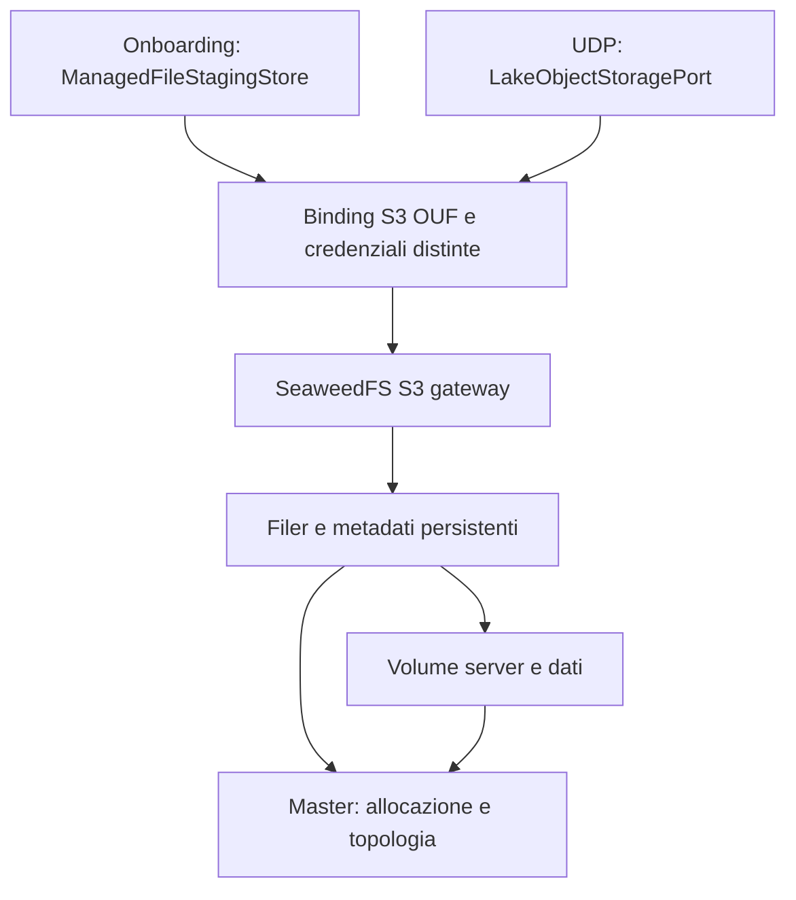

# Checkpoint 3 novembre 2026 — manutenzione AWS SDK e qualifica G1

Il tag SeaweedFS 4.52, commit `984eac6a790be89e2a11de175a7413e1e3e32dd3`, contiene ancora AWS SDK Go v1.55.8. Il grafo Go amd64/CGO disabilitato contiene 55 pacchetti v1 su 1.749. Il tag è la base per una prova di rimozione incrementale. La scelta di una generazione per il target richiede ancora qualifica e ammissione. [Release 4.52](https://github.com/seaweedfs/seaweedfs/releases/tag/4.52).

Il [controllo di ciclo di vita](../scripts/assess-storage-sdk-lifecycle.py) verifica i digest dei metadati e la corrispondenza fra grafo compilato, scansione del binario nell'immagine e SBOM SPDX. Va eseguito sul pacchetto dopo verifica indipendente di byte, provenienza e firma. Uscite 0 per assenza di v1 in tutti e tre gli inventari, 1 per v1 presente, 2 per prova invalida. Il test sull'archivio esatto 4.51 riproduce l'esito HELD e trova v1.55.8 nello scan e nella SBOM. [CI con 8 regressioni](https://github.com/GioNob/ouf-deploy/actions/runs/41576768471).

Due patch di laboratorio sul tag 4.52 sono conservate separatamente. La [prima](../patches/seaweedfs/4.52-listing-remove-sdk-v1.patch) elimina gli import SDK v1 dal listing, mantenendo il valore wire `url` e la rappresentazione dei continuation token. In locale passano 60 casi mirati. La suite completa di `s3api` riporta lo stesso insieme di esiti prima e dopo la patch, con 4.265 eventi PASS e 5 skip. La [seconda](../patches/seaweedfs/4.52-bucket-xml-response-remove-sdk-v1.patch) sostituisce la serializzazione delle risposte di ownership e versioning con `encoding/xml` e rimuove l'import diretto del serializzatore SDK v1 da `s3err`. Mantiene namespace, ordine dei campi, omissione di Status senza configurazione, Content-Type e lunghezza. Il DELETE ownership conserva il corpo vuoto. La prova combinata `s3api` e `s3err` passa in locale con 4.290 eventi PASS e 5 skip. [Workflow per riprodurre le prove](../.github/workflows/storage-sdk-lifecycle.yml).

Il grafo completo conserva 55 pacchetti v1 anche dopo le due patch. Rimangono il parsing delle richieste XML, tipi ACL e multipart, IAM e integrazioni AWS. Sul parser storico è stato misurato, fra l'altro, che elementi Status duplicati usano l'ultimo valore e che XML malformato dopo la chiusura del primo elemento causa un errore. La conversione delle richieste richiede casi espliciti su questi comportamenti per evitare modifiche involontarie del contratto. Go 1.27.3 è stato verificato via SHA256 dal catalogo ufficiale. Le prove qui citate usano sorgente fissato, moduli in sola lettura, CGO disattivato e dipendenze locali durante i test.

La stima MiniPET resta circa 33%, con 8 gate e 21 AT aperti e 0/120 oggetti reali copiati. G1 comprende ancora qualifica di una generazione senza v1, revisione delle licenze, custodia durevole e coorte. Le prove sul grafo e l'esito del controllo di ciclo di vita costituiscono una verifica distinta dall'ammissione dell'immagine.

## Checkpoint precedenti

# Stato corrente — corpus licenze qualificato; G1 ancora aperto

[Licenze, sorgenti e prove](OUF_SEAWEEDFS_LICENCE_EVIDENCE_20261102.md): CI41541625141 e verifica indipendente41542075842 PASS. 245 componenti, 374 testi, 17 archivi sorgente MPL completi; 10 test, 709 checksum nativi e firma del workflow esatto verificati. Corpus completo conservato nel repository. Nessuna modifica a binario, immagine o SBOM originali. Tre UNKNOWN del classificatore di licenze, review degli obblighi, custodia dell'immagine e coorte restano OPEN. Rilevato anche AWS SDK Go v1.55.8 fuori supporto: dipendenza compilata da valutare, senza inventare una CVE o un percorso attivo.

Avanzamento tecnico stimato **circa 33%**, con incertezza di circa 10 punti e metodo nel dossier; non accettazione. Tutti 8 gate / 21 AT / M2 OPEN, copia reale **0/120**. MinIO ancora in esercizio. Teatri/M1 conserva 8/8 tecniche e 6/6 funzionali; stessa Farmacie 61 righe / 10 OPEN / codice ministeriale STRING preservata. Controllo17 e52EngineGET invariati: nessun nuovo effetto target, upload/profiling, grant/reset/replay, merge o release acceptance. Prossimo lavoro pubblico: review dei rilievi licenze/lifecycle, custodia durevole dell'immagine e coorte; restano writer/DB/fence/backup/capacità target da provare.

## Checkpoint precedenti — storico

# Emendamento v1.1 — decisione owner sull'applicabilità, 2 novembre 2026

**Decisione owner recepita — 2 novembre 2026.** `OUF-SW-G1-20261102-01`: GO-2026-5932 classificato `not_affected / vulnerable_code_not_present` per il solo server SHA256 `bb9f768e5afca39c7fdc2113e5caafd9f911d4537917dd25c520ee4dbdab1f74`. Rapporto grezzo conservato: 0HIGH/CRITICAL,1UNKNOWN. Dopo l'unica classificazione accettata: 0HIGH/CRITICAL/UNKNOWN irrisolti nell'insieme di eseguibili esaminato. Nessun ignore aggiunto; gate raw storico invariato. [CI41519037628](https://github.com/GioNob/ouf-deploy/actions/runs/41519037628) PASS: 9 test, advisory ufficiale fresco e provenienza originale autenticata nuovamente;28 sorgenti precedenti intatte. Documento OpenVEX emesso per il solo hash, decisione conversazionale registrata senza rivendicare firma HUMAN/THS. SW-G1 complessivo ancora OPEN per immagine/SBOM/licenze/custody/coorte. Tutti8gate/21AT/M2 OPEN; controllo17 consumato,52DockerGET cumulativi,0 nuovi effetti target. Teatri/M1 8/8tecniche,6/6funzionali e stessaFarmacie preservati.

Il §5 recepisce unicamente la [decisione approvata](OUF_SEAWEEDFS_G1_APPLICABILITY_REVIEW_20261102.md). I restanti requisiti, gate e AT mantengono il proprio stato. Il nome storico del file resta stabile per conservare tutti i riferimenti.

## Stato e checkpoint precedenti

# Stato corrente — 2 novembre 2026, ricevuta17 e core di copia qualificato

1. **SW-WP0 / G0 — inventario e piano privato acquisiti, gate aperto.** Controllo 17 consumato: 4 artifact metadata / 93238 byte letti; 0 nuovi Docker GET, S3, SQL, credenziali o corpi. Totali 17 controlli / 52 Docker GET. Piano privato SHA256 `debed37f949b00f008eae77feecd103c8d4834e105c0d6c727b188e6aafbb501`: 120 record / 203743 byte, tutti PLANNED_NOT_COPIED. 110 hash dichiarati, 10 assenti; 120 corpi reali ancora da verificare.
2. **SW-WP1 / G1 — sicurezza ancora HELD.** Candidato corretto: zero HIGH/CRITICAL, un UNKNOWN grezzo GO-2026-5932. Proposta di applicabilità limitata al binario esatto, non ammessa; nessun ignore o VEX aggiunto. Immagine finale, licenze, custodia durevole e coorte restano da chiudere.
3. **SW-WP2 / G2 e SW-WP6 / G6 — prove sintetiche precedenti conservate.** Adapter originali, TLS, prefissi, versioni/marker, multipart e recovery freddo qualificati in laboratorio; nessuna qualifica della topologia target.
4. **SW-WP4 / G4 — core di copia sintetica qualificato.** Source `99a6d0f00dd1fe490438cef95ce98ee98e7c3ae4`, CI41504703184 PASS; 31 eventi di test passati, inclusi sotto-casi. Due processi SeaweedFS indipendenti sulla stessa VM: 120 corpi sintetici copiati e riletti, CAS concorrente, tre morti reali del processo, 503 dopo salvataggio riconciliato senza secondo PUT. Clock virtuale per Retry-After di un'ora e outage di sei ore. Verifica indipendente byte/sorgenti/firma OUF CI41507064288 PASS; 25 checksum e tutte le 28 sorgenti precedenti invariate. Non è una prova MinIO→SeaweedFS reale.
5. **Passaggio target ancora non ammesso.** Due UNSUPPORTED = publicAccessBlock; non significano assenza. ACL PRESENT/configured0 non prova grant privati. Binding onboarding/udp/udp-evidence-read osservati al14: writer attivi, consumer esterni e DB non provati; snapshot coerente, backup, fence e capacità fresca ancora aperti. Nessun entrypoint di produzione per il core; nessuna nuova operazione VPS dopo17. Cinque vecchi comandi13–17 CONSUMATI: nessun replay, reset o cancellazione. Tutti gli 8 gate / 21 AT / M2 OPEN. Teatri/M1 conserva 8/8 tecniche e 6/6 funzionali, stessa Farmacie preservata. MinIO resta in uso e vulnerabile.

[Core, prove e limiti](OUF_SEAWEEDFS_COPY_CORE_20261102.md) · [Proposta di review SW-G1](OUF_SEAWEEDFS_G1_APPLICABILITY_REVIEW_20261102.md). La proposta richiede una decisione sul criterio vigente, non concede autorità runtime né accettazione degli altri gate.

---

## Checkpoint precedenti — storico, non istruzioni da rieseguire

> **Stato corrente — 2 novembre 2026:** inventario16 acquisito NON ADMITTED:2 bucket/120 record/203743 byte,265 richieste S3;16 controlli/52 GET Docker.110 hash dichiarati/10 assenti;verifica corpi ancora per tutti120.2 risposte feature UNSUPPORTED da classificare dal manifest privato,nessuna assenza/N/A inventata. Quattro vecchi comandi consumati. [Unico nuovo blocco: piano offline qualificato](OUF_SEAWEEDFS_OFFLINE_PLAN_20261102.md), controllo17 NON eseguito:4artifact trattenuti,0 nuovi Docker/S3/SQL/credenziali/corpi,52 GET invariati. Piano privato PLANNED_NOT_COPIED,nessun motore copia o autorità.33 test root/rete isolata e firma/byte indipendenti PASS (CI41488131645/41488523185). Snapshot13/RAM/capacità del14 non rinfrescati,writer/DB ancora da provare. Nessuna migrazione;MinIO vulnerabile,server rawHELD1UNKNOWN,8gate/21AT/M2 OPEN. Teatri/M1 8/8tecniche,6/6funzionali e stessaFarmacie preservati. Storico sotto.

> **Stato corrente — 2 novembre 2026:** ricevuta15 consumata:15 controlli/50 GET Docker,0 file/0 byte credenziali,5 candidati metadata; S3 non raggiunto. Il predicato fallito resta non provato. [Unico nuovo blocco qualificato](OUF_SEAWEEDFS_INPUT_OBSERVATION_20261102.md): controllo16 distinto NON eseguito, max2 GET SOLO MinIO/max52 cumulativi, snapshot14 e SDK invariati. Classifica tutti i candidati prima del contenuto; legge soltanto input dichiarati regolari/bounded/stabili senza symlink, senza cambiare permessi/proprietario e senza ammettere custody della fonte. Casi reali mode0644/UID10001/hardlink e oversize PASS;20 Python/12 Java, CI41446908345 e verifica indipendente41447457400. Tre vecchi comandi consumati: nessun replay/reset/cancellazione. Nessuna migrazione, vulnerabilità MinIO ancora presenti,8 gate/21 AT/M2 OPEN;Teatri/stessaFarmacie preservati. I checkpoint seguenti sono storici.

> **Esecuzione avviata — 2 novembre 2026:** [handoff corrente](handoffs/OUF_SEAWEEDFS_IMPLEMENTATION_20261102.md). L'owner richiede lavoro autonomo secondo questo piano. Scansione upstream1HIGH/3UNKNOWN; build corretta zeroHIGH/CRITICAL,1UNKNOWN con applicabilità da verificare. Nessun gate chiuso o target modificato. La diagnostica isolata e l'ammissione release restano distinte.

# OUF — MiniPET: sostituzione di MinIO con SeaweedFS

**ID:** OUF-MP-STORAGE-SW · **Versione:** 1.1 · **Data:** 2 novembre 2026, Europe/Rome  
**Stato:** piano redatto su richiesta dell'owner; SeaweedFS candidato alla sostituzione, ancora NON qualificato né installato.  
**Owner di prodotto:** Giovanni. **Esecuzione:** agente principale, sequenziale. **Responsabilità operative:** owner dei moduli e operatore della piattaforma, secondo i contratti OUF esistenti.  
**Baseline documentale:** `ouf-deploy@640ae37f5a1c49717e2f4168a928a553bcbfa603`.  
**Relazione con M2:** prerequisito infrastrutturale del [MiniPET CSV M2](OUF_M2_MINIPET_v1_0_20261026.md), senza sostituirne i criteri di accettazione. [Registro del lavoro](../releases/minio-seaweedfs-plan-20261102.json).

## 1. Obiettivo e decisione proposta

Sostituire il backend MinIO non più ammissibile con una generazione SeaweedFS mantenuta, verificata e operabile, preservando tutti i dati, riferimenti applicativi, classificazioni e prove già acquisite. Rendere ripetibile la sostituzione di provider e librerie attraverso contratti, test e procedure di esportazione posseduti da OUF.

La battuta d'arresto ha un costo reale: qualifica, adeguamenti operativi e migrazione. Il lavoro su semantica, onboarding, ingestion e identità UDP resta riusabile. La resilienza richiesta diventa un risultato verificabile: poter cambiare implementazione dello storage senza ricreare sorgenti, rifare il profiling o perdere lineage.

**Strategia proposta:** ambiente SeaweedFS separato → qualifica dei client reali → prova completa di migrazione e ripristino → copia verificata → breve finestra con scritture sospese → cambio coordinato dei binding → osservazione → ritiro governato di MinIO. Nessuna conversione del volume MinIO in-place; un solo backend accetta le scritture OUF in ogni fase.

Questo documento pianifica il cambiamento richiesto. Non dichiara già eseguiti test, scansioni, inventario dei bucket o operazioni sul VPS. Il passaggio sul target richiederà il pacchetto concreto, le prove e l'ammissione runtime previste dai contratti OUF, senza chiedere nuovamente una scelta generica fra AIStor e open source.

## 2. Situazione OUF: ciò che sappiamo e ciò che va ancora misurato

L'analisi usa le ricevute conservate e codice pubblico fissato a commit; non è una nuova ispezione live. È essenziale distinguere il software conservato, le generazioni candidate e il software effettivamente ammesso sul target.

| Area | Evidenza disponibile | Conseguenza per la sostituzione |
|---|---|---|
| MinIO conservato | Manifesto amd64 `a1a8bd4a…`, config `69b2ec20…`; scansione dei byte esatti: 9 CRITICAL, 127 HIGH, 8 UNKNOWN. [Dossier](../evidence/m2-minio-exact-copy-security-readback-20261101.json) | Gate HELD. Sono rilievi ripetibili per componente, non 144 CVE distinti né prova di sfruttabilità sul target. La copia pubblica usata per analisi non autentica il publisher originale. |
| Motivo strutturale | [Decisione storage precedente](decisions/OUF_M2_OBJECT_STORAGE_DIRECTION_20261101.md): fine manutenzione upstream e avvisi ufficiali con correzioni solo AIStor | Un rebuild con Go/base OS aggiornati non basta a sanare i difetti del server. |
| Contratto architetturale | PET Data Lake/UDP §109.4: adapter S3, endpoint/provider come binding ambientali [O1] | La separazione dal prodotto è prevista; va completata anche negli strumenti operativi. |
| Onboarding | Generazione esaminata `73498c17…`: `ManagedFileStagingStore` e implementazione `MinioManagedFileStagingStore`; PUT/GET, CSV fino a 10 MiB, `object://managed-files/<UUID>` [O2] | Conservare interfaccia, riferimenti e limiti. Il client `io.minio` è una dipendenza distinta dal server MinIO. |
| Bootstrap onboarding | Stesso commit: bucket `ouf-managed-files`, principal dedicato, prefisso `managed-files/*`, credenziali da file; amministrazione attraverso `mc admin` [O3] | I comandi amministrativi vanno sostituiti; la sola compatibilità S3 non li rende portabili. Nomi ricavati dal sorgente, da confrontare con binding effettivi. |
| UDP | Generazione `0d40da05…`: `LakeObjectStoragePort`, adapter AWS SDK S3 e configurazione endpoint/region/path-style [O4] | Preservare PUT/HEAD/GET/LIST/DELETE, locator e metadato `ouf-content-hash`. Verificare il reale provider di credenziali. |
| Integrità UDP | L'adapter legge hash e lunghezza da HEAD; non ricalcola in HEAD l'hash del contenuto | La verifica di migrazione deve leggere tutti i byte: copiare un metadato corretto non prova integrità del corpo. |
| Test e recovery | Accettazione UDP legata a localhost:9000; drill PITR e backup fisico costruiti per MinIO [O5] | Parametrizzare i test e rifare il drill con SeaweedFS; non rinominare soltanto il vecchio test. |
| Correzioni sicurezza già acquisite | Candidati Semantic `c2dae77b…` e Gateway `17439fed…` qualificati separatamente; [handoff](handoffs/OUF_M2_STORAGE_SECURITY_DECISION_20261101.md) | Conservare le prove. Non chiamarli già installati; ricomporre la coorte finale e verificare compatibilità. |
| Teatri/M1 | Tecnico 8/8, funzionale 6/6; 26 join, 13 identità, 20 proprietà, 8 Cinema [O6] | Riutilizzare contratti e ricevute. Nessuna terza acquisizione Teatri per dimostrare il cambio storage. |
| Farmacie/M2 | Stesso file/job: 61 righe, 10 campi OPEN, codice ministeriale STRING. M2/G5–G7 e due client aperti | Preservare il lavoro; proseguire il residuo dopo la sostituzione, senza nuovo upload/profiling per aggirare il blocco. |

Il source lock dei candidati non certifica da solo la loro installazione. Il confronto Teatri conserva anche il precedente onboarding V38 `9d19fad3…`: WP0 deve collegare l'esatta generazione installata agli adapter, alle migrazioni e ai binding, senza inferirla dal branch più recente.

**Informazioni non ancora disponibili:** inventario completo di bucket/oggetti/versioni/delete marker; byte totali e crescita; cifratura e chiavi; retention/Object Lock; notifiche, lifecycle, replica, presigned URL e consumer esterni; spazio e memoria liberi; throughput; finestra ammissibile e obiettivi di recovery già contrattualizzati. Non si presume che esistano soltanto i due bucket noti né che siano vuoti. Le 61 righe Farmacie non misurano il volume dello storage.

## 3. SeaweedFS: cosa cambia e come affrontarlo

Release iniziale da valutare: **4.51**, pubblicata il 25 ottobre 2026, commit `153ab668c99731a6d29492bf6c61d0b4fa701101`; licenza del codice Apache 2.0 [S1, S2]. È un riferimento per avviare la qualifica, non un'immagine già ammessa o una garanzia di assenza di vulnerabilità. Prima della costruzione si verificano nuove release e advisory; la versione scelta viene congelata con digest, sorgenti, toolchain e SBOM. La wiki è documentazione corrente e può descrivere funzioni diverse dal tag: decide il comportamento del binario esatto collaudato.

| Differenza | Impatto OUF | Risoluzione e prova richiesta |
|---|---|---|
| Gateway S3 davanti a master, volume server e filer [S3] | Più componenti e stato operativo da proteggere rispetto al semplice cambio container | Profilo esplicito con rete privata, directory persistenti separate, risorse e readiness per ogni ruolo. Il filer mantiene metadati; i volume server mantengono contenuto. |
| Backend del filer [S4] | Nuova scelta di durabilità, backup e dipendenza database | Prima proposta per il singolo VPS: store locale persistente supportato dal tag, candidato `leveldb2`, su volume dedicato. Qualificarne recovery; niente store in memoria. Se serve HA, nuovo dimensionamento e store/topologia coerenti prima dell'ammissione. |
| API S3 ampie ma non identiche [S3] | Le chiamate usate da OUF possono avere differenze di firma, streaming, errori o checksum | Eseguire entrambi i client reali con SigV4, TLS, path-style/region espliciti, multipart e checksum. Mai disabilitare controlli TLS o integrità per ottenere un PASS. |
| Chiavi con semantica di directory [S3] | Coesistenza `a` e `a/b`, chiavi con slash finale e cancellazioni di prefisso possono differire | Inventario preventivo e test distruttivi soltanto su fixture. Nessuna riscrittura silenziosa di chiavi. Collisione reale: gate bloccato; eventuale mapping versionato e resolver compatibile da progettare e collaudare prima della copia. |
| IAM e amministrazione | `mc admin`, variabili root MinIO, console e health endpoint non sono contratti S3 | Nuovo provisioner SeaweedFS con API amministrative supportate dal tag; revisione di utenti/policy e nuove credenziali. Probe S3 autenticata più controlli di ruolo, senza riusare `/minio/health/*`. |
| Policy S3 e grant SeaweedFS [S6] | Traduzione sintattica non garantisce isolamento equivalente | Riprodurre permessi minimi di staging; verificare dinieghi fuori prefisso, su UDP e operazioni admin. Provare effetto combinato di identity policy, bucket policy e grant nativi; niente permessi globali per compensare incompatibilità. |
| Versioning e lifecycle [S7] | Version ID, ordinamento e gestione delle versioni non sono automaticamente trasferibili | Inventariare funzioni realmente usate. Copiare versioni e marker quando presenti, conservando mapping e timestamp originali nel manifest. Nessuna attivazione opportunistica del versioning: può cambiare purge e retention UDP. |
| ETag, Last-Modified e VersionId | Possono cambiare dopo un PUT sul nuovo backend | SHA-256 dei byte e riferimenti OUF restano invarianti; conservare gli attributi originali come evidenza. Se un consumer richiede un VersionId preesistente, serve traduzione verificata o STOP. |
| Cifratura e retention | Il supporto dichiarato non prova equivalenza di chiavi, rotazione, legal hold o permessi | Verificare il profilo OSS esatto. Trasferire tramite canale protetto, ricifrare secondo policy destinazione; conservare accesso alle chiavi dei backup. Retention non accorciata; legal hold ricreato e verificato prima di rilasciare la copia. |
| Backup [S5] | Il solo backup dei volume server non ricostruisce il namespace | Backup coerente di metadati filer, dati, configurazione/IAM e riferimenti ai segreti; recupero coordinato con PostgreSQL/lineage OUF. Prova su ambiente vuoto. |
| Monitoraggio e capacità | Metriche, startup, spazio per volumi e tempi cambiano | Dashboard/errori S3, backlog, spazio, salute filer/volume/master, scadenze TLS, ultimo backup ripristinato. Misurare RSS/CPU/IO e interferenza con OUF prima del canary target. |

Le differenze di cifratura dichiarate nella tabella S3 [S3] non implicano che OUF usi già SSE né che una particolare configurazione KMS sia qualificata. Le limitazioni versioning/lifecycle documentate [S7] si trattano come requisiti da verificare; non si elimina una funzione necessaria per far passare la migrazione.

### Architettura proposta

È una vista delle responsabilità, non l'elenco completo dei flussi di rete. Si qualificano endpoint e TLS/mTLS effettivi della release. Master, filer, volume e amministrazione non sono esposti ai client o a Internet; anche un accesso diretto al filer deve essere negato a chi possiede soltanto credenziali S3 [S8].

Per il laboratorio si può usare un processo aggregato. Il profilo target proposto separa i ruoli in container per diagnosi e ciclo di vita, sul VPS solo se le risorse lo consentono. Più container sullo stesso host **non danno HA**. La protezione dalla perdita del VPS richiede backup esterno verificato; una futura HA richiederà domini di guasto indipendenti e quorum/replica dimensionati, non semplicemente copie sul medesimo disco. Nessuna nuova piattaforma Kubernetes è prerequisito di questo MiniPET.

## 4. Adeguamenti applicativi e operativi

### Onboarding e scelta della libreria

Prima eseguire l'attuale `MinioManagedFileStagingStore` contro SeaweedFS. Se supera compatibilità e sicurezza della propria catena di dipendenze, può restare temporaneamente dietro `ManagedFileStagingStore`: sostituire il server non impone di sostituire insieme il client.

La destinazione architetturale proposta è un adapter dal nome neutro e dipendenze controllate. Se il client MinIO non è mantenibile, fallisce la compatibilità o allarga inutilmente la superficie delle dipendenze, implementare `S3ManagedFileStagingStore` con AWS SDK v2, già usato da UDP, in una modifica separata e misurata. Non duplicare una seconda pipeline di staging. Conservare esattamente validazione CSV, limite 10 MiB, URI `object://`, errori pubblici e gestione protetta delle credenziali. La ripresa di una richiesta non deve creare ulteriori file/job: riusare il riferimento durevole e l'idempotenza dell'owner; l'adapter attuale genera un UUID a ogni nuovo PUT.

La libreria comune è una possibilità, non un nuovo framework obbligatorio: preservare le due porte di dominio, definire un contratto minimo S3 condiviso e una suite riusabile. Le classi dei vendor non devono entrare in DTO pubblici, database o logica semantica.

### UDP, ingestion, Gateway e MCP

UDP mantiene `LakeObjectStoragePort`. Verificare `ouf.udp.lake.s3.{bucket,endpoint,region,path-style}` e la catena `DefaultCredentialsProvider`: nel profilo governato deve risolvere l'identità prevista, senza fallback involontario ad altre credenziali ambientali. Provare inventario oltre 1.000 oggetti e token di continuazione, 403/404/5xx, delete preciso, read-after-write e purge.

Ingestion non viene assunto privo di dipendenze indirette: WP0 cerca in tutti i consumer locator, URL MinIO, presigned URL, notifiche e accessi diretti. Le modifiche necessarie restano nel confine storage. Chatbot → MCP → Gateway → owner mantiene capability, autorizzazioni e ricevute; nessuna credenziale storage viene resa al chatbot. Semantic Registry e OntoPiA mantengono i loro contratti.

### Installazione, supply chain e recovery

Nel deploy si producono nuovi profili, provisioner, probe, policy e runbook; i vecchi script congelati restano testimonianza storica e non vengono modificati per trasformarli in comandi SeaweedFS. Gli strumenti di copia non devono dipendere dal vecchio `mc` vulnerabile. Se si adotta un tool S3 mantenuto, si verificano versione, digest, dipendenze e comportamento su metadati/versioni; un semplice `sync` non è prova di migrazione completa.

Il drill `pitr-minio-restore-drill.sh` costituisce esperienza da riusare: ripristino PostgreSQL, recupero oggetti, riconciliazione. Il nuovo drill deve aggiungere il filer e ricalcolare gli hash dai corpi, non limitarsi a leggere `ouf-content-hash`. Prima si prova il recovery dell'intero insieme; successivamente si qualifica il cambio provider.

## 5. Piano di lavoro e gate

Tutti i gate **SW-G0…SW-G7 sono OPEN** alla redazione. Le ore sono intervalli preliminari di lavoro tecnico sequenziale, non promesse di calendario; includono preparazione e analisi delle prove, non attese operative o durata delle copie reali.

| WP / gate | Attività e consegna concreta | Condizione di uscita | Stima iniziale |
|---|---|---|---:|
| SW-WP0 / G0 — baseline | Inventario contratti e consumer; pacchetto unico per inventario privato target, capacità, funzionalità, DB e writer; rapporto pubblico redatto | Inventario completo riconciliato, generazioni distinte, funzionalità richieste e finestra/RPO/RTO espliciti | 4–8 h |
| SW-WP1 / G1 — candidato | Sorgente/release/immagine esatti, licenze, SBOM, provenienza, scansione OS/Go e tool/client; retention degli artifact in custodia durevole | Zero CRITICAL/HIGH/UNKNOWN irrisolti secondo gate vigente, provenienza verificabile; unica classificazione accettata GO-2026-5932/binario bb9f768e secondo decisione OUF-SW-G1-20261102-01; raw conservato, nessun ignore aggiunto per passare | 6–12 h |
| SW-WP2 / G2 — contratti | Laboratorio isolato, due client reali, policy minime, suite parametrica; eventuale patch adapter separata | Tutti AT applicabili della matrice storage PASS con log; nessuna differenza funzionale aperta | 8–16 h |
| SW-WP3 / G3 — esercizio | Profilo persistente, backup completo, TLS/secret rotation, fault/reboot, restore su ambiente vuoto e prova di ritorno | Recovery e prestazioni entro obiettivi; dati e DB coerenti; spazio sufficiente misurato | 8–16 h |
| SW-WP4 / G4 — migrazione provata | Migratore idempotente con manifest/checkpoint, rehearsal su copie, prova delta e crash nei punti di transizione | 100% byte/metadati/referenze riconciliati, versioni/marker coperti se presenti; ripresa senza duplicati | 8–16 h |
| SW-WP5 / G5 — pacchetto target | Coorte esatta, binding, custody, backup, piano di fermo, rollback/hold, review e autorità correnti | Consegna unica pronta ed ammessa; nessuna dipendenza da authority consumata | 4–8 h |
| SW-WP6 / G6 — passaggio | Copia iniziale autorizzata, pausa writer, delta finale, verifica, switch coordinato, smoke e riapertura | Unico writer, nessuna perdita, percorso reale leggibile e ricevute target verificabili | 4–8 h + trasferimento |
| SW-WP7 / G7 — stabilizzazione | Osservazione, restart governato, recupero backup, ritiro credenziali/accessi MinIO, decisione sulla conservazione | Finestra osservativa superata e manutenzione documentata; accettazione storage distinta da M2 | 4–8 h + osservazione |

**Ordine di grandezza:** 46–92 ore tecniche, con riserva di pianificazione del 30% (circa 60–120 ore). Non è un consuntivo né una ristima dell'intero M2. L'eventuale migrazione di versioni/lock complessi, un requisito HA o difetti upstream possono richiedere un nuovo perimetro. Prima ristima vincolante dopo G0–G2; niente data di fine credibile prima di avere dimensioni e throughput.

Percorso critico: G0 → G1 → G2 → G3 → G4 → G5 → G6 → G7. Nessun subagente o automazione operativa. Il lavoro pubblico su codice, dossier e laboratorio procede autonomamente; l'intervento operatore è concentrato dove i byte privati o l'autorità target sono indispensabili.

## 6. Migrazione dati: procedura da implementare e provare

1. **Inventario e punti di consistenza.** Elencare tutti i bucket, le chiavi, le versioni e i marker; censire tutti i writer, inclusi manutenzione, purge, compaction, scheduler, backup con effetti e tool amministrativi. Collegare DB, job e locator. Conservare in area privata nomi, contenuti, policy e manifest dettagliati; in Git solo schema, conteggi, digest di evidenza e risultati redatti.
2. **Backup recuperabile.** Conservare gli originali MinIO con una procedura coerente già verificata e un punto PostgreSQL compatibile. Non copiare a caldo un volume senza garanzia di consistenza. Provare recupero in ambiente isolato, senza ammettere il vecchio server vulnerabile come nuovo servizio di produzione.
3. **Destinazione indipendente.** Creare bucket e policy SeaweedFS, credenziali runtime distinte da quelle del migratore, TLS, retention e cifratura. Nessun container SeaweedFS monta il volume MinIO. Nessuna cache o tier remota che continui a dipendere da MinIO dopo il cambio.
4. **Copia iniziale.** Lettura API S3 dalla sorgente e PUT sulla destinazione; `CopyObject` interno a un endpoint non copia automaticamente fra due server. Calcolare SHA-256 durante la lettura; rileggere la destinazione e ricalcolarlo. Metadati, Content-Type e tag vengono preservati e verificati. Per oggetti mutabili, usare versioni o condizioni supportate e ripetere sotto fermo: una LIST mentre si scrive non è uno snapshot.
5. **Manifest e ripresa.** Una voce per bucket/key/versione con dimensione, hash dei byte, hash dei metadati rilevanti, attributi originali, identificativo destinazione, stato e tentativo. Checkpoint durevoli dopo verifica. Ripresa confronta destinazione e manifest; una discordanza ferma la voce e il gate, senza sovrascriverla alla cieca. Un crash dopo PUT prima del checkpoint deve essere riconciliato anche sui bucket versionati, senza generare una seconda versione equivalente. Multipart incompleti rimangono tracciati e vengono bonificati entro budget.
6. **Versioni e riferimenti.** Copiare storia e marker secondo ordine verificato quando richiesti. Last-Modified e VersionId originali restano nel manifest; mapparli se referenziati. Mantenere bucket/key e `object://managed-files/<UUID>` ove compatibili. Una migrazione fisica non crea una nuova revisione semantica, un nuovo onboarding o una nuova acquisizione. Qualsiasi remapping necessario diventa una migrazione esplicita con compatibilità in lettura, mai un semplice rename.
7. **Fermo e delta finale.** Bloccare nuovi ingressi e claim dei writer, drenare oppure sospendere durevolmente quelli in corso; fence di tutte le generazioni writer e scadenza dei lease secondo contratti. Verificare assenza di scritture. Rileggere l'inventario completo, inclusi overwrite e delete avvenuti dopo la copia iniziale. Non usare soltanto Last-Modified come criterio delta. Applicare marker/cancellazioni soltanto sulla destinazione di migrazione, con manifest approvato; non cancellare la sorgente.
8. **Riconciliazione prima dello switch.** Uguaglianza degli insiemi previsti, numero e byte per categoria, 100% hash corpo, metadati/retention e riferimenti DB risolvibili. Nessun missing, mismatch o oggetto extra inspiegato; quarantena di anomalie senza scarto. Per staging senza hash preesistente, crearne uno nell'evidenza di migrazione, senza inventare metadati storici.
9. **Cambio coordinato.** Con writer ancora sospesi, applicare i nuovi binding a tutti i consumer; invalidare pool/connessioni e vecchie configurazioni secondo il ciclo di vita previsto. Verificare identità destinatario, letture dei casi conservati e prove tecniche in namespace dedicato. Riaprire i writer solo quando tutti vedono la medesima generazione. Nessun bilanciamento casuale fra MinIO e SeaweedFS.
10. **Osservazione e ritiro.** Confrontare stato applicativo, nuovi oggetti, backlog, errori, backup e audit. Revocare accessi operativi al vecchio endpoint; custodire gli originali in forma non servita, con scadenza di retention da approvare. Cancellazione dei dati MinIO soltanto dopo accettazione, restore dimostrato e chiusura della finestra di ritorno.

**Spazio e tempi:** misurare `B` byte/versioni da migrare, `D` delta e throughput effettivo `R` nel rehearsal. Il tempo comprende trasferimento e rilettura integrale, oltre a latenza per molti piccoli oggetti; non stimarlo dal solo bandwidth teorico. Richiedere spazio per originale + nuova copia + backup indipendente + metadati/versioni/staging + margine operativo misurato. Il fermo comprende drain, delta, verifica residua, cambio binding e smoke: non promettere zero downtime.

**Effetti collaterali della copia:** la destinazione di migrazione non alimenta ingestion, notifiche o consumer produttivi prima dello switch. Eventuali notifiche vengono ricreate con deduplicazione e ripresa dal punto concordato, non riprodotte come nuove acquisizioni. Lifecycle, purge e compaction rimangono sospesi nel perimetro della copia fino alla riconciliazione; le scadenze applicative originali restano nel catalogo. Un nuovo Last-Modified non deve prolungare o anticipare implicitamente retention e cancellazioni. Ogni regola basata sull'età viene tradotta e provata prima della riattivazione.

## 7. Ritorno e gestione dell'insuccesso

| Momento del problema | Risposta prevista | Dati da conservare |
|---|---|---|
| Prima del cambio binding | Fermare la qualifica/copia; sorgente immutata. Bonificare solo fixture con procedura prevista | Manifest e diagnosi, copia parziale, backup |
| Dopo cambio, prima della riapertura writer | Mantenere la manutenzione; ripristinare profilo precedente solo se ammissibile, oppure correggere/ripristinare SeaweedFS | Binding precedente e nuovo, fence, stato DB e punto di recupero |
| Dopo nuove scritture SeaweedFS | Sospendere tutti i writer; inventariare nuovi oggetti, overwrite, delete e transazioni DB; ripristino avanti o migrazione inversa verificata | Tutte le scritture riconosciute, versioni, marker, lineage e audit |
| Vecchio MinIO non ammissibile per sicurezza | Restare in stato controllato e recuperare verso un backend qualificato; nessun ritorno automatico al servizio vulnerabile | Originali offline, backup e nuovo delta |

Il rollback dopo nuove scritture non è un cambio DNS/endpoint. Un ritorno a un backup DB precedente può perdere operazioni già riconosciute: è vietato senza riconciliazione completa. Se non si prova la conservazione, la risposta è STOP con dati custoditi, non il riavvio opportunistico di MinIO.

Obiettivo proposto per il cambio pianificato: **RPO = 0 sulle scritture già confermate**. RTO di migrazione e RPO/RTO di disaster recovery devono ereditare i requisiti OUF e ricevere valori numerici prima di G3/G5; non sono attestati qui. Finestra osservativa proposta: almeno 48 ore, includendo un ciclo di backup con restore e un ciclo di manutenzione previsto; estenderla se il carico reale o la periodicità non coprono i casi.

## 8. Matrice di accettazione storage

Ogni AT richiede input, versione esatta, risultato atteso, risultato osservato e ricevuta. Stato iniziale di tutti: **OPEN**. Una prova di laboratorio non sostituisce il corrispondente riscontro target. N/A consentito soltanto con inventario e motivazione espliciti per funzioni non usate né richieste.

| AT | Prova | Criterio di PASS |
|---|---|---|
| SW-AT01 | Provenienza e vulnerabilità | Byte esatti, SBOM e publisher verificati; gate HIGH/CRITICAL/UNKNOWN superato per server, client e tool di migrazione |
| SW-AT02 | Staging reale | CSV valido, limite 10 MiB e oltre limite; PUT/GET col client reale, stesso URI e byte; rifiuti invariati |
| SW-AT03 | UDP reale | PUT/HEAD/GET/LIST/DELETE e `ouf-content-hash`; hash ricalcolato dai byte e stato catalogo coerenti |
| SW-AT04 | Multipart e streaming | Più parti, retry, interruzione, abort e cleanup; nessun oggetto parziale pubblicato |
| SW-AT05 | Paginazione | Oltre 1.000 oggetti, più pagine, chiavi Unicode/escape; nessuna omissione, duplicazione o loop |
| SW-AT06 | Namespace e delete | `a`, `a/b`, slash finale e prefissi simili su fixture; nessuna cancellazione fuori insieme; collisioni reali risolte prima della copia |
| SW-AT07 | Policy positive e negative | Staging limitato al prefisso; accesso a UDP/admin e anonimo negati; isolamento tenant secondo contratto |
| SW-AT08 | Rete e segreti | Accessi laterali filer/volume/admin negati, TLS e firma invalidi rifiutati, rotazione provata, nessun segreto nei log |
| SW-AT09 | Metadati e caratteristiche | Content-Type, hash, tag; versioni, marker, retention/hold/cifratura/notifiche/presigned se richiesti preservati funzionalmente |
| SW-AT10 | Consistenza e concorrenza | PUT→HEAD/GET/LIST, overwrite e retry concorrenti conformi ai contratti; nessuna perdita riconosciuta |
| SW-AT11 | Errori e budget | 403/404/5xx/timeout/disco pieno producono esiti distinti, retry finiti e ripresa durevole; nessun falso successo |
| SW-AT12 | Restart e perdita componente | Restart gateway/filer/volume/master e reboot isolato; job recuperabili, dati e metadati persistenti |
| SW-AT13 | Restore completo | Ambiente vuoto, dati+filer+config+chiavi+DB compatibili; verifica integrale dei corpi e riconciliazione senza findings |
| SW-AT14 | Migrazione interrotta | Arresto prima/dopo PUT e prima/dopo checkpoint; ripresa idempotente anche versionata, zero oggetti/versioni extra inspiegati |
| SW-AT15 | Delta e fence | Scrittura/overwrite/delete durante precopia rilevati; fermo di tutti i writer, un solo backend attivo |
| SW-AT16 | Parità integrale | 100% oggetti/versioni richiesti e riferimenti confrontati, zero missing/mismatch; conteggi e byte coerenti |
| SW-AT17 | Ritorno dopo scritture | Nuova scrittura, overwrite e delete sul candidato; ripristino avanti/inverso provato senza perdita o divergenza DB |
| SW-AT18 | Teatri e Farmacie conservate | Letture governate dei riferimenti esistenti, stessi ID/hash/lineage; nessuna nuova acquisizione o profiling per il test storage |
| SW-AT19 | Percorso utenti | Due client previsti da M2 via chatbot/MCP/Gateway; operatività ordinaria senza accesso manuale a S3 né grant ad hoc |
| SW-AT20 | Capacità e prestazioni | Carico rappresentativo, risorse e latenze entro budget fissati a G0; nessuna regressione non accettata sugli altri moduli |
| SW-AT21 | Manutenzione e uscita | Aggiornamento patch e restore provati; export indipendente da SeaweedFS leggibile con client S3 neutro |

Il passaggio storage non chiude automaticamente M2: restano i 61 esiti UDP Farmacie, ripetibilità/fault e tutti gli AT/UX/G5–G7 previsti dal MiniPET padre. Riutilizzare le prove pertinenti, non promuovere il resto a PASS.

## 9. Rischi, decisioni residue e criteri di arresto

| Rischio | Trattamento | Arresto obbligatorio |
|---|---|---|
| Nuovo prodotto con vulnerabilità o provenienza incompleta | Qualifica prima dei dati; nuove patch come candidati distinti | Gate sicurezza o publisher non superato |
| Differenze S3 e librerie | Contratti reali e test negativi, patch limitata agli adapter | Funzione necessaria non preservabile |
| Dati non censiti o consumer nascosti | Inventario di tutti i bucket/writer e riferimenti | Inventario non riconciliabile o credenziali/binding ignoti |
| Backup incompleto | Restore coordinato su ambiente vuoto | Hash mancanti, namespace perso, chiavi indisponibili |
| Spazio insufficiente sul VPS | Misure e destinazione separata se necessaria | Capacità/margine non adeguati, degrado OUF |
| Doppie scritture o lease residui | Fence unico e verifica prima del cambio | Writer non sospeso o configurazione mista |
| Ritorno con perdita o vulnerabilità | Hold e recupero avanti; rollback condizionato | Impossibile preservare scritture confermate |
| Tempi sottostimati | Rehearsal e ristima G0–G2 | Finestra richiesta superiore a quella ammessa |

Decisioni da concretizzare con dati: store filer e topologia; cifratura/retention richieste; credenziali; capacità; finestra; RPO/RTO; durata custodia originali; eventuale sostituzione della libreria onboarding. L'agente risolve le scelte reversibili usando evidenze e requisiti esistenti. Porta all'owner soltanto i tradeoff non deducibili o l'approvazione runtime realmente necessaria, con consegna completa e verificabile.

## 10. Resilienza permanente di OUF

Il risultato duraturo comprende un **profilo storage portabile**: operazioni S3 effettivamente necessarie, semantiche richieste, configurazione validata, policy minime, limiti, errori e budget, schema export e test di recovery. Questo profilo appartiene a OUF e non al vendor.

Ogni aggiornamento server o libreria deve poter essere provato con la medesima suite di contratto su un candidato isolato. Registrare digest/BOM e scadenza delle prove; conservare gli artifact necessari oltre la retention temporanea della CI. Prevedere nel processo di manutenzione controllo degli advisory e dello stato del progetto, prove periodiche di restore ed export, senza attivare qui nuove automazioni.

Nessun errore del provider deve costringere l'utente a ricaricare il file: il sistema espone stato, causa comprensibile e riferimento del job conservato, poi riprende attraverso l'owner. Per future librerie vale lo stesso confine: porte di dominio stabili, serializzazioni e tipi invariati, aggiornamenti con prova di compatibilità e percorso di ritorno. Non si impone una libreria comune a tutti i moduli se aumenta l'accoppiamento.

## 11. Governance, consegne e prossima azione

Sono prodotti previsti, ancora da realizzare: profilo storage OUF, lock del candidato e dossier sicurezza, ambiente isolato riproducibile, suite contratti, provisioner, migratore con manifest, drill restore/ritorno, runbook di cutover, pacchetto target e dossier di accettazione. Ogni deliverable distingue prova statica, test reale isolato e osservazione target.

Restano invariati scope12 consumato, 12 controlli/35 GET e tutti i cinque insiemi di pin congelati 235/19/17/21/23. Non rilanciare comandi storici, rinnovare authority o resettare budget. Questo piano non altera package membership, custody, policy, bearer, review, HUMAN/dual-role o accettazione release. La sostituzione richiede una nuova generazione di profilo/coorte; il vecchio ruolo MinIO non diventa SeaweedFS per rinomina.

**Prossima azione tecnica prevista:** SW-WP0 e preparazione SW-WP1 con codice/evidenze pubbliche; preparare insieme inventario e precondizioni target, senza chiedere una nuova microdiagnostica. Solo dopo G0–G4 si presenta la consegna operativa completa per G5. Non esiste ancora un comando di migrazione pronto da eseguire.

## 12. Fonti e tracciabilità

Fonti consultate il 2 novembre 2026. Gli URL ai sorgenti OUF e al tag SeaweedFS sono fissati; le pagine wiki sono dichiarazioni upstream correnti, non prove sul target.

- **O1:** [PET Data Lake/UDP, §109.4](baseline/v1.7/text/OUF_PET_Data_Lake_UDP_Urban_Object_Registry_v1_3_Development_Ready.txt); [source lock dei candidati](../releases/m2-current-core-source-lock-20261101.json).
- **O2:** [Onboarding adapter, commit73498](https://github.com/GioNob/ouf-source-onboarding/blob/73498c17596ae155a3ed9ab36acfd6bb69da9846/src/main/java/it/comune/trieste/ouf/onboarding/application/MinioManagedFileStagingStore.java).
- **O3:** [Bootstrap MinIO e policy](https://github.com/GioNob/ouf-source-onboarding/blob/73498c17596ae155a3ed9ab36acfd6bb69da9846/scripts/r4a_minio_staging_bootstrap.py), [preflight](https://github.com/GioNob/ouf-source-onboarding/blob/73498c17596ae155a3ed9ab36acfd6bb69da9846/scripts/r4a_minio_staging_preflight.py).
- **O4:** [UDP adapter](https://github.com/GioNob/ouf-udp-object-resolution/blob/0d40da05408a14db31d4d41af2372d6a71480291/src/main/java/it/comune/trieste/ouf/udp/S3LakeObjectStorageAdapter.java), [configurazione](https://github.com/GioNob/ouf-udp-object-resolution/blob/0d40da05408a14db31d4d41af2372d6a71480291/src/main/java/it/comune/trieste/ouf/udp/S3LakeConfiguration.java), [porta](https://github.com/GioNob/ouf-udp-object-resolution/blob/0d40da05408a14db31d4d41af2372d6a71480291/src/main/java/it/comune/trieste/ouf/udp/LakeObjectStoragePort.java).
- **O5:** [Test accettazione UDP](https://github.com/GioNob/ouf-udp-object-resolution/blob/0d40da05408a14db31d4d41af2372d6a71480291/src/test/java/it/comune/trieste/ouf/udp/MinioLakeAcceptanceTest.java), [drill PITR MinIO](https://github.com/GioNob/ouf-udp-object-resolution/blob/0d40da05408a14db31d4d41af2372d6a71480291/scripts/ci/pitr-minio-restore-drill.sh).
- **O6:** [M1 completato](handoffs/OUF_M1_COMPLETED_20261026.md), [riuso contratti Teatri](handoffs/OUF_M2_TEATRI_COMPATIBILITY_20261031.md), [audit M2](OUF_M2_CODE_EVIDENCE_GAP_AUDIT_20261026.md).
- **S1:** [SeaweedFS release4.51](https://github.com/seaweedfs/seaweedfs/releases/tag/4.51), [commit](https://github.com/seaweedfs/seaweedfs/commit/153ab668c99731a6d29492bf6c61d0b4fa701101).
- **S2:** [Licenza al tag4.51](https://github.com/seaweedfs/seaweedfs/blob/4.51/LICENSE).
- **S3:** [S3 API: architettura, operazioni e differenze](https://github.com/seaweedfs/seaweedfs/wiki/Amazon-S3-API).
- **S4:** [Store dei metadati filer](https://github.com/seaweedfs/seaweedfs/wiki/Filer-Stores).
- **S5:** [Backup di dati e metadati](https://github.com/seaweedfs/seaweedfs/wiki/Data-Backup).
- **S6:** [Bucket policy](https://github.com/seaweedfs/seaweedfs/wiki/S3-Bucket-Policies).
- **S7:** [Versioning e limitazioni](https://github.com/seaweedfs/seaweedfs/wiki/S3-Object-Versioning).
- **S8:** [Configurazione sicurezza](https://github.com/seaweedfs/seaweedfs/wiki/Security-Configuration).

## Registro di esecuzione — 2 novembre 2026

Avviati WP0/WP1/WP2 e qualifica recovery, senza effetti sul target. Source6cddeee7/CI41391421536:24test Python,7Go e12Java PASS; originali adapter OUF, HTTPS/policy con dinieghi, versioni/marker, Unicode e multipart, copia fredda indipendente dati+filer con rehash fixture. Inventario1010record sintetici e credenziali anonime sigillate, esito parziale esplicito su diniego. Firma/provenienza/source/checksum verificati da CI41391892653; tutti21file pubblicati confrontati con artefatto attestato da CI41392147761.

Il rawgate SeaweedFS resta HELD1UNKNOWN, OpenPGP assente dal grafo compilato: diagnostica sintetica consentita, produzione non ammessa. Nessuna vulnerabilità HIGH/CRITICAL nella build corretta; il reader distinto ha scan zero findings. Non confondere questi risultati con la rimozione delle vulnerabilità dall'installazione corrente, ancora invariata.

[Consegna unica inventario privato VPS](OUF_SEAWEEDFS_PRIVATE_BASELINE_20261102.md) pronta e qualificata; necessaria esecuzione owner perché shell/API inventory assenti all'agente. Tutti8gate e21AT restano OPEN fino alle evidenze richieste, incluse quelle reali. Nessun deploy, migrazione o cutover. [Registro aggiornato](../releases/minio-seaweedfs-plan-20261102.json), [handoff](handoffs/OUF_SEAWEEDFS_IMPLEMENTATION_20261102.md).

## Correzione dell'inventario — 2 novembre 2026

L'esecuzione operatore ha consumato il controllo13/36GET cumulativi con STOP al filtro di nomi `/ouf-`; nessun inspect/S3/credenziale ancora raggiunto secondo il call site qualificato. Questa è una deduzione dal codice, non un contatore S3 target. Il vecchio scope resta intatto e non ripetibile. Correzione sourcef5341294/CI41406925881 qualificata: roster13ID e seed privato già verificati,13GET diretti senza elenco; Docker reale con nomi diversi, namespace/S3 reali,10test Python e12Java PASS. Storico13scope MODELLATO in fixture; non è osservazione VPS. Stesso SDK installato SHA430631fe riscan zero, capsula24con23sorgenti storiche invariate. CI41407543627 verifica firma esatta e byte/sorgenti/pubblicazione/launcher.

[Consegna correttiva](OUF_SEAWEEDFS_INVENTORY_RECONCILIATION_20261102.md) pronta per una sola esecuzione owner necessaria per assenza shell/API inventory all'agente: controllo14 distinto NON ancora eseguito, max13GET nuovi/fino49cumulativi, zero corpi/S3write/SQL/lifecycle. Non è replay, reset o migrazione; tutti8gate e21AT OPEN. [Dossier](../evidence/seaweedfs-inventory-reconciliation-qualified-20261102.json).

## Continuazione sulle credenziali — 2 novembre 2026

Ricevuta14: STOP_RECONCILE/CANONICAL_PRIVATE_CREDENTIAL_REFERENCE_REQUIRED dopo13inspect riusciti,14controlli/49GET cumulativi. Snapshot container/RAM/spazio già conservato; S3 non raggiunto. Non è provato se siano state completate0o1risoluzioni credenziali; Config.Env era già inRAM negliinspect. Il reader assumeva riferimenti assoluti e non replicava il ripiego ENV dei file relativi mancanti. Nuova implementazione dal riferimento MinIO07c3a429, senza shell/defaultcreds o allentamento di filetype/owner/privacy/traversal/symlink. Source6447b0f6/CI41429406938:28Python/12Java, due casi Docker reali,1010record sintetici per caso, dueGET nuovi; ordine mount variato, valori/diritti e contratti runtime congelati preservati. Storico MODELLATO/MinIOwaiter hostnet, nonVPS. SDK430631fe identico riscan zero;26sorgenti con tutte24precedenti invariate, nuovo limite solo-loader294912byte/payload279063 esplicito. CI41430471681 verifica18checksum,sorgenti, firma e byte pubblicati/launcher.

[Nuova consegna](OUF_SEAWEEDFS_CREDENTIAL_CONTINUATION_20261102.md) pronta per una sola esecuzione owner necessaria per assenza shell/API inventory VPS all'agente. Scope15 separato ancora NON eseguito: massimo2GET MinIO/fino51cumulativi, riusa14snapshot senza ripetere13scan; altre12configurazioni non rinfrescate e RAM/spazio datati al14. Tutti8gate e21AT restano OPEN, nessuna migrazione, nessun replay/reset/grant. [Dossier](../evidence/seaweedfs-credential-continuation-qualified-20261102.json).
