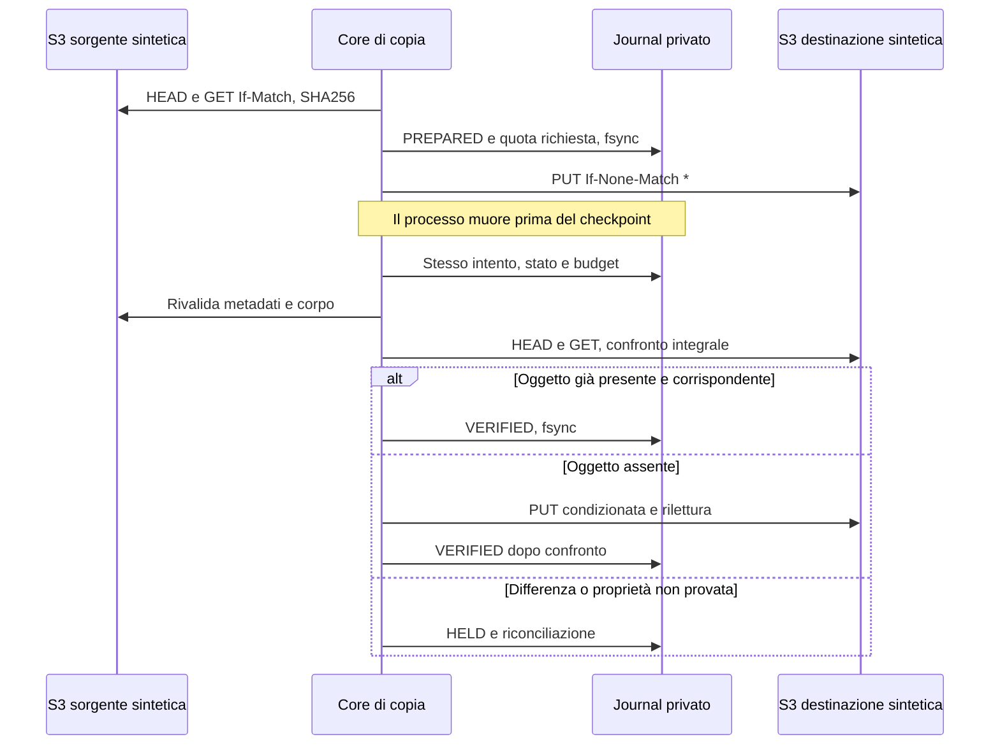

# SeaweedFS — core di copia sintetica con checkpoint e verifica

2 novembre 2026. Core qualificato esclusivamente in laboratorio in `tools/storage_copy`. Non esiste un entrypoint operativo per il VPS. Il binario `.test` viene eseguito soltanto nelle fixture CI su loopback TLS, con server e credenziali sintetici. Nessuna copia dei dati OUF è avviata.

## Risultato e perimetro

Il core legge un insieme dichiarato di bucket/chiavi non versionate, verifica i metadati contro il piano, esegue GET condizionate all'ETag, calcola SHA-256 sui corpi e mantiene gli hash dichiarati come confronto aggiuntivo. Un hash mancante non viene inventato nei metadati originali. PUT sul secondo server con If-None-Match:*; rilettura completa e confronto di corpo, header rilevanti, metadata e tag prima del checkpoint VERIFIED.

I due server sintetici hanno processi e directory dati/filer separati sulla stessa VM. Non è qualifica multi-host, topologia VPS o trasporto reale MinIO→SeaweedFS. La prova usa il reader SDK originale e il compilatore privato già qualificati per creare il piano di120record/203743byte con10hash mancanti. I dati sono generati, non una copia o un campione degli oggetti privati.

## Interruzione e ripresa

Il file lock è esclusivo e non bloccante. Journal append-only privati0600 in directory0700, catena hash e fsync prima degli effetti. Un journal parziale, alterato, non privato o uno scope preesistente senza stato non viene reinizializzato. La quota HTTP è riservata durevolmente prima di ogni tentativo, incluso quello che fallisce; non riparte da zero al riavvio. Un risultato VERIFIED già concluso viene restituito come ALREADY_VERIFIED_NOT_RERUN: è deduplicazione della ricevuta originaria, non nuova prova di stato corrente.

Errori esplicitamente transitori producono PAUSED con NextAt persistito; nessuna sleep o retry SDK nascosto. Ritardi5/15/60/300/900secondi con jitter fino20%, rispettando Retry-After.128tentativi e24ore cumulative,10000richieste riservate,300secondi massimi per invocazione. File lock e quote attive rilasciati all'uscita. Errori permanenti, divergenze o esiti sconosciuti mantengono HELD; rinnovo governato dei budget non implementato in questo prototipo.

## Qualifica superata

[CI41504703184](https://github.com/GioNob/ouf-deploy/actions/runs/41504703184) PASS: 31 eventi di test inclusi sotto-casi. Le prove superate includono: un solo vincitore su16PUT concorrenti;120copie e riletture integrali; morte reale del processo prima del PUT/dopo PUT/prima checkpoint con un solo PUT complessivo per oggetto;503 restituito dopo salvataggio e successiva ripresa senza nuova scrittura; Retry-After di un'ora e outage di sei ore tramite clock virtuale; diniego di sorgenti cambiate, destinazioni estranee o corrotte, journal incompleti e budget scaduti.

La fixture ha una readiness funzionale prima della concorrenza: apertura della porta TLS da sola non prova che il ring dei lock sia pronto. Il limite dei volumi è128 con dimensione massima32 nel profilo del laboratorio, per coprire le diverse collection dei casi di test. Non sono valori del futuro deployment. I log prima dello spegnimento sono distinti da quelli prodotti dalla normale chiusura dei componenti.

## Limiti che restano gate aperti

- Massimo256oggetti,16MiB per oggetto e64MiB totali. Copia multipart e storia di versioni/marker non implementate. Destinazioni versionate e sorgenti con storia vengono rifiutate prima delle scritture. Nessun N/A automatico per gli AT.
- Riconciliazione entro i soli bucket dichiarati. Censimento completo dell'istanza, writer/fence correnti, DB, backup coerente, delta finale, inverse recovery e profilo indipendente di produzione restano da implementare/qualificare.
- Attributi di cifratura, retention o hold attivi richiedono un altro profilo; non vengono ignorati. Le osservazioni del17 su120oggetti non ne rilevano, ma non sono uno snapshot atomico.
- ETag e Last-Modified servono come condizioni e osservazioni, mai come sostituti dell'hash dei corpi. Gli attributi sorgente originali restano nel piano; Last-Modified/VersionId della destinazione possono differire e richiedono riconciliazione applicativa prima del cutover.
- Il report della dipendenza AWS del modulo e la scansione del binario Go/stdlib restano distinti: i binari di test Go possono omettere metadati dei moduli. Nessuna scansione vuota vale zero findings. Il server conserva il suo gate raw HELD per1UNKNOWN; niente ignore o nuova VEX ammessa.

[Verifica indipendente CI41507064288](https://github.com/GioNob/ouf-deploy/actions/runs/41507064288) PASS: archivio originale esatto (4420588 byte, SHA256 `9714833cd2a3a0b1e26635497b1a9807752092ee41981f6bf482a956dd62578e`), 25 checksum, 8 sorgenti del core/compilatore e tutte le 28 sorgenti precedenti invariate. Firma Sigstore verificata sul workflow/source/ref esatti OUF e runner hosted, senza eseguire nuovamente il binario. Il binario di test ha SHA256 `dadb43a3d03297fa434181c9e447fdc7841a501eb4d8c04f43c31fd9c17b1cb2`.

Il [dossier](../evidence/seaweedfs-copy-core-qualified-20261102.json) conserva anche quattro qualifiche fallite e i relativi archivi: classificazione degli errori CAS inizialmente insufficiente; lock ring pronto dopo la porta TLS; errore500 nella preparazione dei crash con causa originaria non provata; fixture tag non valida. Sono state corrette readiness e fixture, aggiunti limiti e log prima dello shutdown, senza ridurre i criteri di successo. Le 16 PUT concorrenti devono sempre produrre un solo vincitore e 15 dinieghi. La prova dei tag invalidi resta negativa e verifica che il corpo sorgente non cambi.

L'[archivio di verifica](../evidence/artifacts/storage-copy-readback-41507064288.zip) contiene rapporti grezzi, log e provenienza originale; `omitted-member.json` identifica esplicitamente l'eseguibile escluso dall'archivio metadata. Il binario completo rimane nell'artifact CI originale con retention90giorni: custodia durevole della release ancora OPEN. [Proposta SW-G1](OUF_SEAWEEDFS_G1_APPLICABILITY_REVIEW_20261102.md) separata e non ammessa.

M2 e tutti8gate/21AT rimangono OPEN. Teatri/M1 conserva8/8tecniche e6/6funzionali, la stessa Farmacie è preservata. Nessun nuovo effetto sul VPS dopo la ricevuta17.
